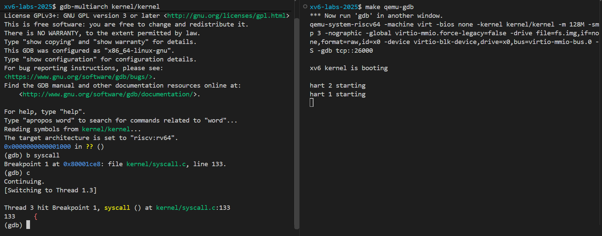
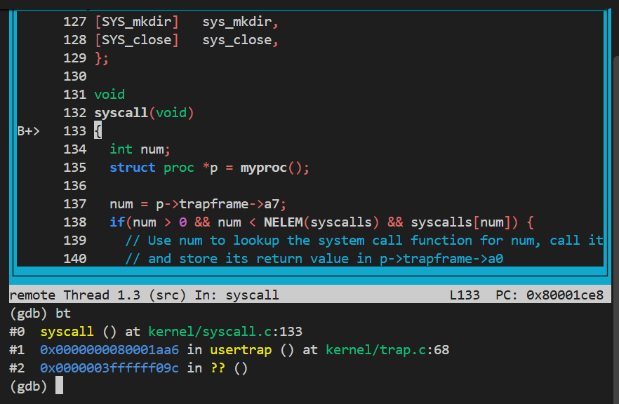
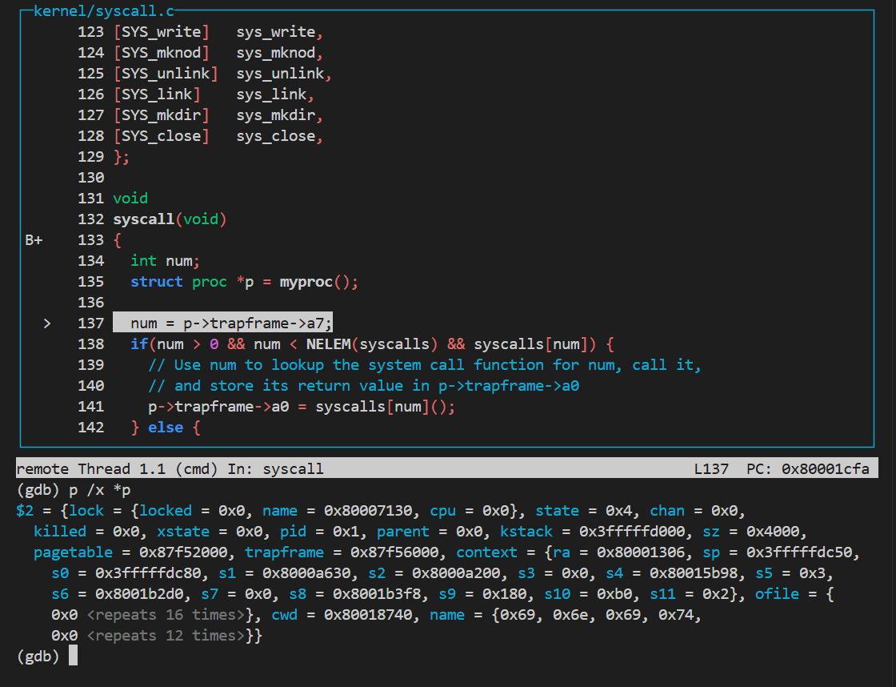
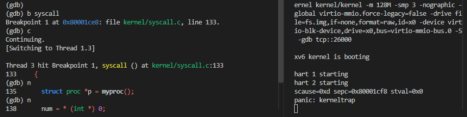
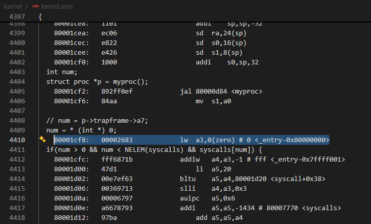

# lab02: system calls

## 环境配置

```bash
git fetch
git checkout syscall
make clean
```

## Using gdb

左边开一个窗口：

```bash
xv6-labs-2025$ make qemu-gdb
*** Now run 'gdb' in another window.
qemu-system-riscv64 -machine virt -bios none -kernel kernel/kernel -m 128M -smp 3 -nographic -global virtio-mmio.force-legacy=false -drive file=fs.img,if=none,format=raw,id=x0 -device virtio-blk-device,drive=x0,bus=virtio-mmio-bus.0 -S -gdb tcp::26000
```

右边开一个窗口：

```bash
xv6-labs-2025$ gdb-multiarch kernel/kernel
```

在 gdb 窗口内输入：

```bash
b syscall
c
layout src
bt
```

能看到：





可以看到 `usertrap()` 这个函数调用了 `syscall`.

按了几次 `n` 跳过 `` ，查看寄存器值：

```bash
(gdb) p /x $sstatus
```

得到：



查看先前 CPU mode:

```bash
(gdb) p/x $sstatus
(gdb) p/d (($sstatus >> 8) & 1)
```

修改以下代码来复现 kernel panic：

```c
  // num = p->trapframe->a7;
  num = * (int *) 0;
```



显然2，引发 panic 的是这一行：



此时 `num` 对应寄存器 `a3`，从地址0读取，导致了page fault.

查看进程 trap 的原因：

```bash
(gdb) p ((struct proc *)$s1)->name
$1 = "R\000\000\000\000\000\000\000dirlooku"
(gdb) p ((struct proc *)$s1)->pid
$2 = 680997
(gdb) p myproc()->name
$3 = "init", '\000' <repeats 11 times>
(gdb) p myproc()->pid
$4 = 1
```

可以看出 proc 的 name 是 `init`，`pid = 1`.

## Sandbox a command

好恶心，下午有点累了，现在读代码都不清楚了：

首先在`proc.h`里面添加成员：

```c
struct proc {
  struct spinlock lock;

  // p->lock must be held when using these:
  enum procstate state;        // Process state
  void *chan;                  // If non-zero, sleeping on chan
  int killed;                  // If non-zero, have been killed
  int xstate;                  // Exit status to be returned to parent's wait
  int pid;                     // Process ID

  // wait_lock must be held when using this:
  struct proc *parent;         // Parent process

  // these are private to the process, so p->lock need not be held.
  uint64 kstack;               // Virtual address of kernel stack
  uint64 sz;                   // Size of process memory (bytes)
  pagetable_t pagetable;       // User page table
  struct trapframe *trapframe; // data page for trampoline.S
  struct context context;      // swtch() here to run process
  struct file *ofile[NOFILE];  // Open files
  struct inode *cwd;           // Current directory
  char name[16];               // Process name (debugging)
    
  // Lab: Syscall
  int mask;                    // !New: Masked Authority
  char allowed_path[MAXPATH];  // !New: Allowed Path
};
```

修改 `sysproc.c`，增加`sys_interpose`函数:

```c
uint64 sys_interpose(void) {
  int mask;
  char allowed_path[MAXPATH];
  struct proc *p = myproc();
  argint(0, &mask);
  if (argstr(1, allowed_path, MAXPATH) < 0) return -1;

  p->mask = mask;
  safestrcpy(p->allowed_path, allowed_path, sizeof(p->allowed_path));
  return 0;
}
```

`syscall.c` 做了大幅度的增加：

```c
void
syscall(void)
{
  int num;
  struct proc *p = myproc();

  num = p->trapframe->a7;
  if(num > 0 && num < NELEM(syscalls) && syscalls[num]) {
    if(p->mask & (1 << num)) {
      if(num == SYS_open || num == SYS_exec) {
        char path[MAXPATH];
        if(argstr(0, path, MAXPATH) >= 0 &&
           strncmp(path, p->allowed_path, MAXPATH) == 0)
          goto allowed;
      }
      p->trapframe->a0 = -1;
      return;
    }
  allowed:
    // Use num to lookup the system call function for num, call it,
    // and store its return value in p->trapframe->a0
    p->trapframe->a0 = syscalls[num]();
  } else {
    printf("%d %s: unknown sys call %d\n",
            p->pid, p->name, num);
    p->trapframe->a0 = -1;
  }
}
```

## Attack

这一节有一点阴了，具体来讲这个代码可以过样例：

```c
#include "kernel/types.h"
#include "kernel/fcntl.h"
#include "user/user.h"
#include "kernel/riscv.h"

#define SEARCH_PAGES 64
#define HELP_STR "This may help."

int
main(int argc, char *argv[])
{
  char *st;
  st = sbrk(SEARCH_PAGES * PGSIZE);

  for(char *p = st; p + 16 < st + SERACH_PAGES * PGSIZE; p++){
    // 此处不能使用用户态的 strncmp(str1, str2, size)，因为 xv6 用户程序使用自己的简化 C 环境，不链接宿主机 libc，写 strncmp 会编译失败.
    if(memcmp(p, HELP_STR, sizeof(HELP_STR) - 1) == 0){
      printf("%s\n", p+16);
      exit(0);
    }
  }
  exit(1);
}
```

但是真正`make qemu`编译来测会失败：

```bash
$ secret 11111
$ attack
(null)
```

这里涉及到的问题是：

`secret.c` 执行了 `strcpy(data, "This may help.");`，编译器会把它放进可执行文件的 `.rodata`，运行时随程序代码段一起映射到内存，`strcpy` 再从这个地址读取字符，复制到 `data`，因此这两份内容并不是同一块内存：

- `.rodata` 中的是源字符串，来自程序文件
- `data` 中的是 `strcpy` 执行后产生的副本

`attack` 看到的是满足 `memcmp(p, "This may help.", 14) == 0` 的地址 `p`，但它不知道这个匹配来自 `.rodata` 还是 `data`：

* 如果来自 `data`：
    ```bash
    p      = 页面内的 data[0]
    p + 16 = data[16] = "xyzzy"
    ```

* 如果来自 `.rodata`：
    ```bash
    p      = 页面内的源字符串
    p + 16 = .rodata 中紧跟其后的 "(null)"
    ```

而 `.rodata` 中的实际字节是：

```bash
0x08f0: 54 68 69 73 20 6d 61 79 20 68 65 6c 70 2e 00 00
        T  h  i  s     m  a  y     h  e  l  p  . \0 \0

0x0900: 28 6e 75 6c 6c 29 00
        (  n  u  l  l  )
```

所以 `p + 16` 指向 `(null)`.

修正：

```c
#define SEARCH_PAGES 64
#define HELP_STR "This may help."

static int isalnum(char c){
  return ('0' <= c && c <= '9') ||
         ('A' <= c && c <= 'Z') ||
         ('a' <= c && c <= 'z');
}

int
main(int argc, char *argv[])
{
  char *st, *end;

  st = sbrk(SEARCH_PAGES * PGSIZE);
  if(st == SBRK_ERROR){
    printf("attack: sbrk failed\n");
    exit(1);
  }
  end = st + SEARCH_PAGES * PGSIZE;

  for(char *p = st; p + 16 < end; p++){
    // 此处不能使用用户态的 strncmp(str1, str2, size)，因为 xv6 用户程序使用自己的简化 C 环境，不链接宿主机 libc，写 strncmp 会编译失败.
    if(memcmp(p, HELP_STR, sizeof(HELP_STR) - 1) == 0){
      char *secret = p + 16;
      char *q;

      for(q = secret; q < end && *q && isalnum(*q); q++)
        ;

      if(q > secret && q < end && *q == '\0'){
        printf("%s\n", secret);
        exit(0);
      }
    }
  }
  exit(1);
}
```

