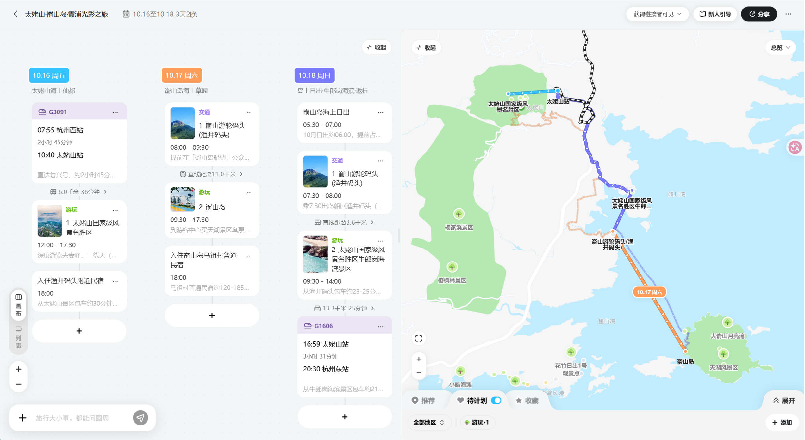
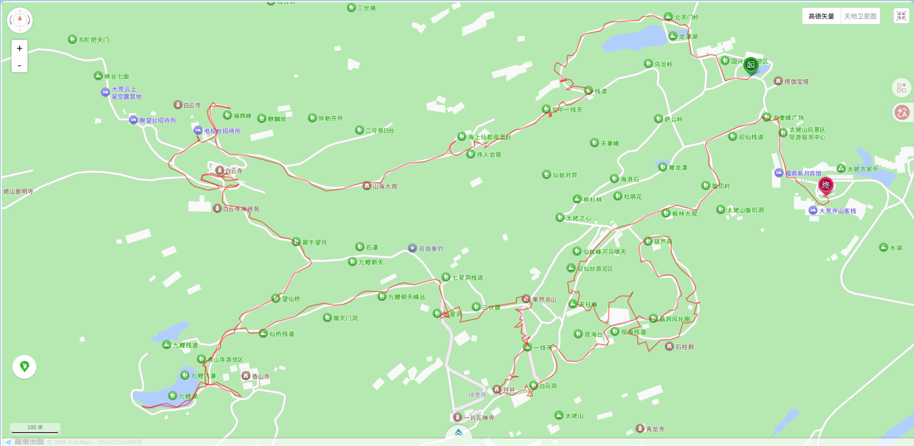
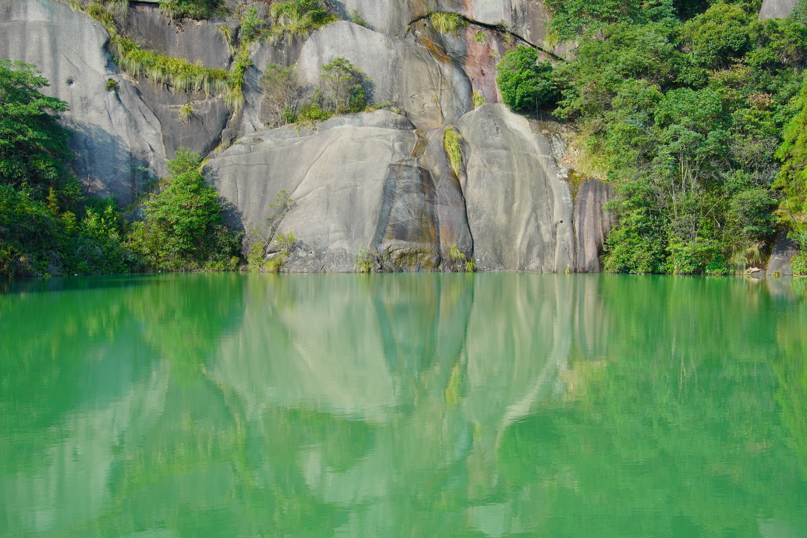
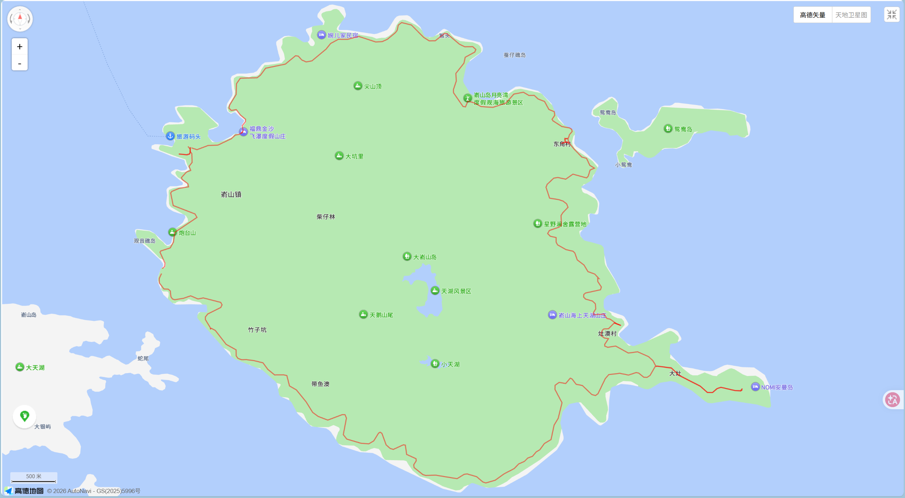
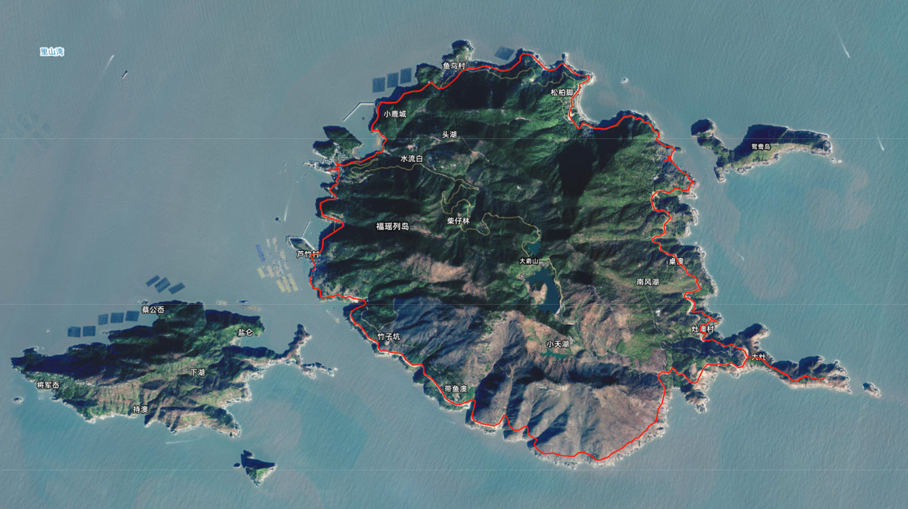
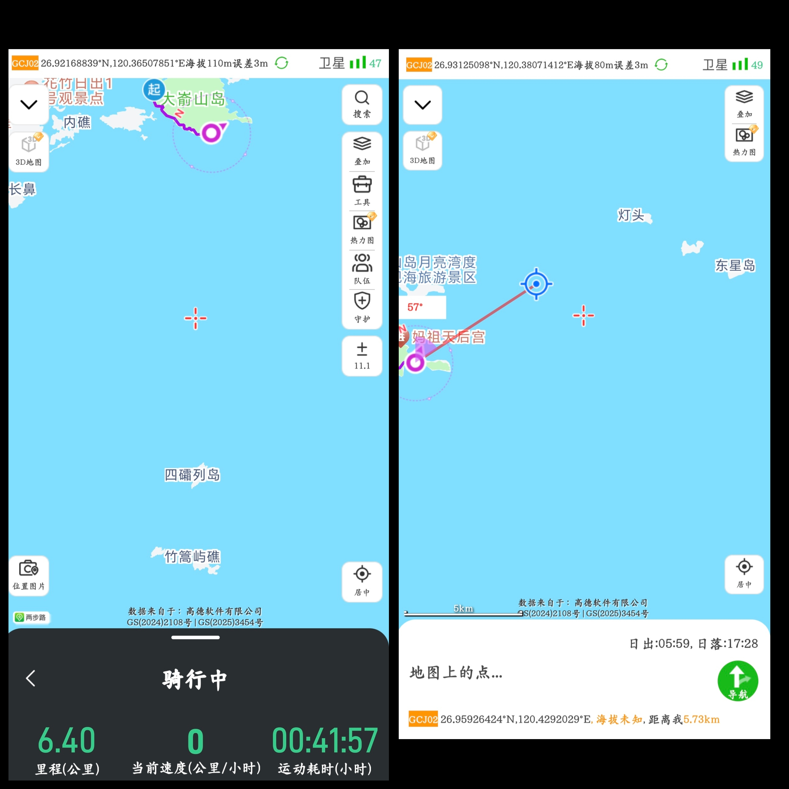
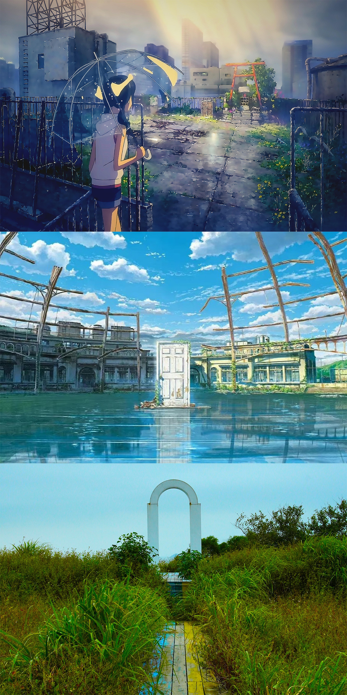
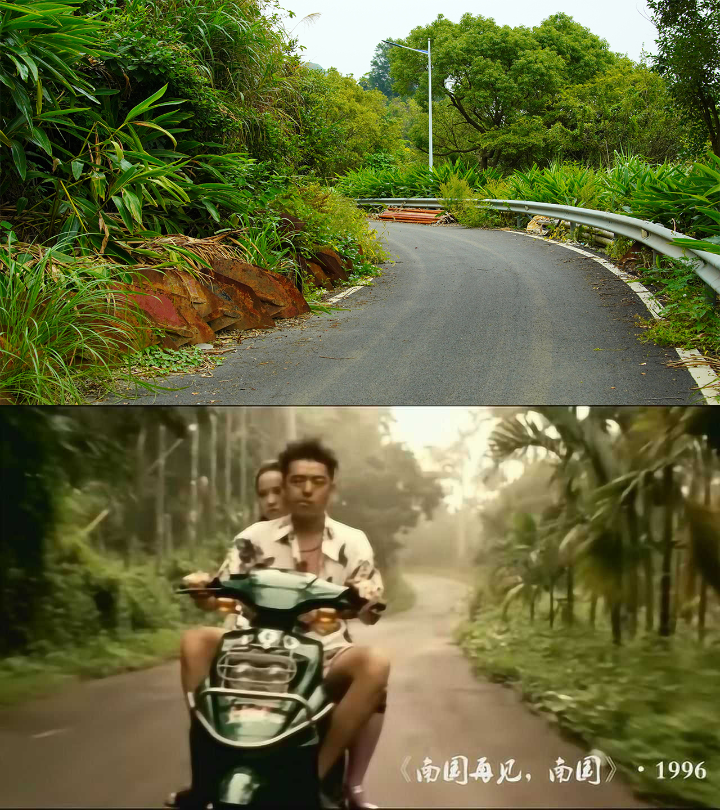
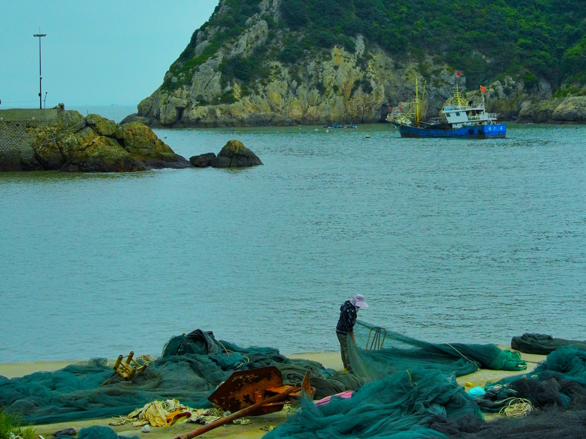
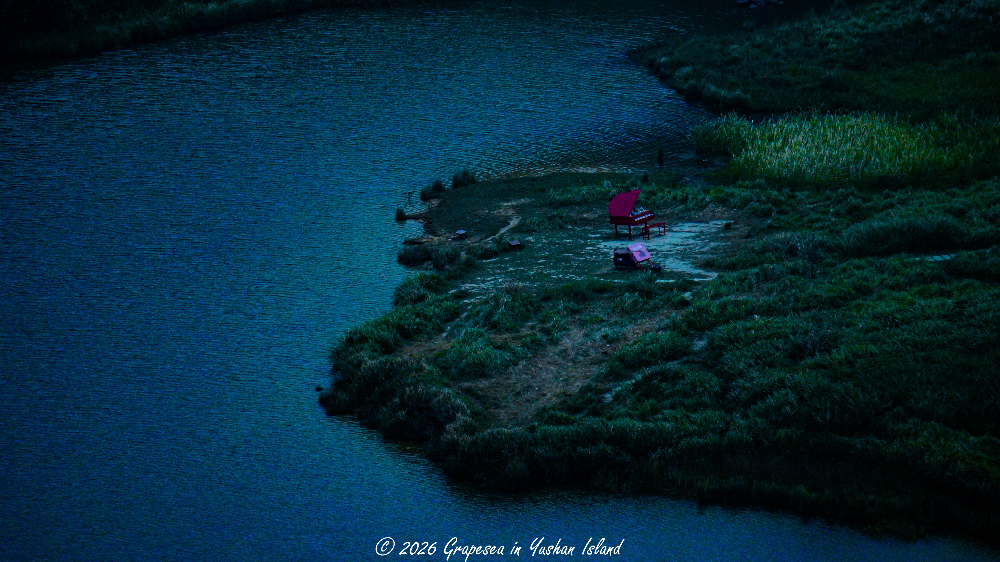

# 太姥山-嵛山岛-牛郎岗 3日

“夏日未完”：福鼎3日纪行

> 2026.10.16-10.18
>
> 路线链接：[圆周旅迹-太姥山&嵛山岛3日](https://www.pitravel.cn/plan/journey/7692028428477518076)

## 行前准备

关于为什么选这个岛，其实思考了蛮久的。~~国庆假期调休看代码累了休息时开始~~挑选喜欢的风景，突然想到去海岛上骑行看日出日落。

检索[2005年中国国家地理十大海岛评选的结果](https://baike.baidu.com/item/中国最美十大海岛/64892393)，并筛选离杭州最近的几个就得到了我的候选列表：

* 温州-南麂岛
* 舟山-普陀山岛

* 福建宁德福鼎-大嵛山岛
* 福建宁德霞浦-四礵列岛（不在清单上，之前听说过）

那么看看实际情况：

* 舟山预计于2028年开通高铁，目前非自驾单人去的时间开销过大；
* 南麂岛的商业开发据说较严重，我不喜欢；
* 四礵列岛只有北礵岛开放，东礵（“人间塞尔达”）、南礵、西礵均为无人岛且目前禁止登岛，预计至少要明年才开放

因此直接 all in 大嵛山岛！翻看地图发现旁边还有一个风评很好的5A级景区太姥山，海拔也并不高，开发较完善，因此主要景区就定了这两个。

准备物品：

* 头灯：有用，钻太姥山的葫芦洞时用到了，那里一片漆黑
* 登山杖：有用，太姥山和嵛山岛的天湖环线坡度很大，的确是需要一点支持的
* 遮阳帽：有用，可以用来挡小雨
* 冰袖、防晒衣：有用，这几天略晒
* 电解质水+坚果+巧克力+面包：有用，可以用来解决某几顿饭
* 相机+三脚架：有用，最好带个等效全画幅焦段 $\leq$ 35mm的，否则给自己拍游客照会有点困难.
* ~~浙江大学中秋月饼：有用，在登完山之后吹着风吃，的确别有风味~~
* 花露水：没用，这个时候虽然热，但是我去的地方都没什么蚊虫

路线设计（最后的实际路线），也可见上面的链接：

## Day 1: 太姥山-渔井码头

> 晴/多云，21-28℃

早上赶7:55的高铁，不紧不慢地抵达了杭州西站，最终在11点以前抵达了太姥山。题外话，太姥山镇虽然仅是一个镇级行政单位，却非常热闹，也有玉池路这种美食街，因此体验非常不错。

虽然是晴天，但是略有点雾蒙蒙的，再加上山上树影斑驳、石穴来风，实际上也不怎么热。

我走的路线是景区推荐的D线的增强版，主打一个尽量逛完：

两步路上的轨迹，用时5.5h，总长度8.4km，累计爬升629m，步数约2.2w

手机和相机都没办法拍出一线天、葫芦洞的逼仄，总之来体验一趟不亏：

山上面有一个小的九鲤湖：

## Day 2: 嵛山岛环岛-天湖跋涉

> 阴转毛毛雨，23-25℃

渔井码头来往嵛山岛的航班其实并不准时，也并不如公开信息所示一天只有3班。去嵛山岛的航班虽然标了是9:30开，实际上8:40就有一班。民宿的老板娘提醒后我赶紧拎起包跑向码头，刚刚好成为了最后一个登船的。

我住在离旅游码头马祖村约2km的芦竹村，这个村子表面上比较陈旧，但非常热闹。村子里有一个小港口，夜晚时停泊的船点起灯光，连成了白色的一片斑点。

老板租给我一辆很新的电瓶车，顺手把雨衣丢进车篓里面。指了个方向让我出了村子往前骑。

于是我开始逆时针环岛：

总长度 27.12km，总耗时 2h45min，累计爬升 326m

嵛山岛是一个集合了众多自然景观的小岛。从上面的地形图也能看出有湖、山、草甸、海等景观。

刚出发就遇到一群羊在路中间趴着，也不怕车和人，只是一直在嚼嚼嚼路边的草。

跟没能登上的四礵列岛、东星岛合个影吧：

安曼岛（实际上并不是岛，而是嵛山岛上的“半岛”）入口有废弃的军事基地和防空洞，想进安曼岛看看还得交20元，蹭旁边的小哥飞无人机看了一圈，于是就接着出发了。

行到灶澳村，路边有一个废弃的拱门景观，有点像新海诚喜欢放在电影里做引子的神秘门。

穿过门后会去向何方？

再往前走一点是一个破败的村办工厂，厂房里依稀可见堆满了棉织品和渔网，可惜没有留下照片（开始飘毛毛雨，怕被淋透没停车）。

出灶澳村的一段路，两侧没有公路护栏，陈放了一堆生锈的钢材和渔网，让人想起侯孝贤《南国再见，南国》的[经典骑车长镜头](https://www.bilibili.com/video/BV11i4y1L7h4/)。

索尼自带黄绿色的显示反而适配老电影的感觉

东角村渔港，远处的是鸳鸯岛

东角村的村景相较于前面的几个村子稍微新一点。骑进村才发现这里是清华驻村的地点，甚至有文化礼堂和村民广场。

路牌杆子好像歪了，看着很难受

月亮湾应该是整个岛上最大的一片沙滩了，但是也要额外花钱，所以没下去看，只是远远地拍了一张：

整个岛屿即使只是慢慢骑，一个上午就可以绕一圈。回到码头所在的马祖村吃中饭，葱油蛏子和葱油海藻都做得偏咸，不过量还算大。

下午去天湖徒步，坐上中巴车看司机时快时慢地在山路上爬坡，没多久就颠簸到了泊车点。

天湖的草甸山路崎岖，走起来还是比较费力气的：一开始沿着大路，还能有石板，走到东侧全是野草淹没的土路。不远处有一架装饰用的钢琴，尽管不能弹奏不过很出片：

世界上最孤独的钢琴

一直往下走，远远看到山脊上许多重装的徒步者，据一个路过的朋友说两步路上评价为“绝望300米”：

天快黑的时候下了山，回到马祖村吃了海鲜面，就此回芦竹村的民宿修整。

芦竹村相比码头和其他村，住宅外观似乎普遍旧一些，不过也有一个小的港口，可以倚在栏杆边吹晚风。

## Day 3: 嵛山岛-渔井码头-牛郎岗-太姥山镇

> 晴，22-31℃

清晨的嵛山岛码头

从嵛山岛回渔井码头的船在7:30出发，等到靠岸时太阳已经非常晒。我的原计划是打车前往榕枫林/杨家村，然而估计山间的晨雾已经散去，并且绕路太远，于是采取了B计划：牛郎岗沙滩。

如果嵛山岛和太姥山能打10分的话，牛郎岗只能打7分，原因是交通。海滨的路要是能提供自行车道的话，体验会更好，在暴晒下走3km实在是折磨。

浅浅留下几张照片就匆忙撤回镇上找地方坐着了：

这个亭子有点像某个gal的背景（）

## 花费结算

| 类别 | 1                                           | 2                       | 3                                                            | 4                                                            | 5                                             | 总价                   |
| ---- | ------------------------------------------- | ----------------------- | ------------------------------------------------------------ | ------------------------------------------------------------ | --------------------------------------------- | ---------------------- |
| 车费 | 高铁￥207+￥196.5 = ￥403.5                 | 电动车 租一天 ￥100     | 打车 ￥0 + ￥46.2 + ￥29.76 + ￥13.26 = ￥89.22              | 嵛山岛船票￥105                                              | 公共交通 太姥山站-景区 ￥6 + 镇-站 ￥4 = ￥10 | ￥707.72               |
| 门票 | 太姥山学生票 ￥90                           |                         | 嵛山岛天湖学生票 ￥56                                        | 牛郎岗学生票￥20 + 景区车 ￥5 = ￥25                         |                                               | ￥171                  |
| 餐饮 | 蜜雪冰城 ￥12.86 + 山上2瓶水 ￥10 = ￥22.86 | Day 1 晚饭（阿耐） ￥54 | Day 2 中饭 嵛山岛供销社饭店 葱油蛏子+海藻 ￥63 + 晚饭 海鲜面 ￥25 = ￥88 | Day 3 早饭 ￥10 + 中饭 ￥33（肉片大叔-剁椒肉片+邱记-肉燕/鸡翅）= ￥43 | 好想来物资 ￥19.23                            | ￥227.09               |
| 住宿 | 赶海民宿￥150                               | 嵛福星民宿￥176         |                                                              |                                                              |                                               | ￥326                  |
| 总计 |                                             |                         |                                                              |                                                              | 预算 ￥1500                                   | 最终实际开销 ￥1431.81 |

这里有几个神奇的省钱方式：

* 每一个售票窗口都会问我是不是福建户籍，猜测福建身份证可以获得更大的优惠；
* 嵛山岛船票在我的检索下，原本是线上115元/线下120元购买。民宿老板让我去线下买，报上民宿名字之后只需要105元就行了；
* 可以选一个从没用过的打车APP（我就选了滴滴），用新客优惠来降低打车开销；
* 太姥山镇有非常多连锁品牌店（蜜雪、古茗、好想来、赵一鸣等等），尽量在镇上备一点物资，上了岛和山之后物价会稍稍上涨.

