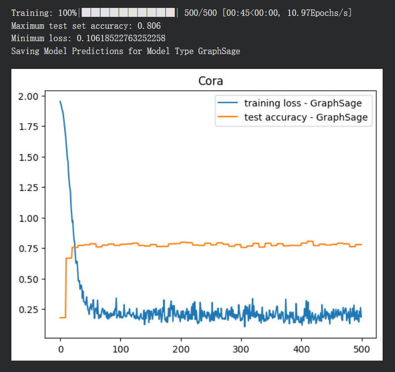

# Colab 3

> [!IMPORTANT] 
>
> 本实验目的是实现 GraphSAGE 的基础函数.

## Setup

```py
# Install torch geometric
import os
import torch
import torch_geometric

if 'IS_GRADESCOPE_ENV' not in os.environ:
	!pip install torch==2.11.0 # 一开始是2.4.0，改成2.11.0了
if 'IS_GRADESCOPE_ENV' not in os.environ:
	torch_version = str(torch.__version__)
	scatter_src = f"https://pytorch-geometric.com/whl/torch-{torch_version}.html"
	sparse_src = f"https://pytorch-geometric.com/whl/torch-{torch_version}.html"
	!pip install torch-scatter -f $scatter_src
  	!pip install torch-sparse -f $sparse_src
  	!pip install torch-geometric
  	!pip install -q git+https://github.com/snap-stanford/deepsnap.git
```

GNN Stack Module：

```python
import torch
import torch_scatter
import torch.nn as nn
import torch.nn.functional as F
import torch_geometric.nn as pyg_nn
import torch_geometric.utils as pyg_utils

from torch import Tensor
from typing import Union, Tuple, Optional
from torch_geometric.typing import (OptPairTensor, Adj, Size, NoneType,
                                    OptTensor)

from torch.nn import Parameter, Linear
from torch_sparse import SparseTensor, set_diag
from torch_geometric.nn.conv import MessagePassing
from torch_geometric.utils import remove_self_loops, add_self_loops, softmax

class GNNStack(torch.nn.Module):
    def __init__(self, input_dim, hidden_dim, output_dim, args, emb=False):
        super(GNNStack, self).__init__()
        conv_model = self.build_conv_model(args.model_type)
        self.convs = nn.ModuleList()
        self.convs.append(conv_model(input_dim, hidden_dim))
        assert (args.num_layers >= 1), 'Number of layers is not >=1'
        for l in range(args.num_layers-1):
            self.convs.append(conv_model(args.heads * hidden_dim, hidden_dim))
        # post-message-passing
        self.post_mp = nn.Sequential(
            nn.Linear(args.heads * hidden_dim, hidden_dim), nn.Dropout(args.dropout),
            nn.Linear(hidden_dim, output_dim))
        self.dropout = args.dropout
        self.num_layers = args.num_layers
        self.emb = emb

    def build_conv_model(self, model_type):
        if model_type == 'GraphSage':
            return GraphSage
        elif model_type == 'GAT':
            # When applying GAT with num heads > 1, you need to modify the
            # input and output dimension of the conv layers (self.convs),
            # to ensure that the input dim of the next layer is num heads
            # multiplied by the output dim of the previous layer.
            # HINT: In case you want to play with multiheads, you need to change the for-loop that builds up self.convs to be
            # self.convs.append(conv_model(hidden_dim * num_heads, hidden_dim)),
            # and also the first nn.Linear(hidden_dim * num_heads, hidden_dim) in post-message-passing.
            return GAT

    def forward(self, data):
        x, edge_index, batch = data.x, data.edge_index, data.batch
        for i in range(self.num_layers):
            x = self.convs[i](x, edge_index)
            x = F.relu(x)
            x = F.dropout(x, p=self.dropout,training=self.training)
        x = self.post_mp(x)
        if self.emb == True:
            return x
        return F.log_softmax(x, dim=1)

    def loss(self, pred, label):
        return F.nll_loss(pred, label)
```

## Q1: Creating Our Own Message Passing Layer

首先复习一下 GraphSAGE 的实现：

current embedding $h_v^{l-1}$，message passing 过程：

$$
h_v^{(l)} = W_l\cdot h_v^{(l-1)} + W_r \cdot AGG(\{h_u^{(l-1)}, \forall u \in N(v) \})
$$

* $W_1$ 和 $W_2$ ：可学习的权重矩阵

* nodes $u$：**neighboring** nodes

此处使用 mean aggregate 来简化 Aggregate 过程：

$$
AGG(\{h_u^{(l-1)}, \forall u \in N(v) \}) = \frac{1}{|N(v)|} \sum_{u\in N(v)} h_u^{(l-1)}
$$

接下来看 GraphSAGE 的 message passing 实现：

```python
class GraphSage(MessagePassing):

    def __init__(self, in_channels, out_channels, normalize = True,
                 bias = False, **kwargs):
        super(GraphSage, self).__init__(**kwargs)

        self.in_channels = in_channels
        self.out_channels = out_channels
        self.normalize = normalize
        
        # Define the (PyTorch) layers needed for the message and update functions below.
        # self.lin_l is the linear transformation that you apply to embedding
        #            for central node.
        # self.lin_r is the linear transformation that you apply to aggregated
        #            message from neighbors.
        # Don't forget the bias as part of the linear layers!

        self.lin_l = nn.Linear(in_channels, out_channels, bias = bias)
        self.lin_r = nn.Linear(in_channels, out_channels, bias = bias)

        self.reset_parameters()
        
    def reset_parameters(self):
        self.lin_l.reset_parameters()
        self.lin_r.reset_parameters()
```

这里使用了一个简化矩阵运算的小 trick：将中心节点的变换和邻居节点的变换分开，使得整个矩阵乘法的过程变得简明一点.


forward 部分：

```python
    def forward(self, x, edge_index, size = None):

        # Implement message passing, as well as any post-processing (our update rule).
        # 1. Call the propagate function to conduct the message passing.
        #    1.1 See the description of propagate above or the following link for more information:
        #        https://pytorch-geometric.readthedocs.io/en/latest/notes/create_gnn.html
        #    1.2 We will only use the representation for neighbor nodes (x_j), so by default
        #        we pass the same representation for central and neighbor nodes as x=(x, x).
        # 2. Update our node embedding with skip connection from the previous layer.
        # 3. If normalize is set, do L-2 normalization (defined in
        #    torch.nn.functional)

        neighbor = self.propagate(edge_index=edge_index, size = size, x = (x,x))

        out = self.lin_l(x) + self.lin_r(neighbor) # skip connection
        if self.normalize:
          out = F.normalize(out, p=2, dim=-1) # If normalize is set, do L-2 normalization

        return out
```

参数对照：

| 代码                            | 公式                                     | 作用                     |
| ------------------------------- | ---------------------------------------- | ------------------------ |
| `self.propagate(..., x=(x,x))`  | $h_{\mathcal{N}(v)} = \text{AGG}(\cdot)$ | 邻居消息聚合             |
| `self.lin_l(x)`                 | $W_l h_v$                                | 中心节点变换             |
| `self.lin_r(neighbor)`          | $W_r h_{\mathcal{N}(v)}$                 | 邻居聚合变换             |
| `lin_l(x) + lin_r(neighbor)`    | $W\cdot[h_v \,\|\, h_{\mathcal{N}(v)}]$  | update / skip connection |
| `F.normalize(out, p=2, dim=-1)` | $h_v \leftarrow h_v/\|h_v\|_2$           | L2 归一化                |

至于 message passing 部分：

```python
    def message(self, x_j):
        # Hint: Look at the formulation of the mean aggregation function, focusing on
        # what message each neighboring node passes.
        out = x_j
        return out
```

额，实际上message指的是直接传回邻居自身.

message aggregate 部分：

```python
    def aggregate(self, inputs, index, dim_size = None):
        # The axis along which to index number of nodes.
        node_dim = self.node_dim
        # See here as how to use torch_scatter.scatter:
        # https://pytorch-scatter.readthedocs.io/en/latest/functions/scatter.html#torch_scatter.scatter
        out = torch_scatter.scatter(inputs, index, node_dim, dim_size=dim_size, reduce="mean")

        return out
```

直接使用这个封装好的函数就行.


然后就结束了，后面的模块全都不需要手写，只需要运行一下看结果就是了.

## Q1.1

最后结果：



acc 为 80.6%，尚可.

