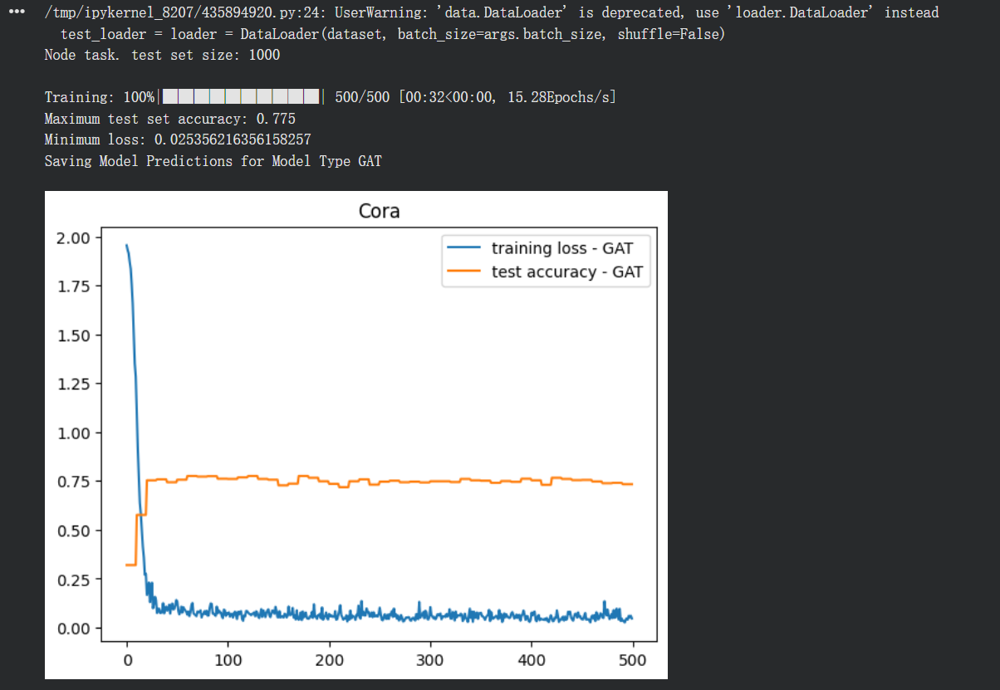

# Colab 4

> [!IMPORTANT]
>
> 本实验的目的是实现 GAT 的基础函数.

## Setup

略，跟colab3差不多的处理就行.

## Q1

```python
class GAT(MessagePassing):

    def __init__(self, in_channels, out_channels, heads = 2,
                 negative_slope = 0.2, dropout = 0., **kwargs):
        super(GAT, self).__init__(node_dim=0, **kwargs)

        self.in_channels = in_channels
        self.out_channels = out_channels
        self.heads = heads
        self.negative_slope = negative_slope
        self.dropout = dropout

        self.lin_l = None
        self.lin_r = None
        self.att_l = None
        self.att_r = None

        # Define the layers needed for the message functions below.
        # self.lin_l is the linear transformation that you apply to embeddings
        # BEFORE message passing.
        #
        # Pay attention to dimensions of the linear layers, since we're using
        # multi-head attention.
        
        self.lin_l = nn.Linear(in_channels, heads * out_channels, bias = True)
        self.lin_r = self.lin_l

        # Define the attention parameters \overrightarrow{a_l/r}^T in the above intro.
        # You have to deal with multi-head scenarios.
        # Use nn.Parameter instead of nn.Linear
        
        self.att_l = nn.Parameter(torch.Tensor(1, heads, out_channels))
        self.att_r = nn.Parameter(torch.Tensor(1, heads, out_channels))

        self.reset_parameters()

    def reset_parameters(self):
        nn.init.xavier_uniform_(self.lin_l.weight)
        nn.init.xavier_uniform_(self.lin_r.weight)
        nn.init.xavier_uniform_(self.att_l)
        nn.init.xavier_uniform_(self.att_r)

    def forward(self, x, edge_index, size = None):
        H, C = self.heads, self.out_channels
        
        # Implement message passing, as well as any pre- and post-processing (our update rule).
        # 1. First apply linear transformation to node embeddings, and split that
        #    into multiple heads. We use the same representations for source and
        #    target nodes, but apply different linear weights (W_l and W_r)
        # 2. Calculate alpha vectors for central nodes (alpha_l) and neighbor nodes (alpha_r).
        # 3. Call propagate function to conduct the message passing.
        #    3.1 Remember to pass alpha = (alpha_l, alpha_r) as a parameter.
        #    3.2 See there for more information: https://pytorch-geometric.readthedocs.io/en/latest/notes/create_gnn.html
        # 4. Transform the output back to the shape of [N, H * C].
        
        x_l = self.lin_l(x).view(-1, H, C) # self.lin_l 输出 [N, H*C]
        x_r = self.lin_r(x).view(-1, H, C)

        alpha_l = (x_l * self.att_l).sum(dim=-1)
        alpha_r = (x_r * self.att_r).sum(dim=-1)
        out = self.propagate(edge_index, x=(x_l,x_r), alpha=(alpha_l,alpha_r), size=size,).view(-1, H*C) # 转换成 [N, H*C]
        return out


    def message(self, x_j, alpha_j, alpha_i, index, ptr, size_i):
        # Implement your message function. Putting the attention in message
        # instead of in update is a little tricky.
        # 1. Calculate the final attention weights using alpha_i and alpha_j,
        #    and apply leaky Relu.
        # 2. Calculate softmax over the neighbor nodes for all the nodes. Use
        #    torch_geometric.utils.softmax instead of the one in Pytorch.
        # 3. Apply dropout to attention weights (alpha).
        # 4. Multiply embeddings and attention weights. As a sanity check, the output
        #    should be of shape [E, H, C].
        # 5. ptr (LongTensor, optional): If given, computes the softmax based on
        #    sorted inputs in CSR representation. You can simply pass it to softmax.
        # 6. size_i: corresponds to the num_nodes variable input to the torch.geometric.softmax method
        
        alpha = alpha_i + alpha_j
        alpha = F.leaky_relu(alpha, self.negative_slope)
        alpha = softmax(alpha, index, ptr, size_i)
        alpha = F.dropout(alpha, p = self.dropout)
        out = x_j * alpha.unsqueeze(-1) # x_j 形状 (E, H, C)，alpha.unsqueeze(-1) 形状 (E, H, 1)，广播相乘得到 (E, H, C)
        return out


    def aggregate(self, inputs, index, dim_size = None):
        # See here as how to use torch_scatter.scatter: https://pytorch-scatter.readthedocs.io/en/latest/_modules/torch_scatter/scatter.html
        # Pay attention to "reduce" parameter is different from that in GraphSage.
        
        out = torch_scatter.scatter(inputs, index, dim=0, dim_size=dim_size, reduce='sum')

        return out
```

需要注意的是，原论文里 $W_l$ 和 $W_r$ 是分开的两个矩阵，但很多实现（包括 PyG 的 `GATConv`）只用一个 `lin`，左右共享. 这里 `self.lin_r = self.lin_l` 就是选择共享，可以保留.


## Q1.1

Emm，acc反而还降了，是77.5%.


