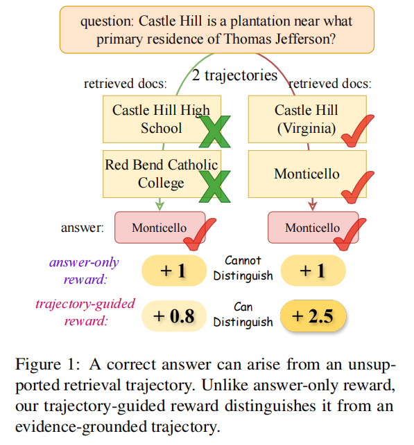
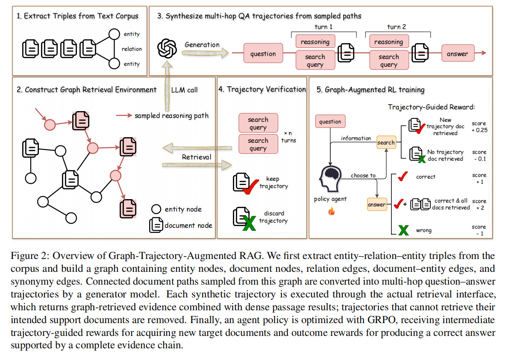

# [arXiv 2026] GTA-RAG: Graph-Trajectory-Augmented Reinforcement Learning for Multi-Turn Retrieval-Augmented Reasoning

> * 论文地址：[GTA-RAG](https://arxiv.org/abs/2608.22479)
> * Github仓库：[cjcj46262/GTA-RAG](https://github.com/cjcj46262/GTA-RAG)
> * **更简洁的摘要：** 从图中采样文档路径，合成并验证可执行的多跳检索轨迹，通过证据获取奖励与两阶段 GRPO，让 Agent 同时学习正确回答和获取完整支持证据。

原先工作的 Problem：

1. **最终答案正确，不代表检索过程正确。** Answer-only reward 无法区分基于支持证据得到的答案与依赖 parametric knowledge 得到的答案。即使检索文档完全无关，只要最终答案正确，模型仍然获得奖励。

2. **多轮检索的反馈过于稀疏。** Multi-hop QA 需要识别 bridge entities、连续查询并整合多个文档。仅使用最终 EM，无法直接奖励每次搜索带来的证据获取进展。

3. **图路径不一定能转化为有效的检索监督。** 文档在图上连通，不保证生成的 query 能通过实际 retriever 找回目标文档；直接使用这些路径训练，可能引入不可执行的轨迹。

相同正确答案对应不同的检索轨迹：两条轨迹均输出 Monticello，但只有一条获取了相关支持文档，这体现了 answer-only reward 的局限

---

GTA-RAG 是一个利用 **graph-derived trajectories 提供证据获取监督**的多轮 RAG 强化学习框架，分为以下三部分：

* **Graph-Augmented Retrieval：** 构建 entity–document graph，将 PPR graph retrieval 与 dense passage retrieval 合并为统一检索接口。
* **Trajectory Construction & Validation：** 从图中采样连通文档路径，合成多跳 QA 与检索轨迹，并使用实际 retriever 验证轨迹可执行性。
* **Trajectory-Guided RL：** 先用证据获取奖励学习多轮检索，再用自然 QA 的答案奖励进行任务适配。

图结构同时用于**在线证据召回**和**离线监督构造**。Agent 自主生成 search query，检索接口负责图传播与文档召回；目标文档集合用于训练奖励计算，无需在推理时提供。

## 构建方法论（Methodology）

### 1. Graph Knowledge Base & Retrieval：构建图增强检索环境

对每篇文档 $d_i$ 使用 OpenIE 抽取 factual triples：

$$
T_i=\{(e_h,r,e_t)\},
$$

其中 $e_h$、$e_t$ 分别是 head entity 和 tail entity，$r$ 是 textual relation。

构建 heterogeneous graph：

$$
\mathcal G=
(V_D\cup V_E,\,
E_{DE}\cup E_{EE}^{r}\cup E_{EE}^{s}).
$$

* $V_D$：document nodes
* $V_E$：entity nodes
* $E_{DE}$：文档与其中抽取实体的连接。
* $E_{EE}^{r}$：triples 对应的实体关系连接
* $E_{EE}^{s}$：实体 embedding cosine similarity 超过阈值 $\delta$ 时添加的 synonymy edges，缓解实体名称变化造成的图碎片化

对于 search query $q$，先计算其与 triples 的相关性：

$$
s(q,t)=\cos(h_q,h_t).
$$

其中 $h_q$、$h_t$ 分别为 query 和 triple 的 embeddings. 高分 triples 将相关性传递给参与其中的 entity nodes，构成 personalization vector $p_q$.

随后执行 Personalized PageRank：

$$
r_q=\alpha p_q+(1-\alpha)P^\top r_q,
$$

其中 $P$ 是图的 normalized transition matrix，$\alpha$ 是 restart probability. 相关性沿实体关系和 document–entity connections 传播，从而召回与当前 query 结构相关的文档.

取分数最高的 $K_g$ 个 document nodes，得到 $R_g(q)$；再使用 dense retriever 获取 $R_d(q)$，最终返回去重集合：

$$
R(q)=\operatorname{Dedup}\big(R_g(q)\cup R_d(q)\big).
$$

**作用：** graph retrieval 补充结构关联证据，dense retrieval 保留直接语义匹配能力.

### 2. Multi-hop QA Trajectory Construction：将图路径转化为可执行监督

**Path sampling：**

从随机 document node 开始进行不重复访问节点的 random walk，收集连通文档序列：

$$
P=(d_1^\star,d_2^\star,\ldots,d_H^\star).
$$

相邻 document nodes 之间最多经过两个 entity nodes，使路径形成候选支持文档链.

**Question and trajectory synthesis：**

Generator 接收路径文档及 distractor documents，生成：

* Multi-hop question $x$。
* Gold answer $y^\star$。
* 逐轮 reasoning、search queries 和最终 answer。
* 每轮对应的 target support document。

生成约束包括：

* 构造 bridge、comparison 或 entity-linking 问题。
* 使用 2–4 轮 search，每轮对应一个唯一目标文档。
* 首轮 query 由 question 支持；后续 query 由之前获取的证据支持。
* 不使用不必要文档，不在 question 或 search queries 中泄露答案。
* 无法构造有效样本时返回 `constructible=false`。

**Retriever-based validation：**

使用与训练、评测相同的检索接口执行 synthetic search queries。只有每一轮的目标支持文档都出现在返回结果中，样本才被保留：

$$
\mathcal D_{\mathrm{traj}}
=
\{(x,y^\star,S(x),\tau^\star)\},
$$

其中 $S(x)$ 是目标文档集合，$\tau^\star$ 是经过验证的检索轨迹。

**关键设计：** supervision 来自实际 retriever 能够执行的证据获取过程，而非仅来自图上的连接关系。

### 3. Trajectory-Guided GRPO：奖励证据获取并进行两阶段训练

**多轮交互：**

Agent 在每轮根据当前 context 生成 reasoning trace $z_t$ 和 action $a_t$：

$$
(z_t,a_t)\sim\pi_\theta(\cdot\mid c_t).
$$

Action 包括：

`<search> query </search>` 或 `<answer> prediction </answer>`。

Search results 被追加到 `<info>` 中：

$$
c_{t+1}
=
c_t\oplus z_t\oplus a_t
\oplus \texttt{<info>}R(q_t)\texttt{</info>}.
$$

Agent 只能使用 question、过去的 reasoning/actions 和已返回证据。输出 answer 时终止；达到 action budget 而未回答时返回空预测。

**Stage I：Trajectory-guided reward**

令 $C_t$ 为本轮之前已获取的目标文档集合。本轮新获取的目标文档为：

$$
\Delta_t=
\big(R(q_t)\cap S(x)\big)\setminus C_t.
$$

Search reward：

$$
r_t^{\mathrm{search}}
=
\begin{cases}
+0.25|\Delta_t|,&|\Delta_t|>0,\\
-0.10,&|\Delta_t|=0.
\end{cases}
$$

* 获取新的目标文档：按数量奖励。
* 未获取新的目标文档：给予负奖励。
* 重复获取已有目标文档：无法重复获得正奖励。

Terminal answer reward：

$$
r^{\mathrm{ans}}
=
\begin{cases}
-1,&\mathrm{EM}(\hat y,y^\star)=0,\\
+1,&\mathrm{EM}(\hat y,y^\star)=1
\land C_T\not\supseteq S(x),\\
+2,&\mathrm{EM}(\hat y,y^\star)=1
\land C_T\supseteq S(x).
\end{cases}
$$

其中 $\hat y$ 是预测答案，EM 表示 exact match。

**答对并完整获取目标证据的 terminal reward 为 +2**；答对但证据不完整时为 +1。

总奖励：

$$
R_{\mathrm{traj}}(\tau)
=
\sum_{t:a_t\in\mathcal A_{\mathrm{search}}}
r_t^{\mathrm{search}}
+
r^{\mathrm{ans}}.
$$

该奖励约束目标文档的集合覆盖，不强制 Agent 使用教师的原始 query 或按指定文档顺序检索。

**GRPO optimization：**

对同一 question 采样 $G$ 条 trajectories，并计算组内相对 advantage：

$$
\hat A_i
=
\frac{
R(\tau_i)-\operatorname{mean}_{j=1}^{G}R(\tau_j)
}{
\operatorname{std}_{j=1}^{G}R(\tau_j)+\epsilon
}.
$$

通过 clipped surrogate objective 更新策略，并使用相对 reference policy 的 KL regularization。这里的 advantage 来自每条 trajectory 的总奖励。

**Stage II：Answer-reward adaptation**

使用自然 QA instances，改为最终答案的 EM reward：

$$
R_{\mathrm{EM}}(\tau)
=
\mathbb I[\mathrm{EM}(\hat y,y^\star)=1].
$$

Stage I 学习 evidence-grounded retrieval，Stage II 适配没有显式目标轨迹的自然问题。

---

## 本文架构优势

* **从答案监督扩展到证据获取监督：** 区分“碰巧答对”与“获取完整支持证据后答对”，为搜索过程提供反馈。
* **降低轨迹标注需求：** 利用图连接关系自动产生候选支持文档链，再合成多跳 QA。
* **监督与检索环境保持一致：** 使用 deployed retriever 验证 synthetic trajectories，过滤不可执行的检索步骤。
* **兼顾结构关联与语义匹配：** PPR graph retrieval 与 dense retrieval 共同返回证据。
* **保留自主检索策略：** 奖励文档获取进展，不要求复现固定教师动作序列。

## Experiments & SOTA Comparison

### 实验配置

| 项目                        | 设置                                                         |
| --------------------------- | ------------------------------------------------------------ |
| Policy backbone             | Qwen2.5-3B、Qwen2.5-7B                                       |
| OpenIE model                | Llama-3.1-8B                                                 |
| Dense retriever             | Contriever                                                   |
| Synthetic trajectories      | 2,000 条                                                     |
| 2-hop / 3-hop / 4-hop       | 1,899 / 93 / 8                                               |
| 路径最多采样 document nodes | 10                                                           |
| Stage I                     | 20 optimization steps，trajectory-guided reward              |
| Stage II                    | 10,000 条 HotpotQA instances，40 optimization steps，EM reward |
| Prompts per step            | 128                                                          |
| Rollouts per prompt         | 5                                                            |

路径采样上限为 10 个 document nodes；合成 QA 的 search rounds 为 2–4，两者对应不同的构造设置。

**Benchmarks：**

* Multi-hop QA：HotpotQA、2WikiMultiHopQA、MuSiQue。
* Simple QA：PopQA、Natural Questions。

**Evaluation：**

* Answer EM、token-level F1、五个数据集的 unweighted average。
* 在 1,000 条 held-out synthetic questions 上评估 target-document coverage、complete-trajectory coverage、zero-target turns 和 average search turns。

**Comparison 概要：**

* Qwen backbone：Vanilla RAG、HippoRAG 2、Search-o1、Search-R1、RouteRAG，以及 7B 下的 R1-Searcher。
* GPT-4o-mini：Direct Inference、GraphRAG、LightRAG、RAPTOR、HippoRAG、HippoRAG 2，作为 training-free RAG 参考。
* Ablations：移除 trajectory-guided reward、移除 trajectory validation、将 graph retrieval 替换为 dense-only retrieval。

## Limitations & Future Work

1. **依赖图构建质量。** Extraction noise 与缺失的图连接会限制可生成的可执行轨迹的多样性。
2. **依赖验证所用的 retriever。** Synthetic trajectories 的可执行性与 deployed retrieval environment 相关。
3. **任务覆盖集中于 open-domain QA。** 后续方向是扩展到更多领域与更丰富的检索环境。

---

## Case Study

问题：**Castle Hill is a plantation near what primary residence of Thomas Jefferson?**

Figure 1 展示两条得到相同答案的轨迹：

* **不受支持的轨迹：** 检索 Castle Hill High School、Red Bend Catholic College，仍回答 Monticello。
* **证据支持的轨迹：** 检索 Castle Hill (Virginia)、Monticello，再回答 Monticello。

Answer-only reward 对两者给予相同的正确答案奖励；trajectory-guided reward 则进一步奖励新的目标文档，并提高完整证据覆盖下的正确答案奖励。

> 🖼️ **[Figure 1: Answer-only reward 与 trajectory-guided reward 的区别]**

这里的证据支持主要通过目标文档覆盖来衡量；文档被获取，不等同于每一步 reasoning 的逻辑正确性都已经得到验证。