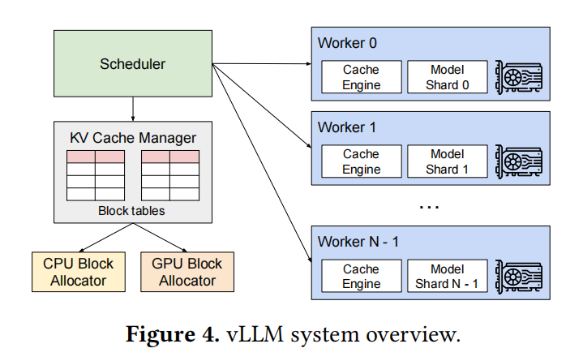
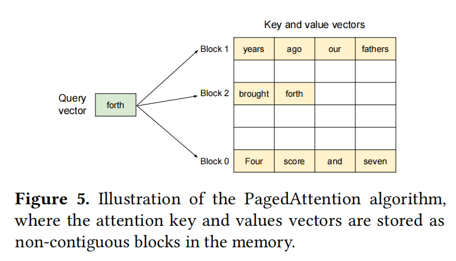
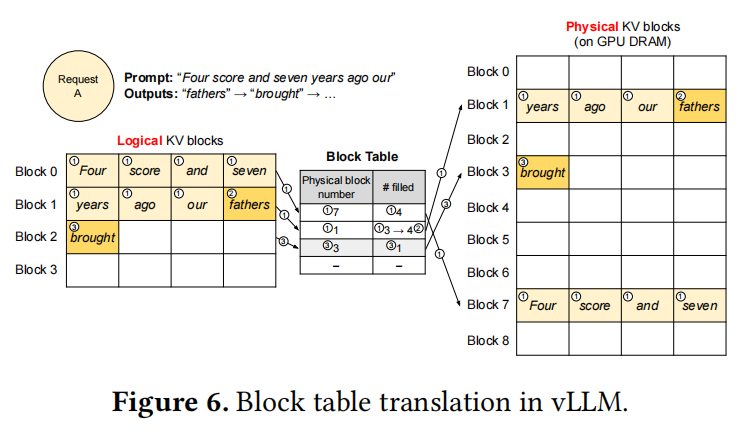
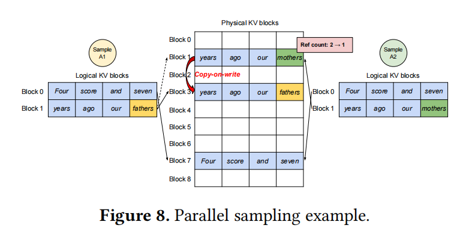
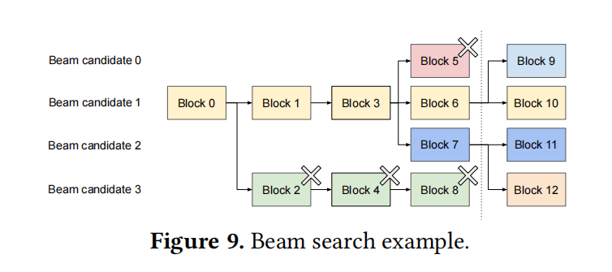

# [SOSP 2023] vLLM: Efficient Memory Management for Large Language Model Serving with PagedAttention

> * 论文地址: [arXiv:2309.06180](https://arxiv.org/abs/2309.06180)
> * Github仓库: [vllm-project/vllm](https://github.com/vllm-project/vllm)
> * **更简洁的摘要：** vLLM 将操作系统的 **virtual memory / paging / copy-on-write** 思想引入 LLM serving，用 PagedAttention 将连续逻辑 KV cache 映射到离散物理 block，减少显存碎片并支持 KV cache 共享，从而扩大 batch size，在相近 latency 下实现约 **2–4× serving throughput**. 

原先工作的 Problem：

1. **KV cache 显存浪费严重. ** LLM 的 KV cache 随生成过程动态增长，输出长度事先未知；已有 serving system 为每个 request 预分配连续显存，产生 reserved memory、internal fragmentation 和 external fragmentation，实验中实际用于 token states 的 KV cache 显存仅占 **20.4%–38.2%**. 
2. **连续内存布局限制 KV cache sharing. ** Parallel sampling、beam search 等 decoding algorithm 中，不同 sequence 往往共享 prompt 或部分生成前缀，但已有系统为每条 sequence 单独保存连续 KV cache，无法直接复用公共状态. 
3. **动态 sequence length 使 serving scheduling 更困难. ** Request 的输入、输出长度高度可变，生成过程中 KV cache 还会持续增长；GPU memory 耗尽时，需要决定 request preemption、KV cache eviction 以及后续恢复策略. 

---

## 方法总览

vLLM 是一个面向 **high-throughput LLM serving** 的系统，其核心将 OS virtual memory 中的 **logical page → physical page** 映射思想应用到 KV cache：

- **PagedAttention**：将每个 sequence 的 KV cache 划分为固定 token 数的 KV blocks，使逻辑上连续的 KV cache 可以存储在物理上不连续的 GPU memory 中. 
- **KV Cache Manager**：维护 logical block → physical block 的 block table，按需动态分配 block，并通过 reference count 与 copy-on-write 支持 sequence 间的 KV cache sharing. 
- **Scheduler + Distributed Workers**：中央 scheduler 负责 request scheduling、block allocation 和 preemption；GPU workers 根据 block table 执行 PagedAttention，并支持 tensor model parallelism. 

PagedAttention 与 OS paging 的对应关系可以理解为：

| OS Virtual Memory | vLLM |
|---|---|
| Process | Sequence / Request |
| Byte / data | Token KV state |
| Logical page | Logical KV block |
| Physical page | Physical KV block |
| Page table | Block table |
| Shared page | Shared KV block |
| Copy-on-write | Shared KV block 的延迟复制 |

---

## 构建方法论（Methodology）

1. **PagedAttention：非连续 KV cache 上的 Attention**

   将 sequence 的 KV cache 按固定 block size \(B\) 划分：

   $$
   K_j=(k_{(j-1)B+1},\ldots,k_{jB}),\qquad
   V_j=(v_{(j-1)B+1},\ldots,v_{jB})
   $$

   Attention 不再假定所有 \(K,V\) 位于连续显存，而是逐 block 根据 block table 找到对应 physical KV block，再完成 attention score 和 value aggregation. 这样 logical sequence 保持连续语义，而 physical memory 可以任意分散. 

   

2. **Paged KV Cache Manager：按需分配 + KV sharing**

   每条 sequence 持有自己的 logical blocks 与 block table. 系统只为已经产生的 token 分配 physical block；只有当前 block 填满后，生成新 token 时才申请下一个 physical block，因此单条 request 的显存浪费被限制在 **最后一个未填满 block** 内. 

   对具有公共前缀的 sequence，多个 logical block 可以指向同一个 physical block，并通过 **reference count** 管理共享关系；某条 sequence 首次修改共享 block 时执行 **copy-on-write**，复制一个 block 后再进行写入. Parallel sampling 可以共享 prompt KV cache，beam search 还可以动态共享更长的生成前缀. 

   

   

   

3. **Scheduling / Preemption / Distributed Execution：围绕 paged KV cache 的 serving co-design**

   vLLM 使用 **FCFS** 调度；显存 block 不足时优先 preempt 后到达的 request，并以 sequence group 为单位共同调度具有共享 KV cache 的 sequences. 被驱逐 KV cache 可通过两种方式恢复：**Swapping** 将 block 移到 CPU RAM，**Recomputation** 则把已有 tokens 重新作为 prompt，通过一次并行 prompt computation 重建 KV cache. 

   多 GPU 场景采用 Megatron-LM 风格 tensor model parallelism. 中央 scheduler 维护统一 block mapping，各 GPU worker 获得相同的 physical block IDs，但只保存自己负责的 attention heads 对应 KV cache；每个 decoding iteration 只需广播 token IDs 与 block tables. 

---

## 本文架构优势

- **将 KV cache allocation 从 request granularity 降到 block granularity. ** 无需为未知 output length 提前预留最大 sequence length 的连续空间，使 external fragmentation 基本消失，并将 internal fragmentation 限制在最后一个 block. 
- **把“显存利用率”转化成“serving throughput”. ** 更高的 KV cache utilization 允许同一 GPU 同时容纳更多 requests，从而扩大 effective batch size；这一点与 Orca 的 iteration-level scheduling 互补. 
- **统一处理复杂 decoding 的共享结构. ** Parallel sampling、beam search、shared prefix 都被抽象为 logical → physical block mapping，模型执行 kernel 无需理解复杂的共享拓扑. 
- **OS abstraction 与 LLM workload 特征高度匹配. ** Paging、reference counting、copy-on-write、swapping 等机制被重新解释为 KV cache management，同时结合 LLM 特性加入 all-or-nothing eviction 和 recomputation. 
- **系统收益来自 memory-system co-design. ** PagedAttention 本身会引入 block-table lookup 和非连续访问开销，但通过 fused reshape/write、fused block read + attention、fused block copy 等 CUDA kernel 将开销控制在可接受范围. 

---

## Experiments & SOTA Comparison

- Models：OPT-13B / 66B / 175B，LLaMA-13B. 
- Hardware：A100；13B 使用 1×A100 40GB，66B 使用 4×A100，175B 使用 8×A100-80GB. 
- Workloads：基于 **ShareGPT** 与 **Alpaca** 的真实 input/output length distribution 合成 serving traces，并采用 Poisson request arrival. 
- Baselines：FasterTransformer、Orca (Max)、Orca (Pow2)、Orca (Oracle). 
- Metric：normalized latency，即 request end-to-end latency / output token 数；通过不断提高 request rate 判断系统在 latency 爆炸之前能够维持的最大 throughput. 

核心结果：

- Basic sampling 下，ShareGPT workload 中 vLLM 可支持比 **Orca (Oracle) 高 1.7–2.7×** 的 request rate，比 Orca (Max) 高 **2.7–8×**；OPT-13B 中平均同时 batching 的 request 数分别达到 Orca (Oracle) 的约 **2.2×**、Orca (Max) 的约 **4.3×**. 
- Parallel sampling 的 KV block sharing 节省约 **6.1%–9.8%** memory；beam search 节省约 **37.6%–55.2%**. 在长序列 ShareGPT 上共享收益进一步增大. 
- Shared-prefix workload 中，相比 Orca (Oracle)，1-shot prefix 达到约 **1.67× throughput**，5-shot 长 prefix 达到约 **3.58×**. 
- 综合不同 workload，vLLM 最终实现约 **2–4× throughput improvement**，同时保持相近 latency. 

---

## Limitations & Future Work

- **PagedAttention 本身存在 kernel overhead. ** Block-table lookup、额外 branch 与 variable-length handling 导致 attention kernel 相比高度优化的 FasterTransformer 高约 **20%–26% latency**；整体收益依靠更高 batch size 抵消这一局部成本. 
- **Block size 存在明显 trade-off. ** Block 太小难以充分利用 GPU parallelism；block 太大会提高 internal fragmentation 并降低 sharing probability. 实验最终选取 **16 tokens** 作为默认 block size. 
- **收益依赖 workload 是否 memory-bound. ** 对 tensor shape 固定或主要受 computation 限制的 GPU workload，引入 paging 的 memory indirection 与 non-contiguous access 反而可能带来性能下降，因此这一设计尤其适合 KV cache 动态增长、GPU memory 成为主要瓶颈的 autoregressive LLM serving. 
- **Preemption recovery 与硬件条件有关. ** Small block 下大量 CPU↔GPU 小传输降低 PCIe utilization，因此 recomputation 更有优势；block 较大时 swapping 更有竞争力. 

---

## Case Study

以 Figure 6 中 `"Four score and seven years ago our"` 的 prompt 为例，假设 block size 为 4：

- 7 个 prompt tokens 只分配两个 logical blocks，并映射到两个任意位置的 physical blocks；
- 第一个生成 token `"fathers"` 填满第二个 block，无需申请新显存；
- 下一步生成 `"brought"` 时才创建 logical block 2，并动态申请一个新的 physical block；
- 整个过程中 logical KV cache 保持连续，但对应 physical blocks 可以是 `7 → 1 → 3` 等任意非连续地址.

这一例子体现了 vLLM 的核心变化：

$$
\boxed{
\text{预分配整条 sequence}
\quad\longrightarrow\quad
\text{按生成进度逐 block 分配}
}
$$

因此系统无需预测 output length，**KV cache memory allocation 可以与 autoregressive generation 同步增长**；PagedAttention 再负责隐藏底层物理地址的不连续性，使上层 attention computation 仍然能够按照逻辑 sequence 正常工作. 
