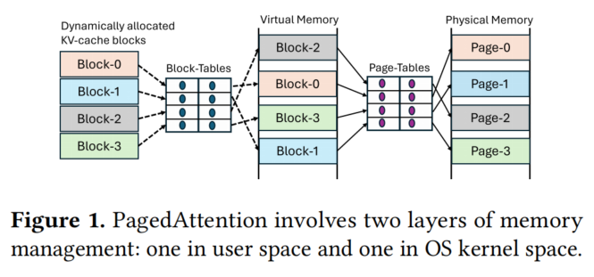
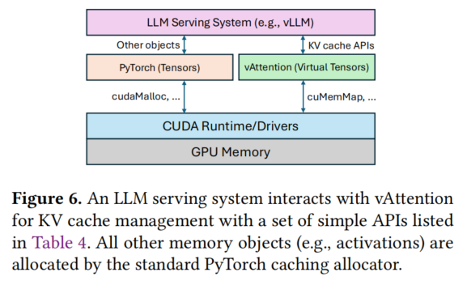
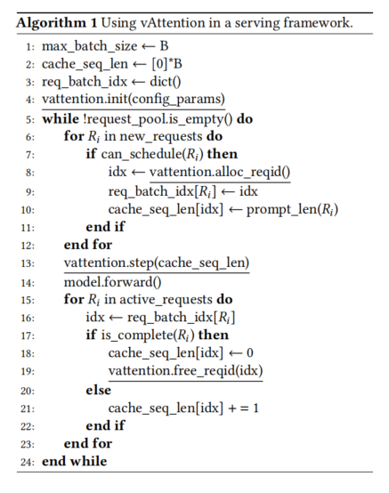
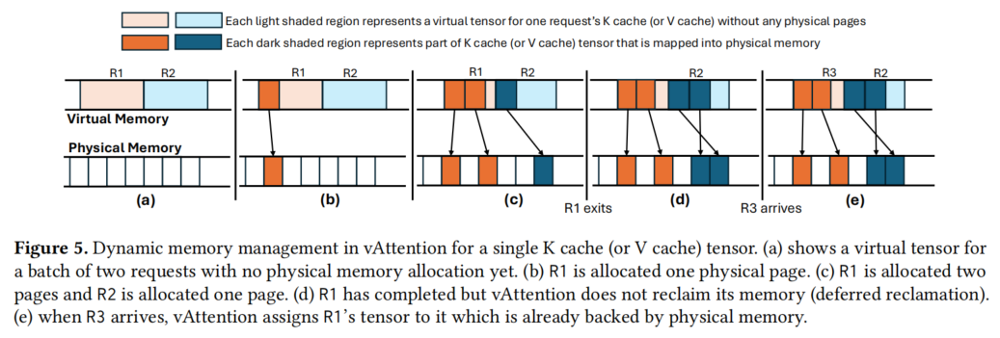
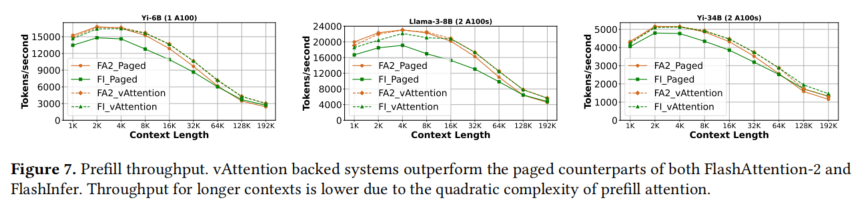
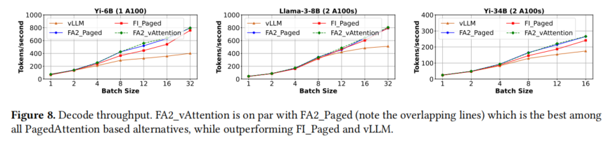
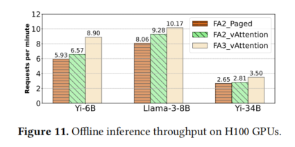

# [ASPLOS 2025] vAttention: Dynamic Memory Management for Serving LLMs without PagedAttention

> - 论文地址：[ACM DOI](https://doi.org/10.1145/3669940.3707256)
> - Github 仓库：[microsoft/vattention](https://github.com/microsoft/vattention)
> - **更简洁的摘要：** vAttention 将虚拟地址预留与物理显存映射解耦，使 KV cache 保持虚拟连续、物理按需增长；结合异步映射、内存复用与小页分配，减少碎片并直接复用普通 attention kernel。

原先工作的 Problem：

1. **静态分配 KV cache 导致严重的内部碎片。** 请求的最终输出长度事先未知，按最大 context length 预留物理显存会让大量空间长期闲置，限制 batch size 和 serving throughput。
2. **PagedAttention 将内存管理复杂性传递给 attention kernel。** 按需分配的 KV blocks 通常在虚拟地址上不连续，服务框架需要维护 Block-Tables，kernel 也必须增加跨块寻址逻辑。新 kernel 因而需要额外进行 paging adaptation。
3. **Block-Table 管理与分页寻址增加 CPU/GPU 开销。** CPU 需要构造和传递映射信息；GPU 增加索引查询、分支和寄存器占用。内存分配粒度还与 kernel performance 耦合，调整 block size 可能同时影响碎片与计算效率。

左侧 Block-Tables 将逻辑 KV blocks 映射到不连续的虚拟地址；右侧 Page-Tables 再将虚拟地址映射到物理页。vAttention 的切入点是：**利用底层虚拟内存机制管理物理页，使 kernel 继续看到连续的 KV tensor。**

------

vAttention 是一个面向 **LLM serving 的动态 KV cache 内存管理框架**，核心包含三个部分：

- **Virtual Tensor Reservation：** 提前预留覆盖最大 batch size 和 context length 的虚拟地址空间，为每个请求提供稳定的 KV cache 地址区间。
- **Dynamic Physical Mapping：** 根据请求的实际长度，将物理显存页映射到对应区间，让 KV cache 按需增长。
- **Allocation Optimizations：** 利用 decode 的增长规律提前映射，并通过延迟回收、预先分配和小页支持降低延迟与碎片。

**连续的虚拟地址不要求连续的物理显存。** 因此，可以保留普通 attention kernel 的寻址方式，同时获得动态分配的空间效率。这里的“预留最大容量”主要指虚拟地址空间，不意味着按最大容量占用物理显存。

KV cache 经由 vAttention 管理；模型权重和其他 activations 仍由普通 PyTorch allocator 管理。优化集中在 KV cache 的分配路径。

## 构建方法论（Methodology）

### 1. Virtual tensors 与请求槽位：解耦地址预留和物理分配

传统 `cudaMalloc` 同时提供虚拟地址与物理显存。vAttention 利用 CUDA Virtual Memory Management（VMM）接口，将地址预留、物理页分配和地址映射分开，并扩展 PyTorch allocator 创建 **virtual tensors**。

每个 worker 负责 $N$ 层，每层分别维护 K 和 V，因此预留 $2N$ 个 virtual tensors。单请求、单层、单个 K 或 V 的最大容量为：
$$
S=L\times H\times D\times P
$$
其中：

- $L$：最大 context length；
- $H$：当前 worker 上的 KV heads 数量；
- $D$：每个 head 的 dimension；
- $P$：每个元素的字节数。

若最大 batch size 为 $B$，每个 tensor 预留 $BS$ 字节，所有层合计：
$$
V_{\mathrm{total}}=2NBS
$$
每个请求获得一个固定的 `reqId`，其 K/V 子区间起点为：
$$
\operatorname{offset}(\mathrm{reqId})=\mathrm{reqId}\times S, \qquad 0\leq\mathrm{reqId}<B
$$
例如 Yi-34B、FP16、TP-2 下，$N=60,H=4,D=128,P=2,L=200K$；若 $B=500$，单 worker 需要约 **12 TB 虚拟地址空间**。物理显存只需为实际使用的部分提供映射。

运行时通过四个接口管理请求生命周期：

| API           | 作用                                       |
| ------------- | ------------------------------------------ |
| `init`        | 预留 virtual tensors，准备物理页池         |
| `alloc_reqid` | 分配一个空闲请求槽位                       |
| `step`        | 按各请求当前长度，确保执行所需物理页已映射 |
| `free_reqid`  | 标记请求结束，允许后续复用或回收           |

**`step` 在 GPU 执行前完成必要检查与映射。** 因而不是等待 kernel 访问未映射地址后，再依靠缺页处理临时分配。

Continuous batching 会使固定 KV 槽位出现空洞。通过 FlashAttention 的 `cache_batch_idx`，当前 query batch 可以映射到各请求实际使用的 KV 槽位，无须移动完整 KV cache。

### 2. Allocation-compute overlap 与内存复用：隐藏映射延迟

Decode 阶段，每个活跃请求每轮仅增加一个 token，因此下一轮的 KV cache 增量可以提前确定。尽管请求的最终长度未知，**每轮是否将耗尽已有物理页是可预测的**。

vAttention 据此采用两类策略：

**Decode：将下一轮映射与当前轮计算重叠。**

在 iteration $i-1$ 调用 `step` 时，检查 iteration $i$ 是否需要新 page-groups；若需要，后台线程提前建立映射，同时 GPU 执行当前轮计算。这样，CUDA VMM 调用尽量离开推理的关键路径。

**Prefill：通过 deferred reclamation 和 eager allocation 减少首次映射。**

请求结束后，暂不立即撤销其物理页映射。新请求复用相同 `reqId` 时，可以直接使用已映射的地址区间；只有新 prompt 超出已有容量时才需要补充页。同时，为一个待使用的 inactive 槽位预先映射部分页，减少新请求到达时的分配工作。

物理页池资源不足时，再后台回收 inactive 请求的映射。

图中过程对应：

(a) 为 R1、R2 预留虚拟地址，尚未映射物理页；
(b)(c) 随请求增长补充物理页；
(d) R1 结束后保留其映射；
(e) R3 复用 R1 的槽位和已映射物理页。

**复用的是内存资源。** R3 仍需要写入自己的 KV 数据，不能直接继承 R1 的 KV 内容。

### 3. Small page-groups：减少跨层累积的页尾碎片

即使按需分配，若分配粒度较大，每个请求、每层 K/V 末尾仍可能留下未使用空间。这些余量会随着层数和并发请求数累积。

标准 CUDA VMM 分配路径采用 2 MB 粒度。vAttention 修改开源 NVIDIA unified memory driver，增加 **64 KB、128 KB 和 256 KB page-groups**，使物理分配更贴近实际 KV cache 长度。

page-group 容纳的 token 数取决于 KV heads、precision 和 TP degree。例如 Llama-3-8B、TP-2 下，单层 K 或 V：

| Page-group 大小 | 容纳的 tokens |
| --------------- | ------------- |
| 64 KB           | 64            |
| 128 KB          | 128           |
| 256 KB          | 256           |
| 2 MB            | 2048          |

小页提高空间利用率，但会增加映射频率，因此需要与异步映射、延迟回收共同使用。

另一个无需修改 driver 的方案是 **Tensor Slicing**：创建形状为 $B,L,N,H,D$ 的 K/V tensors，再按层取 slice，使单个物理页存放多个层的数据，将碎片降低到原布局的约 $1/N$。

其代价是单层 slice 不再连续，需要 kernel 支持 stride。早期 FlashInfer 缺少这一支持，因此采用小页 driver 扩展作为主要方案；两种方案也可以结合。

------

## 本文架构优势

- **将内存管理与 kernel 实现解耦。** 动态分配不再要求每个 attention kernel 都实现 Block-Table 寻址，降低替换和接入新 kernel 的成本。
- **同时保留连续地址与按需分配。** 大容量虚拟地址预留提供稳定布局，动态物理映射控制实际显存占用。
- **让内存优化对应请求生命周期。** Decode 利用可预测增长提前映射，prefill 利用请求更替复用已有映射，小页控制剩余碎片。

## Experiments & SOTA Comparison

### 实验配置

| 项目                | 配置                                        |
| ------------------- | ------------------------------------------- |
| Yi-6B               | 1×A100 80 GB，TP-1                          |
| Llama-3-8B、Yi-34B  | 2×NVLink-connected A100 80 GB，TP-2         |
| FA3 portability     | 1–2×H100                                    |
| Serving framework   | vLLM v0.2.7                                 |
| Attention libraries | FlashAttention-2 v2.5.9、FlashInfer v0.4.0  |
| Artifact 环境       | CUDA 12.1、Python 3.10、PyTorch 2.3.0       |
| Paged block size    | vLLM、FlashInfer：16；FlashAttention-2：256 |

实验分为 prefill、decode、offline serving、online serving，以及 allocation overlap、deferred reclamation、page size 和 allocation bandwidth 的消融。

- **Prefill：** 覆盖 1K–192K context length，指标为 prompt tokens/s。
- **Decode：** 初始 context 为 16K，使用 400 轮 decode 的平均延迟计算 output tokens/s。
- **Offline：** 427 条 arXiv-Summarization 请求，context 为 64K–192K，指标为 requests/min。
- **Online：** 512 条请求，input 为 22K–45K；Poisson arrivals、FCFS 调度，指标为 request latency CDF。

### Comparison 概要

主要对照是 **同一 attention library 的 paged kernel 与 vAttention 支持的 non-paged kernel**，另包含旧版 vLLM decode kernel。

长上下文 serving 的端到端吞吐相对 FA2_Paged、FI_Paged 最高分别达到 **1.18×、1.23×**。同库 FA2 的 decode 吞吐基本相当；相对旧版 vLLM 的最高 **1.99×** 还包含 kernel 实现差异，不能全部归因于内存管理。

FA3 portability 实验展示了无需 paging adaptation 即可接入新 kernel 的能力。

## Limitations & Future Work

- **Small-page driver 依赖：** 细粒度分配需要 NVIDIA driver 扩展；Tensor Slicing 可以避免修改 driver，但要求 kernel 支持 stride。
- **内存不足处理：** `step` 无法满足需求时，服务框架可以 preempt 请求；更复杂的 CPU KV cache swapping 策略留作 future work。
- **性能依赖具体 kernel：** FlashInfer non-paged decode kernel 的延迟较高，因此未纳入 decode 对照。连续地址布局本身不能保证任意 kernel 都更快。