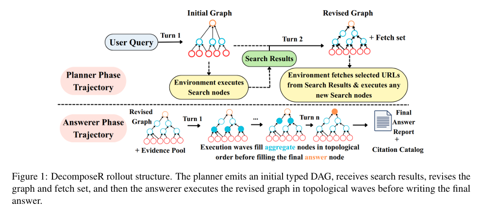
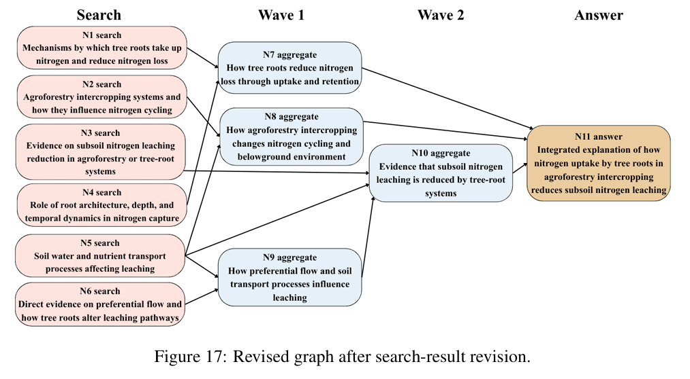

# [arXiv 2026] DecomposeR: Planner-Centric Reinforcement Learning for Deep Research with Structure-Aware Reward

> * 论文地址：[arXiv:2605.30824](https://arxiv.org/abs/2605.30824)
> * GitHub 仓库：[MustafaAH10/DecomposeR](https://github.com/MustafaAH10/DecomposeR)
> * 研究机构：National University of Singapore（新加坡国立大学）
> * **更简洁的摘要：** 将 Deep Research（深度研究）任务表示为有类型的 DAG（Directed Acyclic Graph，有向无环图），先通过 Planner RL 优化检索规划，再通过 Answerer RL 优化证据综合. 利用结构感知奖励（Structure-Aware Reward）直接评价规划质量，缓解长链研究中的奖励稀疏与信用分配困难. 

## 原先工作的 Problem

1. **信用分配模糊（Ambiguous Credit Assignment）**：传统 ReAct（Reasoning and Acting，推理与行动）式轨迹将规划、检索、筛选和写作混在一起，最终答案奖励很难定位具体失误环节. 
2. **奖励稀疏（Reward Sparsity）**：中间规划和证据综合缺少直接反馈，训练主要依赖最终结果，长轨迹优化不稳定. 
3. **结构表达受限**：扁平轨迹难以显式描述子问题依赖、跨分支证据共享和多级综合. 

---

DecomposeR 是以 Planner（规划器）为中心的深度研究框架，包含两个可独立训练的角色：

* **Planner**：生成和修订研究图，指定检索内容、研究分支与证据依赖. 
* **Answerer**：按照图的拓扑顺序生成分支报告，再综合得到带引用的最终答案. 

两个角色共享 Qwen3-8B 骨干模型，分别使用 LoRA（Low-Rank Adaptation，低秩适配）适配器. 

完整流程：用户问题 $x$ → 初始图 $G_0$ → 执行搜索得到 $Z$ → 修订图 $G_1$ 并选择网页 → 执行新增搜索与网页抓取 → Answerer 按拓扑波次生成 $O_{1:K}$ → 最终回答 $y$. 

图包含三类节点：`search`（查询与信息需求）、`aggregate`（分支综合与关键点）、`answer`（最终报告）. 边 $u\to v$ 表示节点 $v$ 消费节点 $u$ 的输出，同一检索证据可以被多个分支复用. 

## 构建方法论（Methodology）

1. **Cold-Start SFT：学习结构化输出协议**

    使用 GPT-5-mini 生成完整的 Planner–Answerer 教师轨迹，只保留 DAG 校验和输出解析均成功的样本. 约 4,000 个候选研究问题中，2,325 条轨迹被用于 SFT（Supervised Fine-Tuning，监督微调），展开为 10,532 条轮次级样本. 模型学习先生成初始与修订规划，再按拓扑波次填写节点；只对模型生成的 Token 计算训练损失. 

2. **Planner RL：直接奖励规划图质量**

    使用结构感知奖励评价修订后的图 $G_1$：

    $$
    R_{\mathrm{plan}}=\mathbf{1}[\mathrm{Valid}(G)]\left(0.4C_{\mathrm{rub}}+0.3Q_{\mathrm{search}}+0.3E_{\mathrm{graph}}\right).
    $$

    * **Rubric Coverage（评分标准覆盖）**：先根据问题和检索上下文生成 8–10 条评分标准，再计算各标准与计划节点字段之间的最佳语义相似度：

        $$
        C_{\mathrm{rub}}=\frac{\sum_u w_u\max_{n,c}\cos^+(\phi(r_u),\phi(c))}{\sum_u w_u}.
        $$

        其中 $r_u$ 为评分标准，$w_u$ 为权重，$c$ 为节点的 `query`、`key_points` 或 `need` 字段，$\phi$ 为文本嵌入函数. 

    * **Search Quality（搜索质量）**：

        $$
        Q_{\mathrm{search}}=0.5C_{\mathrm{search}}+0.5D_{\mathrm{search}}.
        $$

        前者衡量搜索查询覆盖评分标准的程度，后者根据搜索查询间的余弦相似度衡量非冗余性. 

    * **Graph Expressiveness（图结构表达能力）**：

        $$
        E_{\mathrm{graph}}=0.4B_{\mathrm{synth}}+0.4I_{\mathrm{cross}}+0.2B_{\mathrm{search}}.
        $$

        分别鼓励最终答案拥有多样化的综合分支、跨分支证据复用及足够的搜索广度. 计数相关项采用边际收益递减函数 $f(k)=1-1/k$（$k\geq 1$），避免单纯增加节点数量. 

3. **Answerer RL：分别优化分支执行与最终综合**

    固定已经训练的 Planner，预先生成规划图和检索证据，单独训练 Answerer：

    $$
    R_{\mathrm{ans}}=0.5R_{\mathrm{exec}}+0.5R_{\mathrm{synth}}.
    $$

    * **Execution Reward（执行奖励）**：逐个 Aggregate 节点评价输出是否覆盖规划中的关键点：

        $$
        r_v=0.5K_{\mathrm{emb}}(v)+0.5K_{\mathrm{lex}}(v).
        $$

        其中 $K_{\mathrm{emb}}$ 使用语义匹配，$K_{\mathrm{lex}}$ 使用关键点内容词的召回率；节点分数通过移位调和平均（Shifted Harmonic Mean）整合. 

    * **Synthesis Reward（综合奖励）**：

        $$
        R_{\mathrm{synth}}=0.5J_{\mathrm{rub}}+0.5U_{\mathrm{branch}}.
        $$

        $J_{\mathrm{rub}}$ 是外部模型的评分标准判分，$U_{\mathrm{branch}}$ 衡量最终报告对中间分支内容词的复用比例. 

    两个 RL 阶段均采用 GRPO（Group Relative Policy Optimization，组相对策略优化），每个提示采样 6 条轨迹；搜索结果、抓取页面等环境文本被屏蔽，不参与策略梯度（Policy Gradient）更新. 

---

## 本文架构优势

1. **规划与执行解耦**：Planner 奖励只针对图质量，Answerer 在固定规划分布上训练，减少联合训练中的非平稳性（Non-stationarity）. 
2. **结构可直接优化**：搜索广度、证据共享和分支综合被转化为显式奖励目标. 
3. **检索反馈修订**：Planner 在真实搜索结果返回后调整规划，缓解初始规划与可检索证据不匹配的问题. 

---

## Experiments & SOTA Comparison

实验配置：Qwen3-8B；LoRA rank 64、alpha 128；2,325 条 SFT 轨迹和 1,432 个 RL 研究问题. 使用 Jina Search（每节点最多 5 条结果）与 Serper（每轮最多 4 次网页抓取）. 训练硬件为 8 张 NVIDIA RTX PRO 6000（每张 96 GB）. 评测包含 DeepResearchBench（100 题）、HealthBench（500 题）与 ResearchQA-Mini（776 题）. 

| 方法                        |  DRBench | HealthBench | ResQA-Mini |
| --------------------------- | -------: | ----------: | ---------: |
| Qwen3-8B + Search           |     34.4 |        19.8 |       57.0 |
| WebExplorer-8B              |     36.7 |        34.0 |       65.5 |
| DecomposeR（SFT only）      |     36.3 |        39.1 |       63.8 |
| **DecomposeR（SFT + RL）**  | **41.8** |    **42.0** |   **71.4** |
| Tongyi DeepResearch-30B-A3B |     40.6 |        45.9 |       66.7 |

相比 SFT-only，完整训练在三个基准上分别提高 5.5、2.9、7.6 分. 

消融实验（Ablation Study）：

| 变体                 |  DRBench | HealthBench | ResQA-Mini |
| -------------------- | -------: | ----------: | ---------: |
| Joint RL             |     37.1 |        38.3 |       66.9 |
| Linear Plan          |     34.2 |        31.5 |       57.8 |
| Tree Plan            |     38.6 |        39.8 |       65.3 |
| Single-turn Planning |     35.1 |        36.7 |       67.5 |
| **完整 DecomposeR**  | **41.8** |    **42.0** |   **71.4** |

去除 Graph Expressiveness 后，DRBench 从 41.8 降至 34.1；去除 Execution Reward 后，HealthBench 从 42.0 降至 31.9，说明结构奖励和分支执行奖励均对性能有重要贡献. 

---

## Limitations & Future Work

1. **缺少执行期动态重规划**：Answerer 开始执行后，规划图固定，不能根据中间分支产生的新信息继续搜索. 

2. **缺乏来源忠实性验证**：检索证据可能不完整或包含噪声，现有流程缺乏独立的事实与来源一致性校验. 

3. **奖励设计存在代理偏差**：语义相似度可能高估内容覆盖程度，固定奖励权重也可能不适合所有领域. 

4. **信用分配粒度仍有限**：尽管奖励由不同图结构指标组成，GRPO 实际上仍将同一个阶段级优势分配给一条轨迹中的所有有效模型 Token，尚未实现节点级或动作级优势归因（Node-level / Action-level Credit Assignment）：

    $$
    \hat A_i=\frac{R_i-\operatorname{mean}(R)}{\operatorname{std}(R)+\delta}.
    $$

    因而一个图中某个节点设计失败，其他节点对应的 Token 仍参与同一个整体奖励的更新. 进一步的研究可引入局部奖励及因果依赖验证（Causal Dependency Verification）. 

---

## Case Study

问题：*How does nitrogen uptake by tree roots in agroforestry intercropping systems help reduce subsoil nitrogen leaching?*

1. **初始规划**：分别研究根系吸氮机制、农林间作氮循环、淋失证据、根系结构和土壤运输过程. 
2. **搜索后修订**：检索发现优先流（Preferential Flow）十分重要，于是新增搜索节点 N6，并建立 N9 聚合节点研究相关机制. 
3. **拓扑执行**：第一波生成 N7、N8、N9 三个分支报告；第二波 N10 结合 N3、N5、N9 的结果；最终 N11 综合 N7、N8、N10 生成带证据引用的研究报告. 

案例展示了 DAG 的两个关键能力：同一检索结果可以服务多个分支，后续综合节点也可以依赖已经完成的中间结论. 

---

## 研究启示

DecomposeR 的核心价值在于：**把隐式的复杂研究过程转化为显式的、可评分的依赖结构，再将规划质量直接纳入强化学习目标. **

对于复杂多跳推理（Multi-hop Reasoning），后续可以重点研究节点级因果依赖验证与局部信用分配，使训练信号能够定位具体断链位置，而不仅仅提高整体规划图的奖励. 