# Assignment 1:词向量和文本分类

## Project Introduction

> 内容包括：（这部分内容不要太长，讲清楚即可）
>
> 1. 实验简介，即要做什么事情
>
> 2. 开发环境及系统运行要求，包括所用的开发工具、开发包、开源库、系统运行要求等

### 实验简介

本实验分成两小节，词向量章节是基于 Python 和 gensim 框架实现 Word2Vec 在 Wikipedia 语料集上面的应用；文本分类章节是基于 MindSpore 搭建 TextCNN 模型用于情感分析


### 开发环境及系统运行要求

开发环境：

* 词向量实验采用 ModelArts Ascend Notebook 开发环境，软件环境为 Python3.7 和 Gensim;
* 文本分类实验采用 ModelArts Ascend Notebook环境，软件环境是 MindSpore 1.1. （不知道为什么，找不到所需要的镜像和 GPU/CPU 型号）

系统运行要求：

使用的远程 JupyterLab，SSH连接极不稳定.

## Technical Details

> 内容包括：
>
> 1. 工程实践当中所用到的理论知识阐述
>
> 2. 具体的算法，请用文字、示意图或者是伪代码等形式进行描述（不要贴大段的代码）
>
> 3. 程序开发中重要的技术细节，比如用到了哪些重要的函数？这些函数来自于哪些基本库？功能是什么？自己编写了哪些功能函数？等等

### 环境配置

华为这个环境配置很抽象，按它的官网指导 VSCode 接入反而是连不上的，因此使用以下配置：

在 `C:/Users/<user id>/.ssh/config` 中添加以下配置：

```text
Host huawei-assign1
    HostName dev-modelarts-cnnorth4.huaweicloud.com
    User ma-user
    Port 31854
    IdentityFile C:/Users/<user id>/.ssh/KeyPair-1280.pem
    StrictHostKeyChecking no
    UserKnownHostsFile /dev/null
```

并把公钥文件放进 `C:/Users/<user id>/.ssh/` 中.

scp传输文件：

```bash
scp -O -i "C:\Users\<user id>\.ssh\KeyPair-1280.pem" -P 31854 -o StrictHostKeyChecking=no -r "Assignment 1/" ma-user@dev-modelarts-cnnorth4.huaweicloud.com:/home/ma-user/work/
```

scp接收文件：

```bash
scp -O -i "C:\Users\<user id>\.ssh\KeyPair-1280.pem" -P 31854 -o StrictHostKeyChecking=no -r "ma-user@dev-modelarts-cnnorth4.huaweicloud.com:/home/ma-user/work/'Assignment 1'/" "D:\Downloads\"
```

然后发现实验1-1这个环境连 VSCode 非常不稳定，最后切换成华为平台内置的 JupyterLab 搭载 MindQuantum 来完成.

实验1-2的配置就更抽象了，试验了几次用这个配置才能成果，而且还没有完全对应版本的NPU，爆了一堆Warning修了一下午不知道在干什么.

<center>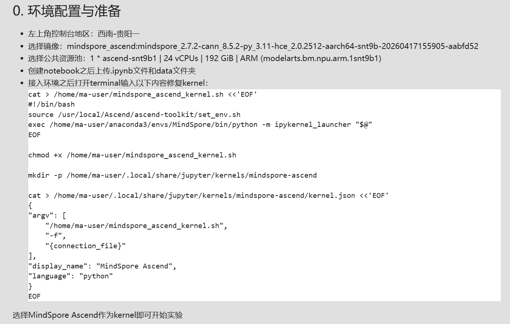</center>


### 理论阐述

Word2vec是2013年Google提出的词向量模型，能从大量文本语料中以无监督方式学习语义知识，广泛应用于NLP. 其核心是浅层神经网络：CBOW用上下文预测中心词，Skip-gram用中心词预测上下文；训练后每个词被映射为低维稠密向量，语义相近的词在向量空间中距离更近，并支持“国王-男人+女人≈女王”等类比. 它奠定了预训练词表示的基础. 

TextCNN模型用于对电影评论进行情感分析（文本分类），核心原理如下：

1. **数据预处理**：清洗文本、分词，构建词表（Vocab），将句子转换为固定长度的词索引向量。
2. **特征提取（TextCNN）**：通过Embedding层将词索引映射为词向量；使用不同尺寸（3、4、5）的一维卷积核捕捉局部N-gram语义特征；经最大池化层提取显著特征并拼接。
3. **分类与训练**：拼接后的特征经Dropout正则化后送入全连接层，通过Softmax输出情感极性（正面/负面）。采用Adam优化器和交叉熵损失函数，配合动态学习率（warm-up与衰减）完成模型训练与评估，掌握CNN在NLP任务中的应用.

## Experiment Results

> 用图文并茂的形式给出实验结果，如系统界面、操作说明、运行结果等，并对实验结果进行总结和说明，对`.ipynb`中要求的探索和实验结论进行阐述、分析，如果有做额外的探索和发现，也可以在这里附上.

### Word2vec

配置环境：

<center>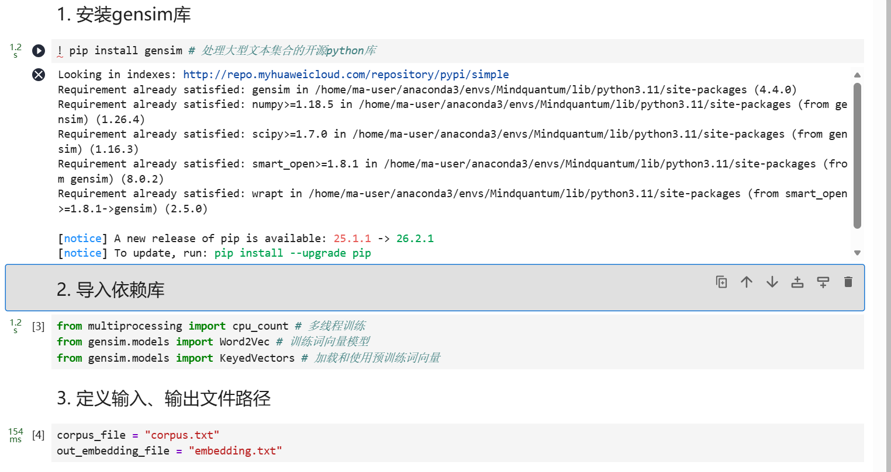</center>

查看函数文档：

<center>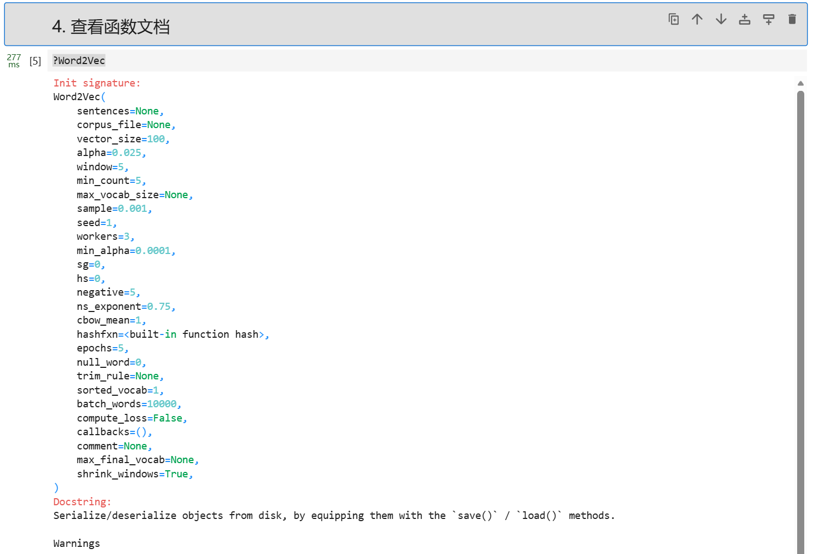</center>

词向量训练：

<center>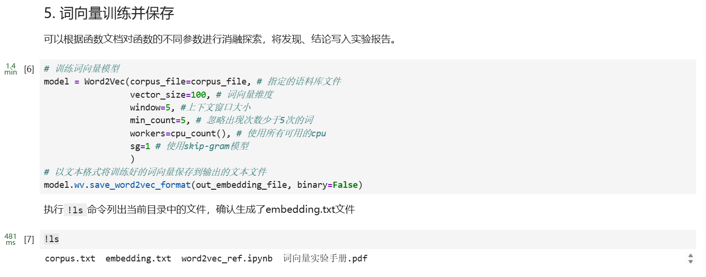</center>

查看embedding生成情况：

<center>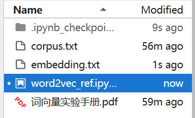</center>

加载离线词向量：

<center>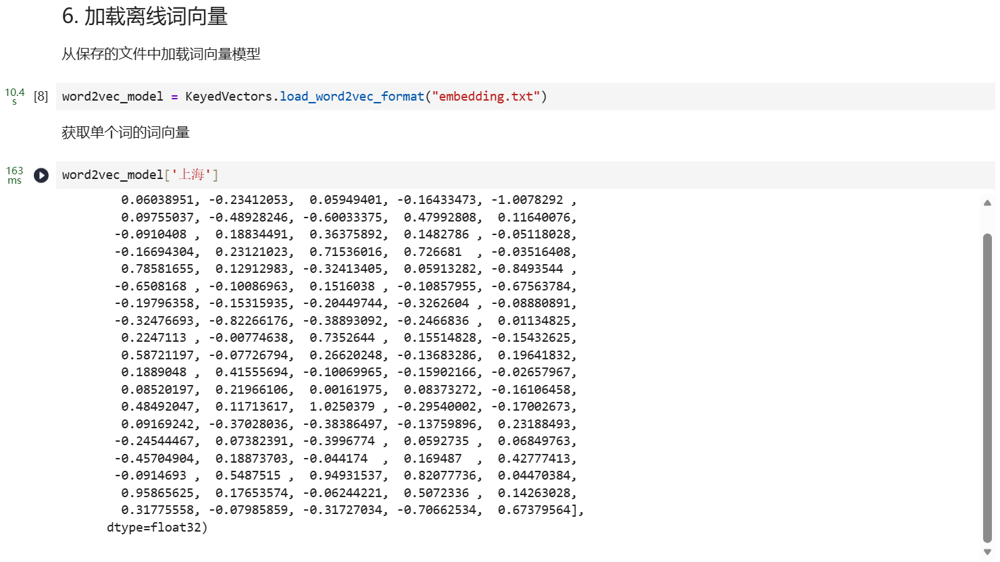</center>

相似度测试：

<center>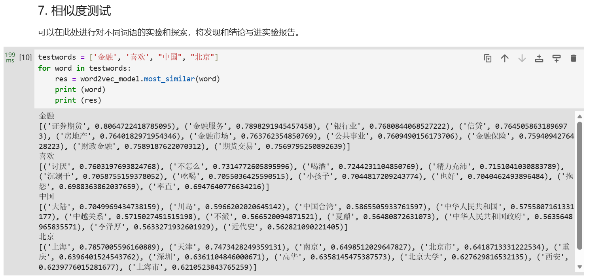</center>

### TextCNN

导入依赖：

<center>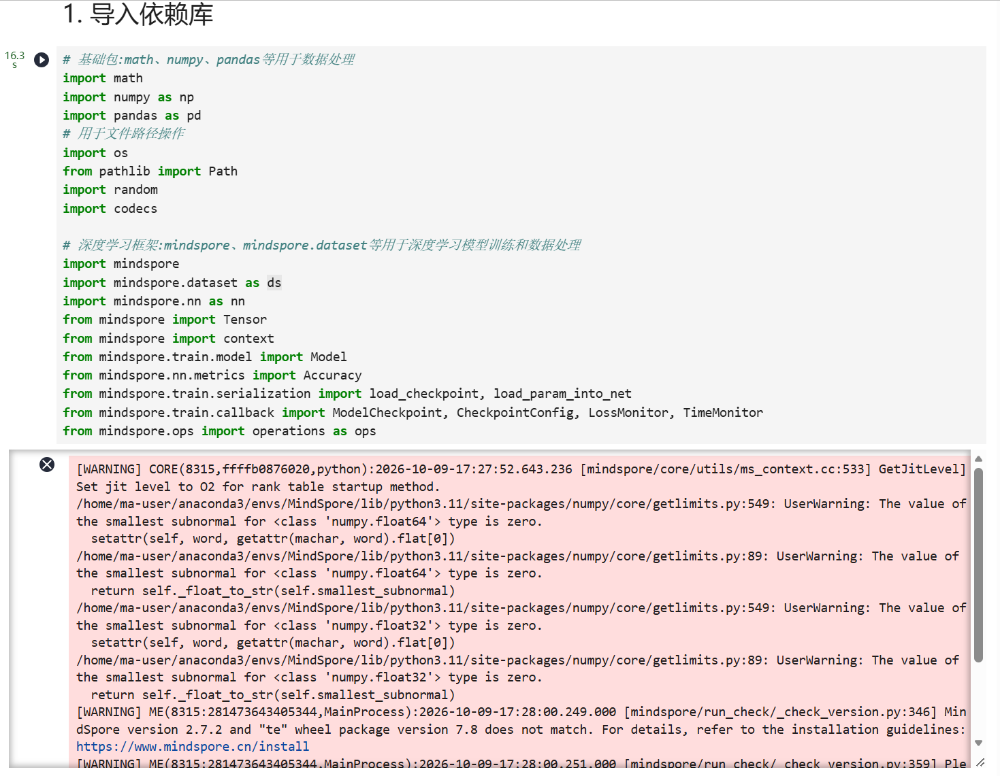</center>

安装easydict:

```bash
%pip install easydict
```

设置 hyperparam: 

<center>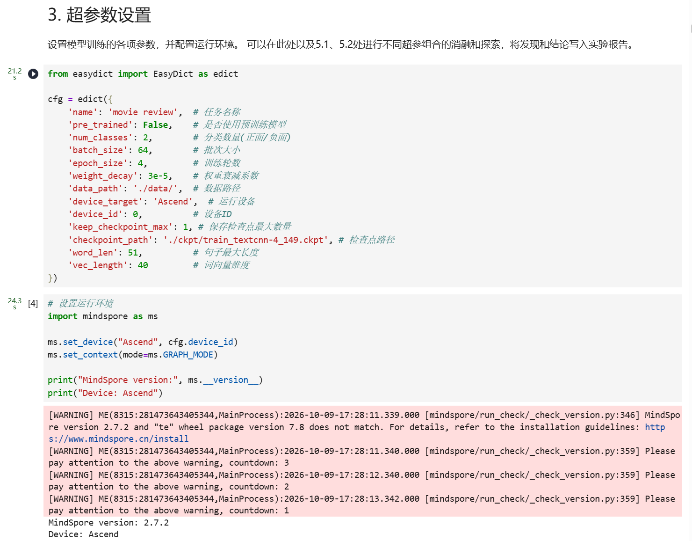</center>

preprocessing:

<center>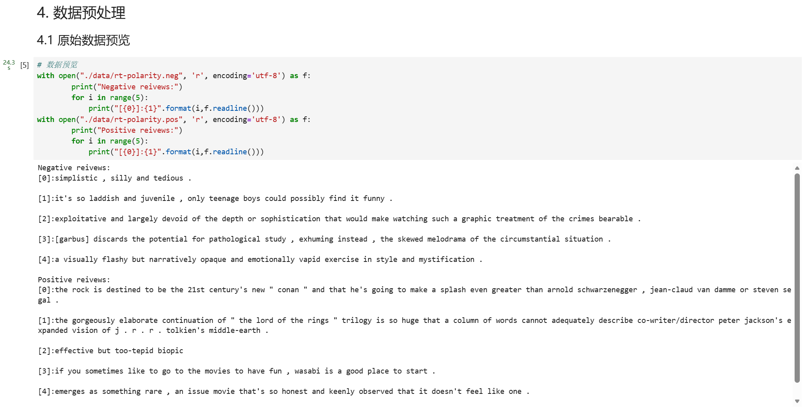</center>

训练：

<center>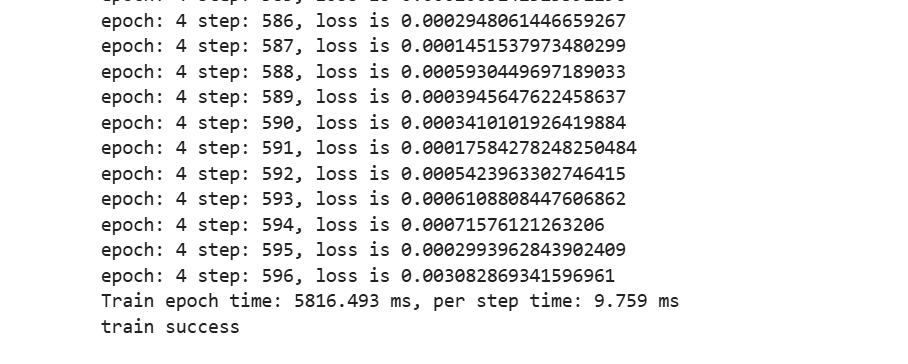</center>

可以看到 $\text{acc} \approx 0.76$.

<center>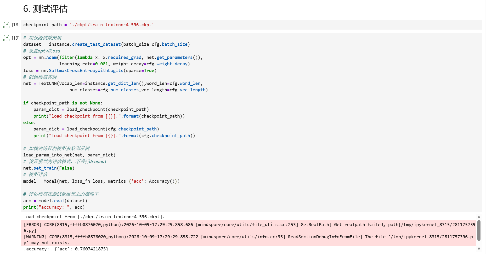</center>

Case Study:

```python
review_en = "the movie is good"
inference(review_en)
# 在这里补充尝试一些case

review_1 = "This experiment is awful."
review_2 = "Sounds good."
review_3 = "I'm neutral about that."
inference(review_1)
inference(review_2)
inference(review_3)
```

显然结果这里是有一个小错误的，写了 neutral 却被判成了 Negative:

<center>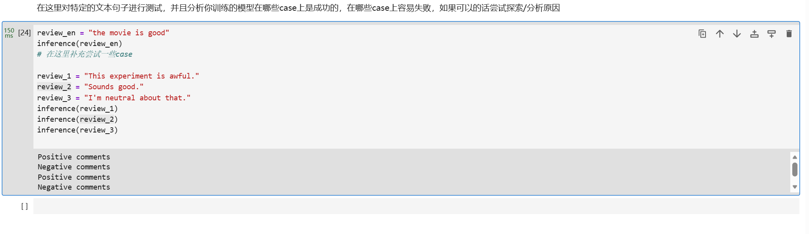</center>

原因应该是二分类问题里面没有中立选项，训练集里面可能掺了类似表达导致这个case错了.


## References

>  给出主要的参考文献，可以是论文、网站、书籍、别人的技术报告等；对ai使用进行简单的声明，阐述清楚在哪个部分使用了ai、如何使用的.

未使用AI.

> 备注：代码中请给出较为详细的注释，并且提交 `.ipynb`的时候保留在notebook上跑出来的输出，此报告中切勿粘贴大量代码，否则扣分. 提交实验报告的pdf版本和word或markdown纯文字版用于查重/ai评分. 

本实验没有任何要书写的代码.