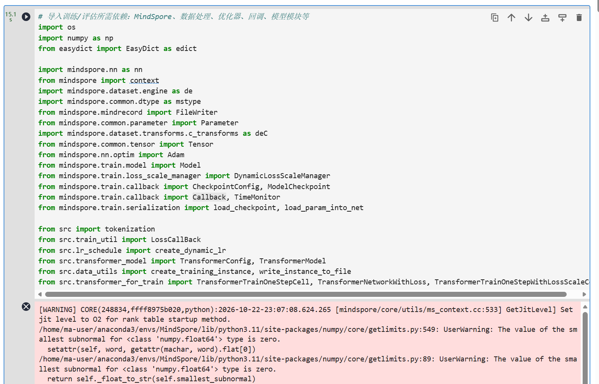
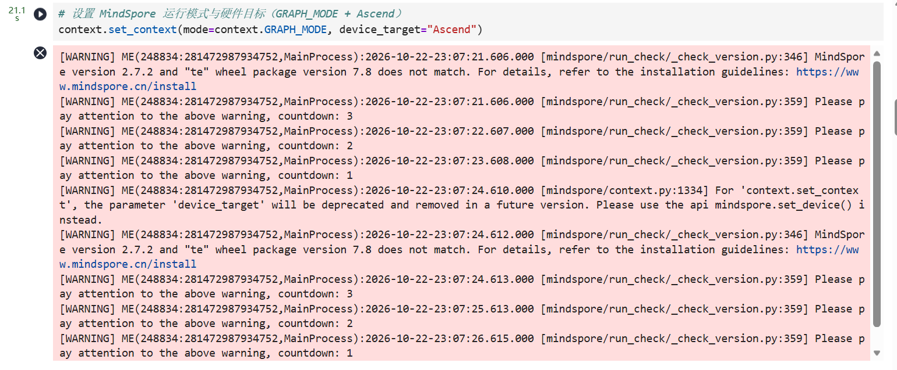
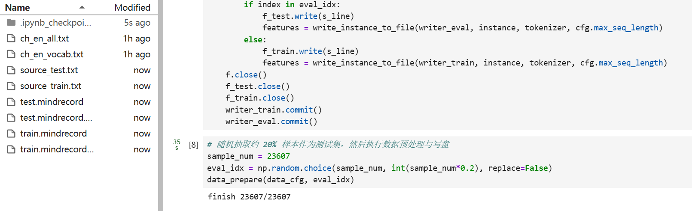
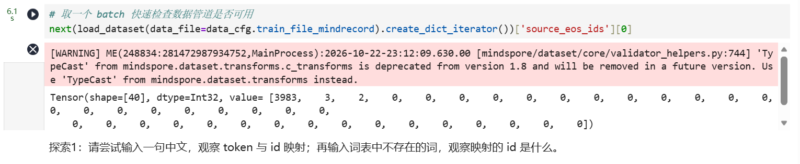
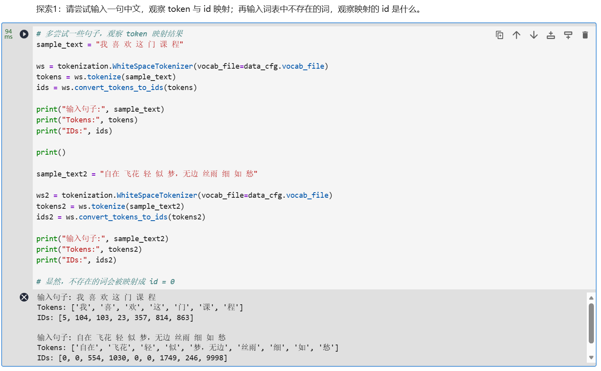
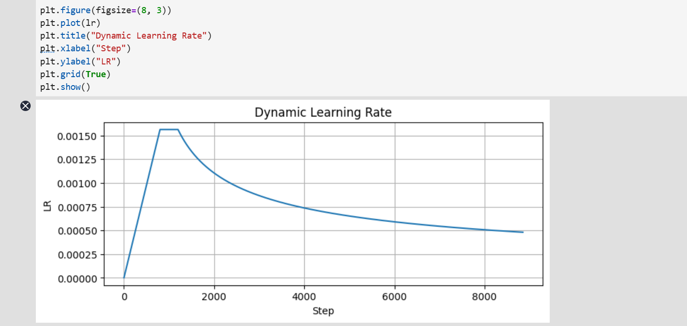
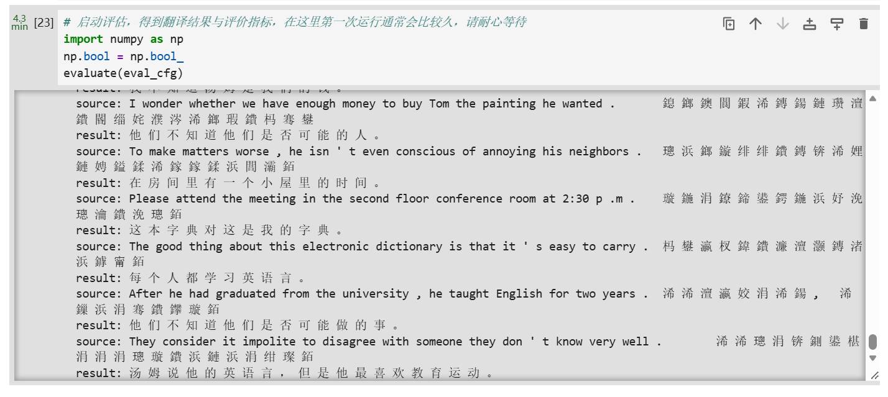
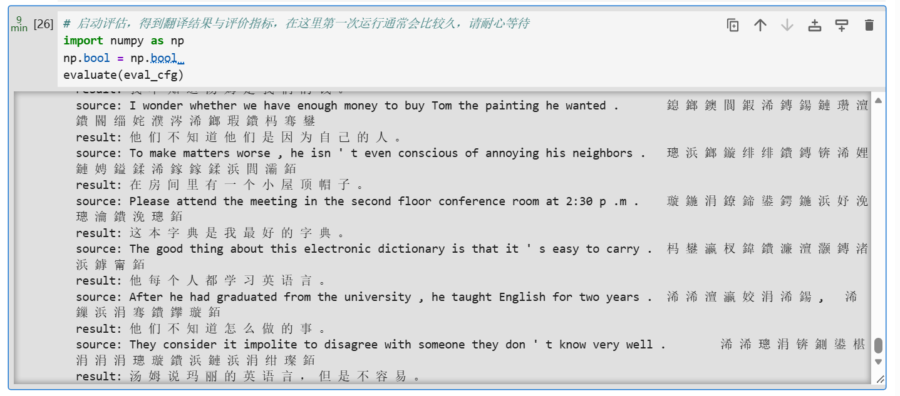

# Assignment 2: 机器翻译实验

## Project Introduction

> 内容包括：（这部分内容不要太长，讲清楚即可）
>
> 1. 实验简介，即要做什么事情
>
> 2. 开发环境及系统运行要求，包括所用的开发工具、开发包、开源库、系统运行要求等

### 实验简介

本实验为Transformer 中英文翻译实验，基于 attention 注意力机制、transformer 架构 实现 中英文翻译.

### 开发环境及系统运行要求

环境：MindSpore 2.7.2，Ascend 版本，镜像为`mindspore_ascend:mindspore_2.7.2-cann_8.5.2-py_3.11-hce_2.0.2512-aarch64-snt9b-20260417155905-aabfd52`

硬件配置：1 张昇腾 Ascend Snt9，24 vCPU，192 GB主机内存

## Technical Details

> 内容包括：
>
> 1. 工程实践当中所用到的理论知识阐述
>
> 2. 具体的算法，请用文字、示意图或者是伪代码等形式进行描述（不要贴大段的代码）
>
> 3. 程序开发中重要的技术细节，比如用到了哪些重要的函数？这些函数来自于哪些基本库？功能是什么？自己编写了哪些功能函数？等等

### 环境配置

直接使用华为自己的 Jupyter Lab 来完成.

### 理论阐述

1. 基本理论：Transformer采用编码器—解码器结构，通过多头注意力捕捉词间依赖：根据Q与K的相似度计算权重，再加权汇总V。位置编码提供词序信息，残差连接和层归一化帮助稳定训练。
2. 算法流程：分词→词ID→词嵌入与位置编码→编码器→解码器→词概率。训练时将目标句右移输入解码器，通过掩码防止读取未来词，以交叉熵计算损失，用Adam更新参数。推理从起始符开始，结合编码结果逐词预测，通过束搜索保留较优候选，遇结束符停止。

## Experiment Results

> 用图文并茂的形式给出实验结果，如系统界面、操作说明、运行结果等，并对实验结果进行总结和说明，对`.ipynb`中要求的探索和实验结论进行阐述、分析，如果有做额外的探索和发现，也可以在这里附上.

### 环境配置

环境显示可能有不兼容，不管这个风险直接继续：





### 数据预处理

随机抽取样本作为测试集，开始数据预处理和复盘

至此 `data/` 会多出许多文件：



### 定义训练数据加载器



探索1：我选择了很大概率不在词库里面的一句诗“自在飞花轻似梦，无边丝雨细如愁”。可以看出



不存在的词会被映射成 id = 0

### 模型架构的定义

> 建议配合 Encoder-Decoder 架构图阅读源码（`transformer_model.py`），充分理解模型架构：
>
> - Encoder：多层自注意力 + 前馈网络
> - Decoder：掩码自注意力 + 编码器-解码器注意力 + 前馈网络
>
> 关键超参数
>
> - `hidden_size (d_model)`：表示维度
> - `num_attention_heads`：多头注意力头数
> - `num_hidden_layers`：编码器/解码器层数
>
> 思考题：若将 `num_attention_heads` 从 8 改为 1，参数量会显著变化吗？表达能力可能受什么影响？

回答：

* 参数量通常不会显著变化；但多头注意力带来的“多子空间并行建模”能力会明显减弱，可能影响表达能力和最终效果
* 多头注意力允许模型并行学习多种注意力模式和表示子空间，单头会削弱这种多样性，可能降低对复杂依赖、长距离关系、源目标对齐等的建模能力，进而影响收敛速度和最终性能. 

### 模型训练



### 模型推理

这里面有一个Unicode编码问题：

```python
f2 = open(cfg.test_source_file, 'r', encoding='gb18030', errors='ignore') # 我修改了，防止兼容问题
```

会报这个错：

```bash
---------------------------------------------------------------------------
UnicodeDecodeError                        Traceback (most recent call last)
Cell In[21], line 4
      2 import numpy as np
      3 np.bool = np.bool_
----> 4 evaluate(eval_cfg)

Cell In[20], line 84, in evaluate(cfg)
     81 sent = sent.split("<s>")[-1]
     82 sent = sent.split("</s>")[0]
---> 84 label_sent = f2.readline().strip()+'\t'
     85 print("source: {}".format(label_sent))
     86 print("result: {}".format(sent.strip()))

UnicodeDecodeError: 'gb18030' codec can't decode byte 0xa8 in position 7: illegal multibyte sequence
```

修改完重新运行得到：



### 探索

#### 模型训练

可以做的探索：

- 尝试调整 `batch_size`、`learning_rate`，观察 Loss 曲线变化和训练结果变化。

- 阅读 `lr_schedule.py`，理解“先升后降”学习率曲线的意义。

    `lr_schedule.py`里面，
    $$
    \text{learning rate}
    =
    \text{constant}
    \times
    \text{rsqrt\_hidden}
    \times
    \text{linear\_warmup}
    \times
    \text{rsqrt\_decay}
    $$
    其中真正决定“先升后降”的是 `linear_warmup` 和 `rsqrt_decay`.

    * 前期是线性升高的，原因是这一段：

        ```python
        def linear_warmup(warmup_steps, current_step):
            return min([1.0, float(current_step)/float(warmup_steps)])
        ```

        `warmup` 让模型先用较小步长更新，再逐渐进入正常训练状态，这可以防止 Loss 剧烈震荡甚至发散.

    * 后期呈现反平方根下降，原因是这一段：

        ```python
        def rsqrt_decay(warmup_steps, current_step):
            return float(max([current_step, warmup_steps])) ** -0.5
        ```

        意义是：训练前中期用较大的学习率快速寻找较优参数区域，后期则减小步长，避免在最优点附近来回震荡，使训练逐渐稳定收敛.

#### 模型推理

> 可以做的探索实验：
>
> 1. Greedy vs Beam Search：在评估前尝试设置不同的 
>
>     ```
>     eval_cfg.beam_width
>     ```
>
>     ，比较同一句子的翻译质量与推理耗时。
>
>     - `beam_width=1` 近似贪心搜索
>     - `beam_width>1` 每步保留多个候选，通常翻译质量更好但耗时更高
>
> 2. Bad Case 分析
>
>     - 查看评估结果或自行构造长句、歧义词句、专有名词句，记录失败案例并分析原因：OOV 未登录词、训练数据领域偏差、训练轮次不足、模型容量或解码策略限制等；如果可以，尝试优化模型或训练数据，以提高翻译质量。

首先查找参数位置：

```bash
grep -Rni "batch_size"
```

一开始 `beam_width` 是4，改成8的话：



额，翻译质量一下子不行了。

Deepseek的解释：

> 适度增大 `beam_width` 可以提升质量，但超过某个阈值后，质量反而可能下降，这被称为 **“Beam Search Curse”（束搜索诅咒）**。
>
> - **相对于贪婪搜索（`beam_width=1`）的提升**：Beam Search 被证实能带来稳定的性能增益。有研究显示，精心调优的 Beam Search 相比贪婪搜索，**能带来超过1个 BLEU 点的持续提升**。因为它在每一步都保留了多个最优候选，从而有更大概率避免局部最优解。
> - **“甜点区”（Sweet Spot）**：最佳 `beam_width` 通常在 **5 到 10** 之间。在你的配置中，`base` 模型设为 **8**，`large` 模型设为 **4**，都落在这个经验范围内。一项实验数据显示，`beam_width` 从1增加到**5**时，BLEU 分数从35.82提升至**37.15**的峰值。
> - **继续增大的性能衰减**：一旦超过“甜点区”，质量往往会**轻微但持续地下降**。在上述实验中，`beam_width` 从5增至10、15、20时，BLEU 分数从37.15逐步降至**36.35**。这主要是因为更宽的搜索会加剧模型偏好**生成过短、不完整的翻译**的倾向，导致 BLEU 等指标下降

## References

>  给出主要的参考文献，可以是论文、网站、书籍、别人的技术报告等；对ai使用进行简单的声明，阐述清楚在哪个部分使用了ai、如何使用的.

Tranformer 论文链接：[[1706.03762] Attention Is All You Need](https://arxiv.org/abs/1706.03762)

仅仅使用AI查阅了探索内容的资料.

> 备注：代码中请给出较为详细的注释，并且提交 `.ipynb`的时候保留在notebook上跑出来的输出，此报告中切勿粘贴大量代码，否则扣分. 提交实验报告的pdf版本和word或markdown纯文字版用于查重/ai评分. 

本实验几乎没有任何要书写的代码.