# Lab 2: 抢占式内核线程调度

[TOC]

> [实验文档地址](https://os.pages.zjusct.io/fa26/doc-shoulidan/lab2/)
>
> 本次实验的目标是：**实现抢占式内核线程调度，让多个任务能够在一个 CPU 上通过时间复用的方式交替运行**.

## 环境配置

```bash
git checkout -b lab2
git fetch upstream
git merge upstream/lab2
```

需要把`csr.h`里面的空白代码改成lab1的实现，防止后续编译出错.

同时在`log.h`里面修改以下内容：

```c
#define LOG_LEVEL LOG_LEVEL_DEBUG  // 原来是 LOG_LEVEL_WARNING
```

## 内存管理

### 笔记1

RISC-V 里面，**系统只会映射其中的一小部分地址作为物理内存，其余地址范围通常保留给外设、固件、I/O 总线等**，比如：

- 某些区域存放固件或测试寄存器（如 `mrom`, `sifive.test`）

    ```
    0000000000001000-000000000000ffff (prio 0, rom): riscv_virt_board.mrom
    0000000000100000-0000000000100fff (prio 0, i/o): riscv.sifive.test
    ```

- 某些区域对应定时器、PLIC（中断控制器）、串口、virtio 设备等外设

    ```
    000000000c000000-000000000c5fffff (prio 0, i/o): riscv.sifive.plic
    0000000010000000-0000000010000007 (prio 0, i/o): serial
    0000000000101000-0000000000101023 (prio 0, i/o): goldfish_rtc
    ```

在访问/写入某些地址空间的时候，实际上是利用了**Memory-Mapped I/O（MMIO）**机制（通过“内存地址空间”来操纵外设），通过总线把数据读写到某个外设寄存器上.

在 lab 1 里面，`0x80000000-0x87ffffff` 这 128MB 的物理内存的划分：

- `0x80000000-0x801fffff`：OpenSBI 占用
- `0x80200000-_ekernel`：内核占用
- `_ekernel-0x87ffffff`：可以自由使用的物理内存

---

关于内存碎片的处理方法，其中一个经典方案是 Buddy System：

> 1. **内存划分规则**
>     - 假设我们有一段连续的物理内存，总大小是  页. 
>     - 系统按 **2 的幂次方大小**划分内存块：1 页、2 页、4 页……直到  页. 
>     - 每次分配时，如果需要的大小不是 2 的幂，会自动向上取整. 
> 2. **分配过程**
>     - 找到能满足需求的最小块，如果没有，就从更大的块中“劈开一半”. 
>     - 每劈一次，就会得到一对“伙伴块”（buddy）. 
> 3. **释放过程**
>     - 当一个块被释放后，系统会检查它的伙伴是否空闲. 
>     - 如果伙伴也空闲，就将两者合并成更大的块，并继续向上合并，直到不能合并为止. 
>     - 这样可以减少碎片，使得大块空间能重新腾出来. 

本实验给出了简化版的 Buddy System 物理内存分配器（位于 `mm.c` / `mm.h`）的实现，接口位于`kernel/arch/riscv/include/list.h`，可以使用 `alloc_page(<# pages>)` 和 `free_pages(<reg name>)` 来实现.

---

侵入式链表（intrusive linked list）：

<center>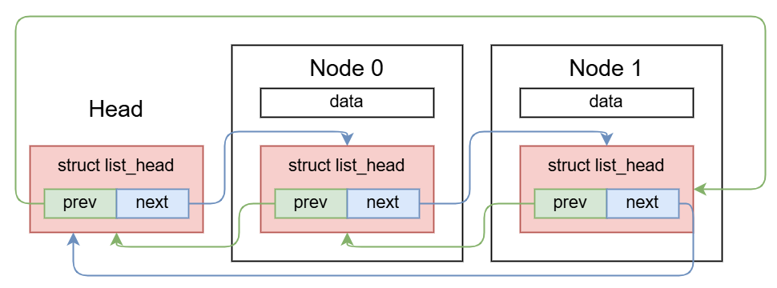</center>

```c
struct list_head {
    struct list_head *next, *prev;
};
#define LIST_HEAD_INIT(name) { &(name), &(name) }
#define LIST_HEAD(name) struct list_head name = LIST_HEAD_INIT(name)
static inline void list_add(struct list_head *new, struct list_head *head);
static inline void list_del(struct list_head *entry)

// 使用例
struct data_node_A {
    int data;
    struct list_head list;
} a;
struct data_node_B {
    char data;
    struct list_head list;
} x;
LIST_HEAD(list_A);
LIST_HEAD(list_B);
list_add(&a.list, &list_A);
list_add(&x.list, &list_B);
```

这里面相当于**建构了2种node（数据 node 和 纯链表node）** + **纯链表node之间的联系**（用`list_head`来联系），把data做了间隔，从而实现了函数复用（泛型编程）. 比如这里`list_add`不需要对各种数据类型分别进行定义，实现了复用. 如果是普通链表就不得不这样写：

```c
struct data_node_A {
    int* data;
    struct data_node_A *next, *prev;
} a, *list_A = NULL;
struct data_node_B {
    char* data;
    struct data_node_B *next, *prev;
} x, *list_B = NULL;
static inline void list_A_add(struct data_node_A *new, struct data_node_A *head);
static inline void list_B_add(struct data_node_B *new, struct data_node_B *head);

// 使用例
list_A_add(&a, list_A);
list_B_add(&x, list_B);
```

而通过 `list_A` 这种链表头来访问 `data_node_A` 结构体的方法是，定义 `container_of` 这个结构宏，通过内存的摆放来找到 data 的实际地址，从而计算出`data_node_A`的起始地址：

```c
// kernel/arch/riscv/include/list.h
#define container_of(ptr, type, member) ({          \
    const typeof( ((type *)0)->member ) *__mptr = (ptr); \
    (type *)( (char *)__mptr - offsetof(type,member) );})
...
struct data_node_A a;
struct list_head *p = &a.list;
struct data_node_A *q = container_of(p, struct data_node_A, list);
assert(q == &a); // q 恰好指向 a 的起始地址
```

这也顺带实现了双向队列.

### Task 1: 侵入式双向循环链表的实现

这个比较简单，但是细节我踩中了一堆坑，基础太差了.

首先是这个，虽然编译不会出错，但是为了robustness还是写一句吧：

```c
static inline void list_del(struct list_head *entry)
{
	/* Lab2 Task1 */
	struct list_head *prev = entry->prev;
	struct list_head *next = entry->next;
	prev->next = next;
	next->prev = prev;
	INIT_LIST_HEAD(entry); // 把entry的连接彻底初始化
}
```

还有这个：

```c
static inline int list_empty(const struct list_head *head)
{
	/* Lab2 Task1 */
	return head->next == head; // 一开始写了 head->next == NULL，大错特错
}
```

这里的遍历语法我记不清了，搜了一下：

```c
#define list_for_each(pos, head) for ((pos) = (head)->next; (pos) != (head); (pos) = (pos)->next) /* Lab2 Task1 */
```

加括号是为了防止以后有inline展开之后优先级混乱.

编译通过：

<center>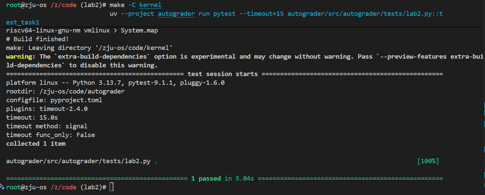</center>

### 笔记2

空闲链表缓存：`object cache`.

> [!WARNING]
>
> 阅读 `cache.h` 和 `cache.c`，理解空闲链表缓存的实现. 画一幅图，展示相关的数据结构及其布局. 
>
> <center>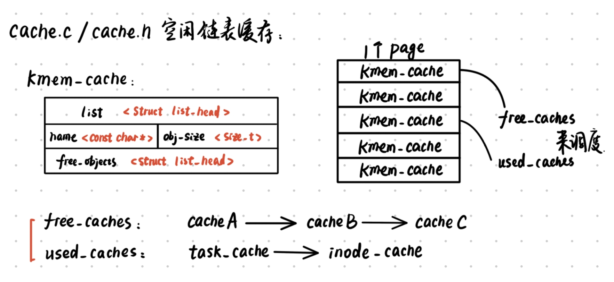</center>

> [!NOTE] 
>
> 内存管理与基础数据结构：
>
> - Buddy System 与对象缓存（`kmem_cache`）的职责边界分别是什么？分别适用哪些场景？
>
>     * Buddy System：内存**页**碎片的收集，便于管理和优化内存空间;
>     * `kmem_cache`：构建在 Buddy System 之上的**对象级缓存层**，粒度相对更小一点.
>
> - 释放页框时，Buddy 为什么能“向上合并”？伙伴块（buddy）的地址如何根据当前块大小计算？
>
>     因为引入了让 block 强制按大小对齐的机制，通过判断 buddy block 块是否空闲，决定是否合并，进而递归向上合并，直到无法再合并为止. 可以保证管理的有效性.
>
> - 侵入式双向循环链表为何能实现“泛型”？`container_of` 如何从 `list_head*` 还原到宿主结构体指针？
>
>     * 因为这里面相当于**建构了2种node（数据 node 和 纯链表node）** + **纯链表node之间的联系**（用`list_head`来联系），把data做了间隔，从而实现了函数复用（泛型编程）. 比如这里`list_add`不需要对各种数据类型分别进行定义，实现了复用. 
>
>     * 因为 `container_of` 这个结构宏能通过内存的摆放来找到 data 的实际地址，减去实际偏移量，从而计算出`data_node_A`的起始地址.
>
>         ```c
>         (type *)( (char *)ptr - offsetof(type, member) )
>         ```
>
> - 实现 `list_add`/`list_add_tail`/`list_del` 时，带哨兵循环链表有哪些易错点（例如自环、顺序、空表判断）？
>
>     * 自环：额，我就犯了这个错误，为了不引发麻烦，`list_del` 需要最后做 `INIT_LIST_HEAD(entry);`.
>     * 顺序：要判断最后一个跟哨兵节点不一样才算tail
>     * 空表：额，我就犯了这个错误，判断为空应该写 `head->next == head`.

## 进程切换与内存处理

> 本节我们探究实现用于切换进程上下文的汇编函数 `__switch_to()`，以及进程切换与 Trap 处理的相互影响.

### 笔记3

这段话似乎没办法写点什么高度概括的笔记了.

<center>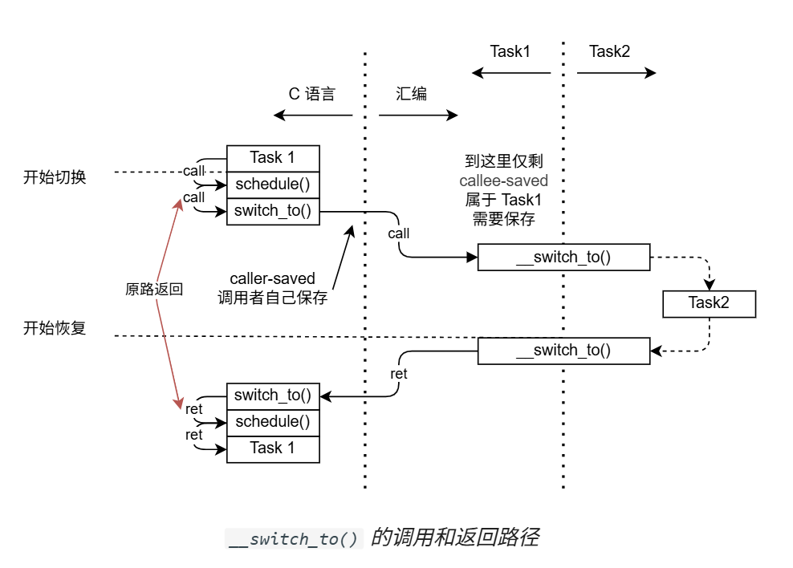</center>

`__switch_to()` 需要保存的进程上下文：

- `ra`：函数返回地址，我们需要它来返回到调用 `__switch_to()` 的位置
- `sp`、`s0-s11`：调用约定中规定的 callee-saved 寄存器

内核抢占需要综合考虑时钟中断、系统调用等 Trap 情况. **抢占**通过在 **Trap** 退出路径上视情况**调度 (schedule)**实现.

内核中不能被 trap 的部分：

* 自动执行禁用中断的设置：`sstatus.SPIE = sstatus.SIE` (Previous IE 保存了中断使能状态), `sstatus.SIE = 0` (Interrupt Enable 直接被禁用，说明不能中断了)

* **Trap 处理过程不会被 Trap**.

访问共享资源的代码区域称为**临界区 (Critical Region)**，必须识别出这些临界区，并使用保护机制来防止并发访问.

进程切换的两种可能性：

1. **非抢占式**：发生时机确定，在进程主动调用 `__switch_to()` 时发生；
2. **抢占式**：发生时机不确定，只要发生（时钟）中断，`trap_handler()` 就会调用 `__switch_to()`，发生进程切换

临界区保护：可以阅读 `csr.h` 中的 `interrupt_save()` 和 `interrupt_restore()` 函数，理解它们是如何操作 `sstatus` 寄存器来开启和关闭中断的：

```c
// csr.h 
void interrupt_save(void);
void interrupt_restore(void);
```

> [!NOTE]
>
> - **`__switch_to()` 为什么只需要保存 `ra`、`sp`、`s0–s11`？**
>     * 首先因为这是一个 callee-saved 函数，必须保证 `s0–s11`（保存寄存器）和 `sp`（栈指针）在它执行前后保持不变；
>     * 其次比较特殊的是 `ra` 这个寄存器，虽然是 caller-saved，但是因为将来需要做 Task 1 的 return 恢复，所以必须要保存返回的地址.
>
> - **蹦床函数（`__kthread`）是如何运行的？请说明 `ra`、`sp`、`s0/s1` 的设置意图.**
>
>     这个函数看注释是写在了`entry.S`里面：
>
>     ```assembly
>     __kthread:
>         csrs sstatus, SSTATUS_SIE
>         mv ra, s0
>         mv a0, s1
>         ret
>     ```
>
>     意思是：首先令 CSR 寄存器 `sstatus.SIE` 这一位置为1，中断使能开启；（我又忘记了这伪指令在干什么）
>
>     | `csrr rd, csr` | 读取 CSR     |
>     | -------------- | ------------ |
>     | `csrw csr, rs` | **写入** CSR |
>
>     然后令`ra`的值是`s0`，`a0`的值是`s1`，再返回`ra`现在指向的地址，这相当于**把预先放在 `s0` 里的线程入口函数地址设置为接下来要跳转的目标**，最终效果是跳转到 `s0` 保存的线程函数，且第一个参数为 `s1`.
>
>     把内容放在 `s1` 里面保存主要是因为这是 callee-saved 寄存器，如果是属于 caller-saved 寄存器的 `a0`，会直接被修改掉丢失原值.
>
> - **为什么 `__switch_to()` 不能被抢占？**
>
>     感觉是跟文档上面提到的 双重进程抢占 有关，
>
>     <center>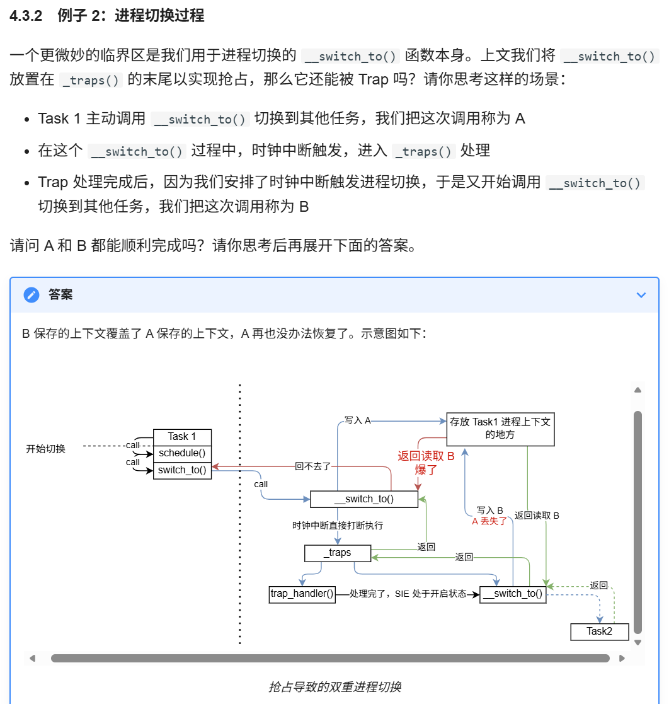</center>
>
> - **为什么调度点必须放在 `trap_handler()` 尾部？若在 Trap 处理中切换会导致哪些具体问题？**
>     * 这样 `sepc`（异常返回地址）和 `sstatus`（中断状态）这些关键 CSR 寄存器的状态可能会出问题；
>     * 内核栈出问题：`trap_handler()` 运行在**当前进程的内核栈**上，中途切换会导致执行流冻结，进而出现一系列问题.
>
> - **为什么 `_traps()` 需要额外保存 `sstatus`？`sret` 依据 `SPIE` 如何决定是否重新开启中断？**
>     * 进程 A 在 `_traps()` 中被切走时，它的 `sstatus` 被硬件自动更新（例如 `SIE` 被清零，`SPIE` 记录之前的状态）. 随后进程 B 运行，进程 B 也会触发 Trap，从而**修改全局的 `sstatus` CSR 寄存器**. 如果 `_traps()` 不把进程 A 的 `sstatus` 压入它自己的内核栈，当进程 A 恢复运行时，它将面对一个被进程 B 篡改过的 `sstatus`，导致中断状态错误. 因此只要发生上下文切换，必须把 `sstatus` 等关键 CSR 保存到当前进程的栈帧中.
>     * 上面提到过 RISC-V 的 `sret` 指令在执行返回时，硬件会自动执行 `sstatus.SIE = sstatus.SPIE`，同时 `SPIE` 会被置为 1，这样return之后可以根据 `SIE` 决定是否重新开启中断.
>
> - **六种切换情形中，哪些路径上需要谁来“开启中断”？请逐一给出理由. **
>
>     首先，进入 `__switch_to()` 时，中断一定是关闭的. 按照文档的意思：
>
>     <center>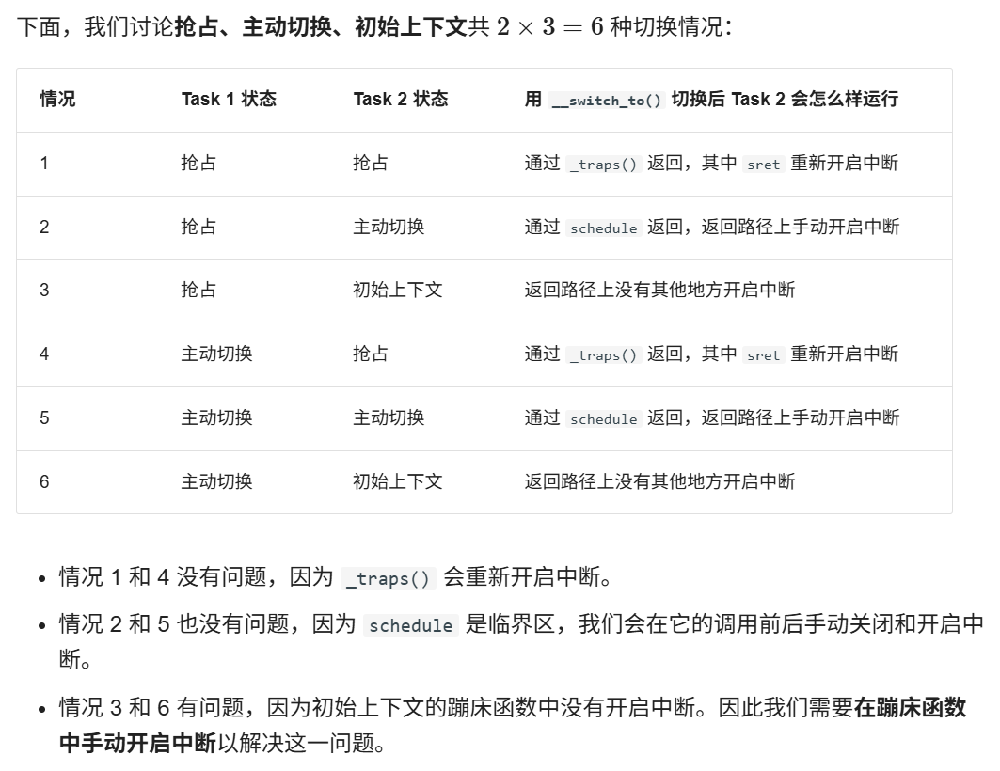</center>
>
>     * 1, 4：Task 2 抢占，需要 `_traps()` 调用 `sret` 开启中断
>
>     * 2, 5：Task 2 主动切换，并没有进入 trap，由于 `schedule()` 处于一个临界区，所以内核已经有使能的处理方法
>
>     * 3, 6：Task 2 初始上下文，这样子没有 `sret` 来开启中断，也没有 `schedule()` 调用内核使能来处理，所以用蹦床函数 `_kthread()` 手动开启中断：
>
>         ```assembly
>         csrs sstatus, SSTATUS_SIE
>         ```
>

说起来，把`__kthread`比喻成蹦床有点抽象了，DeepSeek V4.1 Flash 给我的解释是：

> `__kthread` 就像是新线程的“发射架”，它用最短的代码、最巧妙的寄存器操作，完成参数传递、开中断等准备工作，然后通过修改 `ra` 并 `ret`，将新线程“弹射”进真正的函数入口. 因为这种“只负责中转，绝不回头”的特性，被称为蹦床函数再贴切不过了

---

进程的数据结构：

需要存储的信息包括：

- `uint64_t pid` 进程 ID
- `struct thread_struct thread` 进程的上下文
- `void *stack` 进程的栈

多进程复用同一个栈会导致冲突：

<center>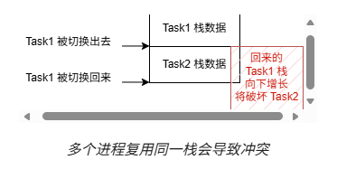</center>

因此需要让不同进程的 Trap 上下文分离，将上下文存到不同的栈上. 代码实现：

```c
struct task_struct {
	struct list_head list; /**< 进程链表 */
	uint64_t pid; /**< 进程 ID */
	struct thread_struct thread; /**< 线程上下文 */
	void *stack; /**< 栈指针 */
	uint64_t state; /**< 进程状态 */
	struct sched_entity se; /**< 调度实体 */
};
```

同时用 thread pointer 寄存器 `tp` 来内联汇编，便于查看当前进程信息：

```c
register struct task_struct *current asm("tp");
```

### Task 2:设置初始进程

有点坐牢了，搜想要的函数和变量名很花时间.

首先是运行的状态的宏定义在 `sched.h`：

```c
#define TASK_RUNNING 0
#define TASK_DEAD 4
```

其次是 `struct sched_entity` 这个定义在 `sched.h` 上：

```c
struct sched_entity {
	uint64_t runtime; /**< 时间片 */
	uint64_t sum_exec_runtime; /**< 已执行时间 */
};
```

我的实现：

```c
void task_init(void)
{
	// 使用 kmem_cache_create() 创建 task_struct 对象缓存池，
	task_cache = kmem_cache_create("task_struct", sizeof(struct task_struct));

	/* Lab2 Task2 */
	// 并分配一个新的 task_struct 结构体作为初始进程
	struct task_struct *task_1 = (struct task_struct *)kmem_cache_alloc(task_cache);
	memset(task_1, 0, sizeof(struct task_struct)); // 清空脏数据

	// 初始化该进程的各项字段，包括 pid、stack、state、se（调度实体，见 Part4）等. 
	task_1->pid = 0;
	task_1->stack = NULL;
	task_1->state = TASK_RUNNING; // sched.h里面定义的
	task_1->se = (struct sched_entity){0,0}; // 似乎能这么写吧

	// 并将其加入进程链表（task_list）
	INIT_LIST_HEAD(&task_1->list);
	list_add(&task_1->list, &task_list);
	// 将该进程设置为当前运行进程（把新分配的task地址写入tp寄存器里）
	current = task_1;
}
```

最后一行一开始漏掉了，然后死活想不明白怎么回事. 问了ChatGPT才发现这个问题的.

`task_1->pid = 0;` 这句话很迷，我是调用了 `create_pid()` 这个函数，却得到 `AssertionError: Expected pid to be 0, got 1`，究其原因大概是，初始进程约定为0，而函数体内的`pm_nr_tasks` 初始就已经被赋了1这个值吧.

通过结算：

<center>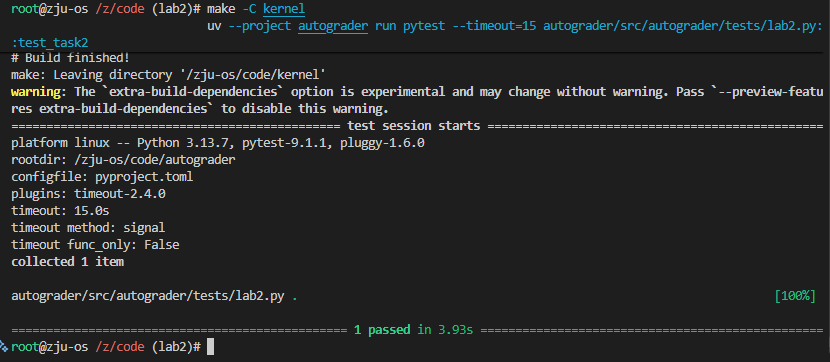</center>

##  进程生命周期

### 笔记4

Unix 进程模型将进程创建分为两步：

1. `fork()`：**复制**当前进程，创建一个新进程
2. `exec()`：在当前进程的上下文中**加载**并执行一个新的程序

**组合优于复杂接口**：`fork()` 后 `exec()` 前，可以自由配置新的进程；内核引入新的功能时，也无需修改 `fork`/`exec` 的接口，比直接创建（Windows系统的实现）更加灵活.

这次需要实现的是支撑这两个顶层封装函数的两个辅助函数：

- `copy_process()`：**拷贝**当前 Task
- `kernel_thread()`：修改前者创建的 Task，在其中**运行新的函数**

### Task 3：实现进程复制与加载

* `copy_process()`：

    ```c
    struct task_struct *copy_process(struct task_struct *old)
    {
    	/* Lab2 Task3 */
    	struct task_struct *new_proc;
    	// 复制当前进程的数据结构，
    	new_proc->thread = old->thread;
    	new_proc->state = old->state;
    	// 分配新的内核栈，
    	new_stack = alloc_page();
    	// 分配唯一的进程号，
    	new_proc->pid = create_pid();
    	// 并初始化调度相关字段（见 Part4），
    	new_proc->se = (struct sched_entity){0,0};
    	// 将新进程加入进程链表
    	list_add_tail(&new_proc->list, &task_list);
    	return new_proc;
    }
    ```

    一开始是这么写的，然后就寄掉了，修正版：

    ```c
    struct task_struct *copy_process(struct task_struct *old)
    {
    	/* Lab2 Task3 */
    	struct task_struct *new_proc = (struct task_struct *)kmem_cache_alloc(task_cache);
    	if (old == NULL) old = current;
    	// 复制当前进程的数据结构，
    	memcpy(new_proc, old, sizeof(*new_proc));
    	// 分配新的内核栈，
    	new_proc->stack = alloc_page();
    	// 分配唯一的进程号，
    	new_proc->pid = create_pid();
    	// 并初始化调度相关字段（见 Part4），
    	new_proc->state = TASK_RUNNING;
    	new_proc->se = (struct sched_entity){0,0};
    	// 将新进程加入进程链表
    	INIT_LIST_HEAD(&new_proc->list);
    	list_add_tail(&new_proc->list, &task_list);
    	return new_proc;
    }
    ```

    问题非常多，首先是 `new_proc` 还是得从 `task_cache` 里分配一个. 同时，需要判断 `old` 指针的非空情况.

    之后是 `state` 必须设置成 `TASK_RUNNING`.


* `kernel_thread()`：

    首先看一下 `struct thread_struct` 内容：

    ```c
    struct thread_struct {
    	uint64_t ra;
    	uint64_t sp;
    	uint64_t s[12];
    };
    ```

    因此只需要：

    ```c
    struct task_struct *kernel_thread(int (*fn)(void *), void *arg)
    {
    	// 调用 copy_process() 创建新进程
    	struct task_struct *new_task = copy_process(NULL);
    
    	/* Lab2 Task3 */
    	// 设置新进程的初始上下文，通过 struct thread_struct 向蹦床函数传递要运行的函数和参数
    	new_task->thread.ra = (uint64_t)__kthread;
    	new_task->thread.sp = (uint64_t)new_task->stack + PGSIZE;
    	new_task->thread.s[0] = (uint64_t)fn;
      	new_task->thread.s[1] = (uint64_t)arg;
    	
    	return new_task;
    }
    ```

    这个函数将上下文保存完，返回整个信息，之后调用 `__kthread` 会得到：先开启中断，再把 `s0` 中保存的 `fn` 放入 `ra`，把 `s1` 中保存的 `arg` 放入参数寄存器 `a0`，最后跳转到 `fn`. 按照 RISC-V 调用约定，函数的第一个参数放在 `a0`，所以就开始执行 `fn(arg) `. 

通过结算：

<center>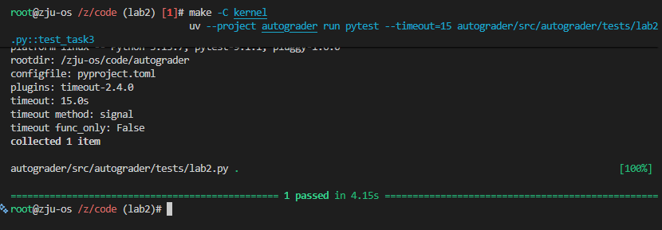</center>

### 笔记5

> **进程没有办法析构自己**，因为如果进程析构自身，那么析构工作也是进程运行的一部分. 只要进程仍在运行状态，释放相关资源就可能导致悬空指针等问题. 
>
> 因此可以将进程的析构设计为退出和销毁两个阶段：
>
> - `do_exit()`：进程完成所有任务后调用该函数，将自身状态置为 `TASK_DEAD`，然后主动发起调度，此后它再也不会被调度运行，可以安全释放
> - `release_task()`：调度离开上一步的进程后，随时可以释放其资源
>
> 我们还会实现一个辅助函数：
>
> - `kthread()`：内核线程的 **Wrapper**，只是为了帮助在每个内核线程结束后调用 `do_exit()`，这样就不用让所有工作函数都显式调用 `do_exit()` 了. 
>
>     ```c
>     noreturn int kthread(void *arg)
>     {
>         struct kthread_create_info *info = arg;
>         int (*threadfn)(void *) = info->threadfn;
>         void *data = info->data;
>         int ret = threadfn(data);
>         do_exit(ret);
>     }
>     ```
>
>     一个例外是 `kthreadd` 线程（在刚刚的 Task 中见过），**它是第一个内核线程，负责创建其他内核线程**. **它永远不会退出**，因此不需要 `kthread()` 包装.

> [!NOTE]
>
> 进程数据结构与生命周期
>
> - 为什么每个任务必须有独立内核栈？
>
>     多进程复用同一个栈会导致冲突, 文档里写了：
>
>     <center></center>
>
> - `current` 与 `tp` 的绑定带来什么便利？在 C 代码中使用它时要注意什么？
>
>     * 便利：可以随时随地用C语言看内核状态
>
>     * 注意：emm, maybe 内联汇编的语法？
>
> - `task_init()` 至少需要初始化哪些关键字段，如何把它设为当前任务并加入 `task_list`？
>
>     * 至少要初始化 `pid`, `stack`, `state`, `se`
>
>     * 对应的代码是：
>
>         * 设为当前任务
>
>             ```c
>             // 把新分配的task地址写入tp寄存器里
>             current = task_1;
>             ```
>
>         * 加入 `task_list`
>
>             ```c
>             // 并将其加入进程链表（task_list）
>             INIT_LIST_HEAD(&task_1->list);
>             list_add(&task_1->list, &task_list);
>             ```
>
> - `copy_process()` 哪些字段应该“复制”，哪些必须“重新初始化”？
>
>     * 应该复制：`thread`
>     * 重新初始化：`pid`, `stack`, `state`, `se`
>
> - `kernel_thread()` 如何构造新任务的初始上下文才能正确跳到 `__kthread` 并传参？
>
>     设置好 `ra`, `sp` 以及 `s0`/`s1` 从而确保跳转的成功和寄存器的赋值成功.
>
>     代码：
>
>     ```c
>     	new_task->thread.ra = (uint64_t)__kthread;
>     	new_task->thread.sp = (uint64_t)new_task->stack + PGSIZE;
>     	new_task->thread.s[0] = (uint64_t)fn;
>     	new_task->thread.s[1] = (uint64_t)arg;
>     ```

## 调度器

### 笔记6

<center>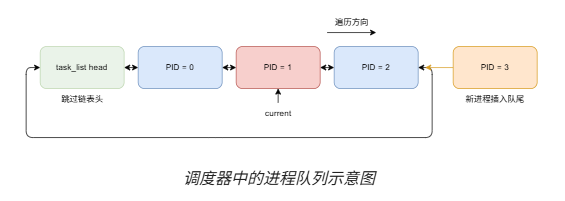</center>

Round-Robin 算法在课上讲过了，是一个 preempted 调度的方法.

> **调度顺序**：
>
> - 进程的调度遵循 FCFS 的原则，因此在将进程加入任务队列时，应确保新进程被添加到**队列的末尾**. 
> - 当进程的时间片耗尽，从**当前进程** (current) 开始向后寻找下一个就绪进程进行调度. （双向循环链表其实是一个环，按图示方式进行循环遍历即可维护 FCFS 的调度顺序）
>
> **时间片管理**：
>
> - 每个进程在被调度时，都会获得一个固定的时间片（`TIME_SLICE`）. 
> - 在每次 `schedule()` 调用时，应当**计算调度间隔**，并对当前进程的调度时间并进行更新. 

此时终于知道前文的两个莫名其妙的字段是做什么的了：

```c
struct sched_entity {
    uint64_t runtime; /**< 当前剩余时间片 */
    uint64_t sum_exec_runtime; /**< 已执行时间 */
};
```

### Task 4：实现时间片轮转调度和抢占

破绷了，这一节的代码完全不知道在做什么.

缝缝补补得到这个结果：

* `sched.c`：

    ```c
    void schedule(void)
    {
    	uint64_t flags;
    	interrupt_save(&flags);
    	struct task_struct *next_task = NULL;
    
    	/* Lab2 Task4 */
    	/* 从当前任务之后开始轮转，绕一圈后也检查当前任务.  */
    	struct list_head *p = current->list.next;
    	while (1) {
    		// task_list 是哨兵节点，需要跳过
    		if (p == &task_list) {
    			p = p->next;
    			continue;
    		}
    		// 当前指向的 task 节点的结构体
    		struct task_struct *task = container_of(p, struct task_struct, list);
    		if (task->state == TASK_RUNNING) { // 找到合适的仍在 running 的 task，
    			next_task = task;
    			break;
    		}
    		if (p == &current->list) // 空列表
    			break;
    		p = p->next; // 暂时没合适的，接着找
    	}
    
    	if (next_task) // 如果找到了 next_task，那么给它分配一个时间片，表示能允许最多运行这么久
    		next_task->se.runtime = TIME_SLICE;
    
    	if (next_task) {
    		if (next_task != current) {
    			LOG_DEBUG("Schedule to [PID = %" PRIu64 "]\n",
    				  next_task->pid);
    			switch_to(next_task);
    		}
    	} else {
    		LOG_ERR("No suitable task found.\n");
    		for (;;)
    			;
    	}
    	interrupt_restore(&flags);
    }
    ```

* `trap.c`增加：

    ```c
    ...	
    	/* Lab2 Task4 */
    	/* 调度期间 CSR 可能被其他线程的 Trap 覆盖.  */
    	uint64_t saved_sstatus = csr_read(sstatus);
    	if (scause == SCAUSE_STI) {
    		/* 覆盖 Lab1 的一秒定时，使用调度器的中断周期.  */
    		sbi_set_timer(csr_read(time) + TIMER_INTERVAL);
    		
    		/* 启动任务已创建 kthreadd 和测试任务，交接后不再运行.  */
    		if (current->pid == 0) do_exit(0);
    		current->se.sum_exec_runtime += TIMER_INTERVAL / (TIMECLOCK / 1000000);
    		
    		if (current->se.runtime > TIMER_INTERVAL)
    			current->se.runtime -= TIMER_INTERVAL;
    		else
    			current->se.runtime = 0;
    
    		if (current->se.runtime == 0)
    			schedule();
    	}
    	csr_write(sstatus, saved_sstatus);
    }
    ```

* `proc.c`

    ```c
    noreturn void do_exit(int exit_code)
    {
    	/* Lab2 Task4 */
    	uint64_t flags;
    	interrupt_save(&flags); // 根本想不出来要干这个事
    	(void)exit_code;
    	current->state = TASK_DEAD;
    	current->se.runtime = 0;
    
    	schedule();
    	/* 死亡线程不应再次运行，也不能从 noreturn 函数返回.  */
    	for (;;)
    		asm volatile("wfi");
    }
    ```

    说实话，没有AI的话我是不可能想出来12-13行这个玩意的.
    
    ```c
    void release_task(struct task_struct *task)
    {
    	int pid = task->pid;
    	LOG_DEBUG("Release [PID = %" PRIu64 "]\n", pid);
    
    	/* Lab2 Task4 */
    	// 内核线程的销毁，应该是这样就行了
    	list_del(&task->list);
    	if (task->stack != NULL) free_pages(task->stack);
    	kmem_cache_free(task_cache, task);
    
    	LOG_DEBUG("Release [PID = %" PRIu64 "] Done\n", pid);
    }
    ```

评测结果：

<center>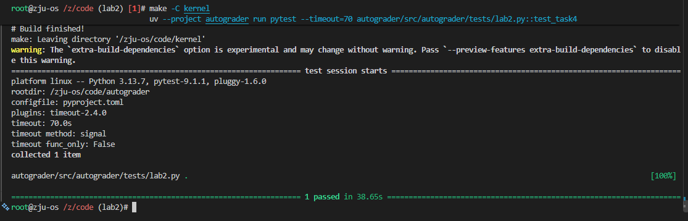</center>

> [!IMPORTANT]
>
> 5个进程的调度情况：
>
> ```text
> Process 1 started at 0,  finished at 19
> Process 2 started at 1,  finished at 3
> Process 3 started at 4,  finished at 9
> Process 4 started at 5,  finished at 8
> Process 5 started at 8,  finished at 18
> ```
>
> 以题目给出的请求创建时间 A 为起点，完成时间为 C，运行时间为 B：
>
> - 周转时间：T=C-A
>
> - 等待时间：W=T-B
>
> - 响应比：R=(W+B)/B=T/B
>
>     最终计算结果：
>
> | 进程 | 请求创建时间 A | 运行时间 B | 完成时间 C | 周转时间 T | 等待时间 W | 响应比 R |
>| ---- | -------------: | ---------: | ---------: | ---------: | ---------: | -------: |
> | 1    |              0 |         10 |         19 |         19 |          9 |     1.90 |
> | 2    |              1 |          1 |          3 |          2 |          1 |     2.00 |
> | 3    |              4 |          2 |          9 |          5 |          3 |     2.50 |
> | 4    |              5 |          1 |          8 |          3 |          2 |     3.00 |
> | 5    |              8 |          5 |         18 |         10 |          5 |     2.00 |
> | 平均 |                |            |            |     7.8 秒 |     4.0 秒 |     2.28 |

> [!IMPORTANT]
>
> 实际上我做了5组实验，结果收集如下：（表中开始、完成时间均按进程 1～5 排列，单位为秒，日志只保留整数秒）
>
> |    TIMER_INTERVAL |      TIME_SLICE | 开始时间                      | 完成时间          |
> | ----------------: | --------------: | ----------------------------- | ----------------- |
> |             10 ms | 50 ms（原配置） | 0、1、4、5、8                 | 19、3、9、8、18   |
> |             10 ms |             2 s | 0、4、7、9、12                | 18、5、12、10、19 |
> |            500 ms |           50 ms | 0、1、4、6、9                 | 19、3、10、9、19  |
> |            100 ms |          150 ms | 0、1、4、5、8                 | 19、3、9、8、18   |
> | 1 tick，即 0.1 μs |         5 ticks | 观察 5 秒，无测例进程开始运行 | 无                |
>
> 这表明：（ChatGPT总结的）
>
> 1. 时间片增大，响应变慢：2 秒时间片下，进程 2 虽然在第 1 秒请求创建，却直到第 4 秒才开始运行. 它既要等待 kthreadd 处理请求，也要等待自身获得 CPU. 时间片足够大时，RR 的行为趋近于先来先服务. 
> 2. 时间片小于中断周期，无法获得预期的轮转频率：500 ms 中断周期下，50 ms 时间片只能在下一次中断时被检查，所以一次完整时间片实际上约为 500 ms. 继续减小时间片也无法突破这一粒度. 
> 3. 时间片不是中断周期的整数倍，会向上取整：忽略开销且线程不主动退出时，实际时间片约为
>
>     $$
>     Q_{\mathrm{eff}}=\left\lceil\frac{Q}{I}\right\rceil I
>     $$
>    
>    因此，100 ms 周期、150 ms 时间片实际需要两次中断，约为 200 ms. 本次秒级输出与基准相同，说明粗粒度日志可能掩盖调度差异. 
> 4. 中断周期过小，会产生中断风暴，还可能破坏计时：1 tick 实验在 5 秒内打印了 83158 次时钟中断，却没有测例进程开始运行. 中断和打印开销已远超设定周期. 此外，当前运行时间累计表达式为：
>    
>    ```c
>    TIMER_INTERVAL / (TIMECLOCK / 1000000)
>    ```
>    
>    当 `TIMER_INTERVAL=1` 时，整数除法得到 1/10=0. 即使线程开始执行，累计运行时间也不会增长，测例无法正常结束. 
> 5. 中断周期过大，会使运行时间统计和完成判断过于粗糙：例如每次累计 3 秒，那么需要运行 1 秒和 2 秒的线程，都要等至少一次中断才能满足退出条件；创建请求的检查也可能被推迟. 这一点是根据代码推导，未包含在上述实测组中. 

> [!NOTE]
>
> - RR 调度中时间片如何消耗与补充？当时间片耗尽时如何选择下一个任务？此选择与进程链表遍历顺序的关系是什么？
>
>     * 在每一次时钟中断处理完之后，当前任务的剩余时间片 `se.runtime` 减少 `TIMER_INTERVAL`；不足一个周期时直接置零，避免无符号数下溢，同时累加 `se.sum_exec_runtime`；
>     * 通过链表顺序往后选一个running状态的任务
>     * 链表顺序遍历
>
> - 抢占从哪里触发？进入和离开 `__switch_to()` 前后，对中断位（`SIE/SPIE`）分别有什么要求？为什么？
>
>     * 抢占由时钟中断触发：`trap_handler()` 更新时间片，时间片为零时调用 `schedule()`，再经 `switch_to()` 调用 `__switch_to()`. 此外，`kthreadd` 会主动让出 CPU，退出线程也会主动调用调度器
>     * 对中断位的要求是：不能在 `__switch_to()` 中无条件开中断，此时目标线程可能仍需完成调度器或 Trap 的收尾工作. 当前 `__switch_to()` 不保存 `sstatus`. 
>         * `trap_handler()` 将自己的 `sstatus` 保存在局部变量中，并在恢复执行后写回，防止其他线程的 Trap 改变 `SPIE` 等状态，导致 `sret` 后中断状态错误.
>         * `SPIE` 应保存原有语义，并非所有切换路径都要求它固定为 1.
>
> - `do_exit()` 与 `release_task()` 分别在何处调用、各自职责是什么？为什么不能让进程“自我销毁”？
>
>     * `do_exit()`在线程函数返回后，由 `kthread()` 包装函数调用；当前启动任务也会在首次时钟中断交接时调用. 它关闭中断，将当前任务标记为 `TASK_DEAD`，清空剩余时间片，再调用 `schedule()` 切走，正常情况下不再返回
>
>     * `release_task()` 在后续其他线程执行 `schedule()` 时调用，负责将死亡任务从链表移除、释放内核栈和 `task_struct`
>
>     * 原因前文讲了：
>
>         > **进程没有办法析构自己**，这一逻辑很容易理解. 如果进程析构自身，那么析构工作也是进程运行的一部分. 只要进程仍在运行状态，释放相关资源就可能导致悬空指针等问题
>
> - `kthreadd` 有何特殊性？为什么几乎不占用调度时间？异步创建对公平性/饥饿有什么影响？
>
>     * `kthreadd` 是处理内核线程创建请求的守护线程. `kthread_create()` 只把请求放入创建队列；等 `kthreadd` 获得 CPU 后，才调用 `kernel_thread()` 创建任务并加入进程链表. 
>
>         它几乎不占用完整时间片，是因为每轮处理完请求后都会执行：
>
>         ```c
>         current->se.runtime = 0;
>         schedule();
>         ```
>
>         即使没有请求，它也会立即让出 CPU，所以开销几乎为零. 
>
>     * 异步创建对公平性的影响是：
>
>         - RR 保证的是已经进入就绪链表的任务轮流运行；创建请求在队列中等待的时间不受这项保证覆盖. 
>
>         - 时间片越长，kthreadd 再次获得 CPU 的等待可能越长，新线程即使早已请求创建，也可能迟迟不能进入就绪队列. 
>
>         - 正常情况下，有限个可运行任务按 RR 轮转，kthreadd 最终会获得 CPU，创建请求通常不会永久饥饿. 
>
>         - 当前 kthreadd 会关中断并一次处理完整个请求队列. 若积压请求很多，会形成较长的不可抢占区间，推迟其他任务执行；因此“通常很快让出 CPU”不代表它在所有负载下都没有公平性问题. 

## 总结

我已经要晕倒了. Part 2 是我见过最猎奇的实验小节.

Part 4 的 debug 看了一会就放弃了，日志看不明白.
