# Lab3: Sv39 分页式虚拟内存系统

[TOC]

>  [实验文档地址](https://os.pages.zjusct.io/fa26/doc-shoulidan/lab2/)
>
> 本次实验的目标是：让内核正式进入“虚拟世界”——实现 RISC-V 的 Sv39 分页式虚拟内存系统.

## 环境配置

```bash
git checkout -b lab3
git fetch upstream
git merge upstream/lab3
```

这里的冲突处理：

首先接受 `head.S`与 `vmlinux.lds` 中的一切修改，然后观察内存栈：

```assembly
# new
	.bss : ALIGN(0x1000) {
        _sbss = .;
        _sstack = .;
        *(.bss.stack)		/* 放入所有输入文件中的 .bss.stack 段，让后面的空间属于 .bss.stack 段，并在这个段中预留 4096 字节，这样当前位置 . 就前进到了 . + 0x1000的位置*/
        . = ALIGN(0x1000);
        _estack = .;

        *(.sbss .sbss.*)
        *(.bss .bss.*)

        _ebss = .;
    } >ramv AT>ram

# old
    .bss : ALIGN(0x1000) {
        *(.bss.stack)
        . = ALIGN(0x1000);
        _sbss = .;

        *(.sbss .sbss.*)
        *(.bss .bss.*)

        _ebss = .;
    } AT>ram
```

> [!NOTE]
>
> 复习（实则是忘光了）：`= .;` 中的 `.` 表示当前位置计数器，表示当前安排到的地址.
>
> * `_sstack = .;` 意思是：把当前地址记录为符号 `_sstack` 的值. 它只给地址起名字，不分配空间，也不向内存写数据.
>
> * 而 `. = ALIGN(0x1000);` 是修改当前位置，让它向上对齐到 `0x1000`（4096 字节）的边界.

新版本的 `>ramv` 表示把这个段的运行地址放在 MEMORY 中定义的 `ramv` 区域，实际上就是 **logical addr**.

| inst     | meaning                                 | type         |
| -------- | --------------------------------------- | ------------ |
| `>ramv`  | 运行地址（VMA），代码链接时使用的地址   | 高位虚拟地址 |
| `AT>ram` | 加载地址（LMA），内核实际装入内存的位置 | 物理地址     |

而前面定义了：

```assembly
MEMORY {
    ram  (wxa!ri): ORIGIN = PHY_START + OPENSBI_SIZE, LENGTH = PHY_SIZE - OPENSBI_SIZE
    ramv (wxa!ri): ORIGIN = VM_DIRECT_START + OPENSBI_SIZE, LENGTH = PHY_SIZE - OPENSBI_SIZE
}
```

所以可以知道 `.text` 的起始地址对应为：

* 加载到物理地址：`0x80200000`
* 链接的虚拟地址：`0xffffffd600200000`

页表建立后，这两个地址映射到同一块物理内存.

所以还需要更改一下 `head.S`，把 `sp` 映射的栈地址修改成目前的布局：

原先的：

```assembly
	/* Lab1 Task1 */
    la sp, _sbss # assign sp the addr of top of the stack.
```

改成现在的：

```assembly
    /* Lab1 Task1 (new)*/
    la sp, _estack # assign sp the `new` addr of top of the stack.

    /* Lab1 Task3 */
    la t0, _traps # put the addr of _traps into reg t0
    csrw stvec, t0 # write the addr to CSR stvec
```

<center>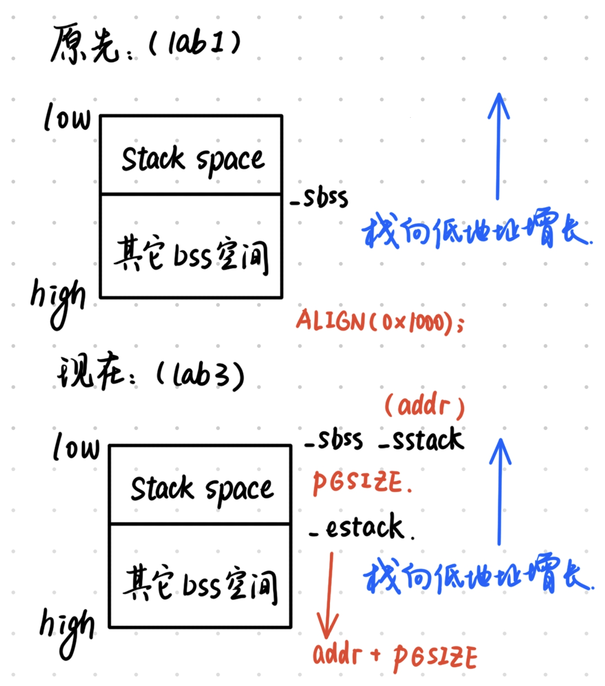</center>

## 从物理地址到虚拟地址

### 虚拟与加载地址

`System.map`的新旧地址对照：

<center>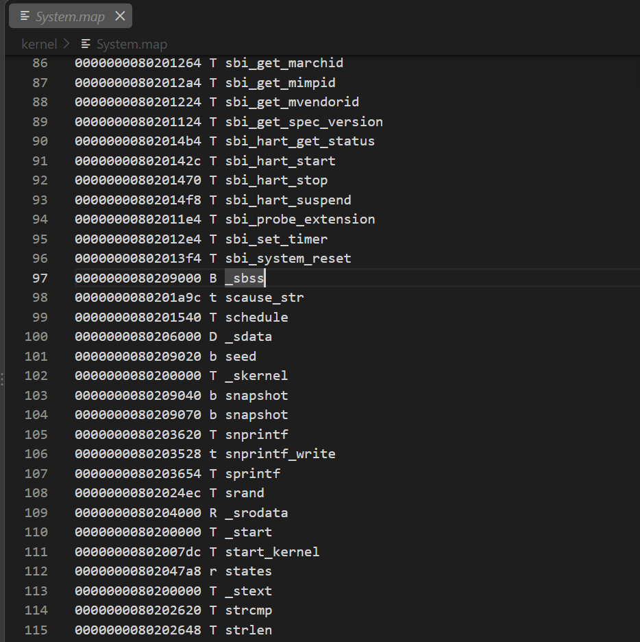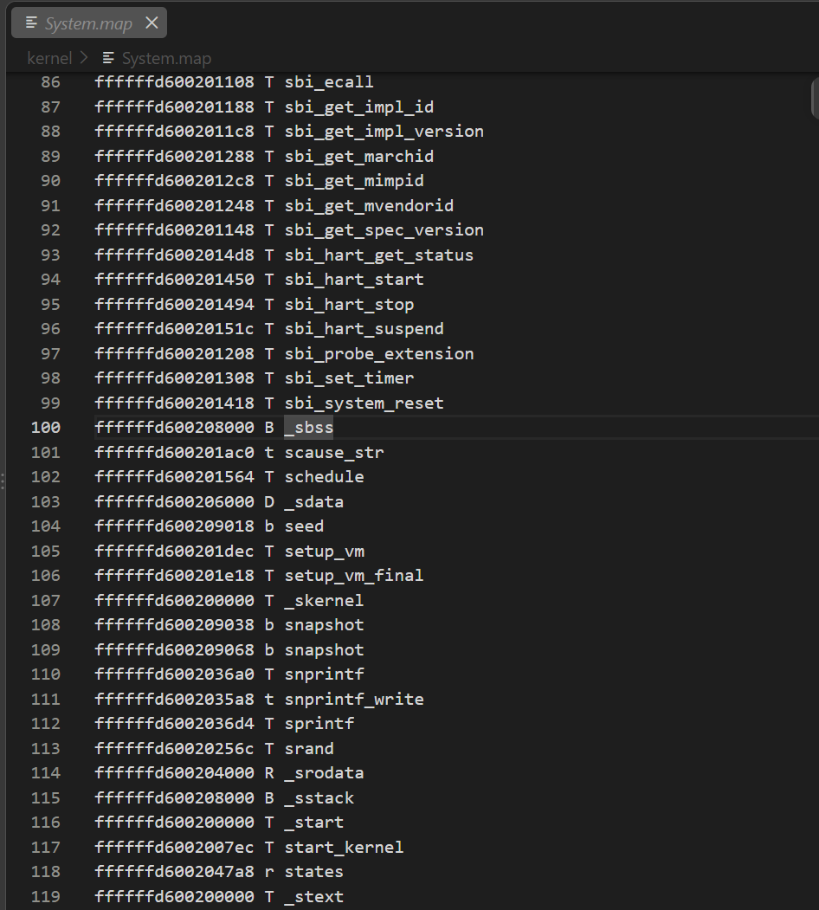</center>

> [!WARNING]
>
> **动手做：验证内核加载的仍是物理地址**
>
> **动手调试一下刚编译的内核：**
>
> - **在 `0x80200000` 处打断点，让 GDB 运行到断点处停下来；**
>
>     <center>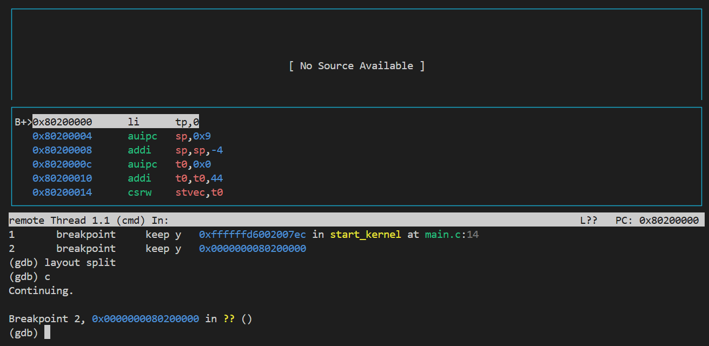</center>
>
>     确实.
>
> - **你会发现 GDB 现在没法解析源码位置（比如断点处停下来的时候显示 `0x80200000 in ??()`）。这是因为 GDB 是根据符号的位置来推算当前位于哪个函数的，现在所有符号都变成了虚拟地址，它现在找不到 `0x80200000` 对应哪个函数；**
>
> - **使用 GDB 或 QEMU Monitor，将从 `0x80200000` 开始的内存打印为指令，与 `vmlinux.asm` 中的反汇编结果对比，它们是否一致？**
>
>     对比图：（除了地址不同其余均相同，gdb用的是物理地址，反汇编用的是逻辑虚拟地址）
>
>     ```bash
>     x/10i 0x80200000 # 打印 0x8020000 开始的 10 条指令
>     ```
>
>     <center>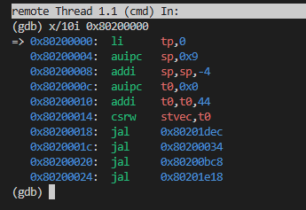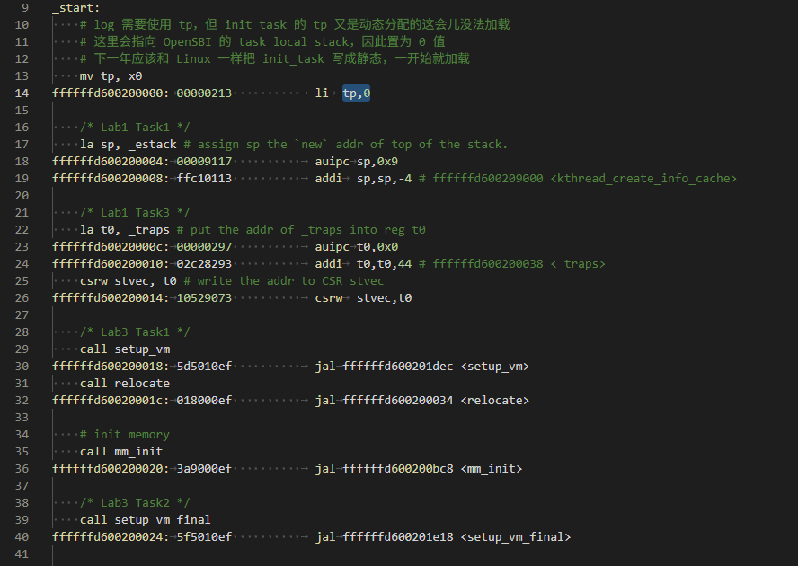</center>

### 寻址方式

> [!WARNING]
>
> **动手做：解释同一条指令的不同翻译结果**
>
> - **把机器码（用你自己的机器码，和文档不一定相同）输入到 [rvcodec.js · RISC-V Instruction Encoder/Decoder](https://luplab.gitlab.io/rvcodecjs/) 中，看看解码出来是什么。**
>
>     我也使用 `mm_init` 这条来看看：
>
>     ```assembly
>         # init memory
>         call mm_init
>     ffffffd600200020:	3a9000ef          	jal	ffffffd600200bc8 <mm_init>
>     ```
>
>     机器码解析出来是 `jal x1, 2984`：
>
>     <center>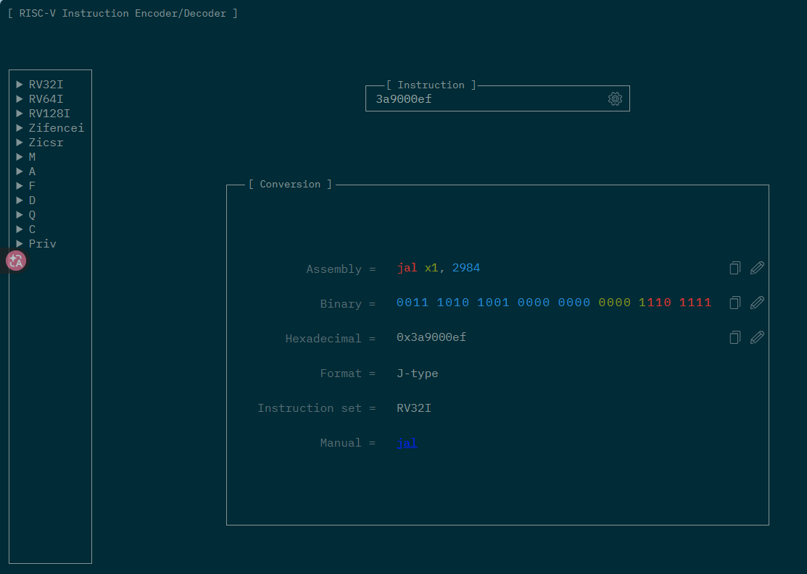</center>
>
> - **`jal` 指令的寻址方式是什么？**
>
>     PC相对寻址，在当前PC位置基础上移动offset.
>
> - **在 `vmlinux.asm` 和 GDB 中，当前指令地址（PC）分别是什么？你能算算跳转目标地址是否和翻译结果一致吗？**
>     * 在 `vmlinux.asm` 中，`PC = ffffffd600200020`, 由指令解码得到 `offset = 2984 = 0xba8`，所以跳转目标地址： `0xffffffd600200020 + 0xba8 = 0xffffffd600200bc8` 
>     * gdb中，`PC = 0x80200020`,计算得：`0x80200020 + 0xba8 = 0x80200bc8`
>     * 两种情况下，跳转结果都与 `mm_init` 对应的地址一致

> 链接器在解析函数、全局变量等符号时，使用的都是 PC 相对寻址.
>
> <center>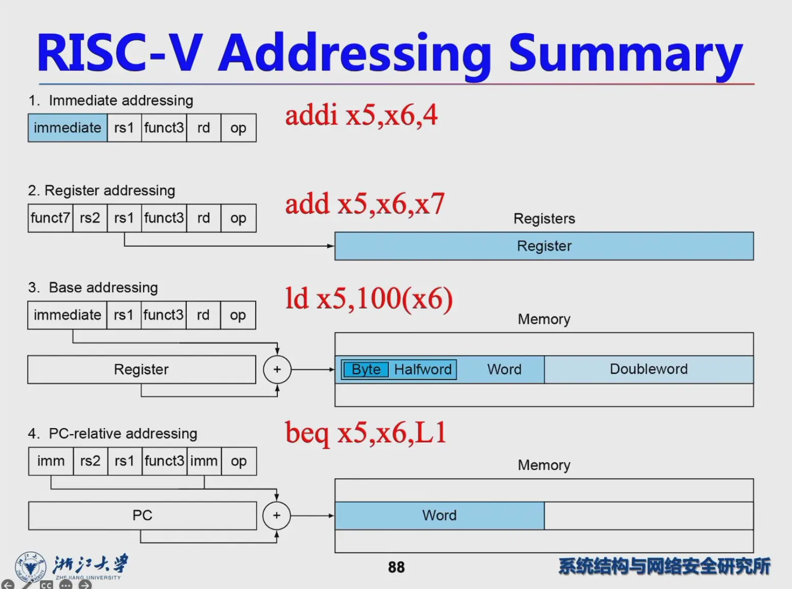</center>

### 虚拟与物理地址的转换

> 需要注意的是，有些地方仍然使用物理地址。例如：
>
> - `sbi_debug_console_write()` 函数仍然接收物理地址参数
> - Buddy System 仍然使用物理页帧（PFN）管理内存
> - 下文学习的 SATP、PTE 中的 PPN 也是物理页号
>
> 这些位置使用 `VA2PA`、`PA2VA` 等宏进行转换。在合并、编写代码时，请务必区分清楚虚拟地址与物理地址，避免混淆。

mark 一下，用到再说吧.

## 构造 Sv39 页表

### RISC-V Sv39 规范阅读

#### 12.1.11 `satp` CSR


#### 12.3 Sv32 分页机制

<center>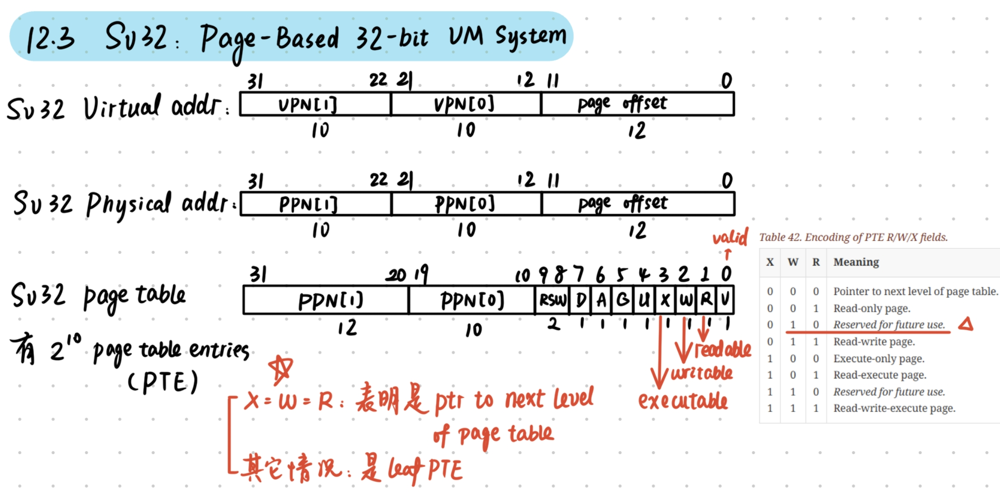</center>

翻译算法很繁复，看了一遍仍然看不懂：

<center>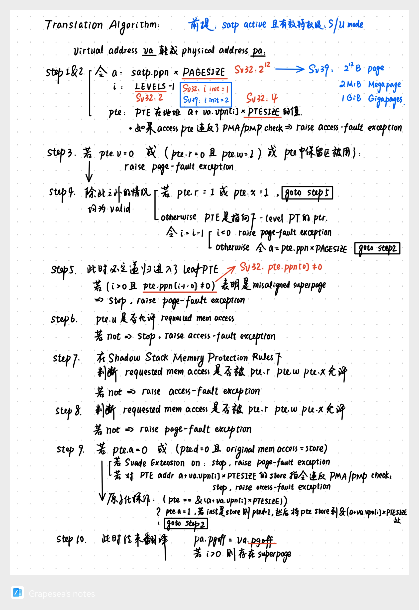</center>

> PMA 和 PMP 是 RISC-V 中针对**物理地址**的两套并行检查机制。它们发生在 MMU 完成虚拟到物理地址翻译**之后**.

#### 12.4 Sv39 分页机制

> [!WARNING]
>
> **Sv39 是分页机制的核心，历年考试几乎必考。不读标准，你会在位宽、权限位、翻译流程上出现理解偏差。请务必认真通读并结合图表理解。**

跟 Sv32 的区别是：

* page table entries 是 $2^9$;
* 翻译算法上，`LEVELS = 3`, `PTESIZE = 8`.

<center>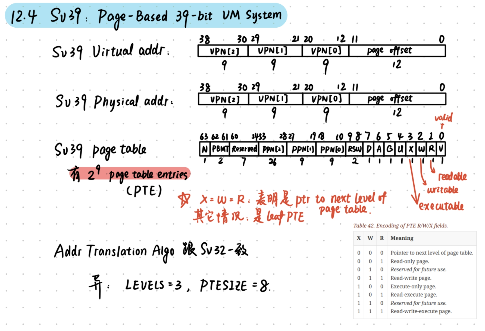</center>

### 内存屏障与 TLB、缓存刷新

这一节在讲 `sfence.vma` 指令，但也不知道在说什么，体系结构的 TLB + Cache coherence 忘得差不多了.


### 内核内存布局

照着阅读就行：

> - **内核与用户空间：**
>
>     同学们已经了解到，Sv39 分页式虚拟内存系统中，64b 的虚拟地址实际有效的只有 39b，其余高位必须与 bit 38 保持符号扩展一致。这意味着整个 $2^{64}B$ 的地址空间被划分为两个对称的区域：
>
>     - **用户空间**：`0x0000000000000000` ~ `0x0000003fffffffff`（低地址半区）
>     - 无效地址：多达 16M TB
>     - **内核空间**：`0xffffffc000000000` ~ `0xffffffffffffffff`（高地址半区）
>
>     在本实验中，我们只实现内核空间的映射，用户空间的映射将在 Lab4 实现。
>
> - **内核空间：**
>
>     Linux 的内核空间布局较为复杂，包含设备 I/O、内核堆栈等区域，我们全部弃用。本实验只实现直接映射，也就是将 Lab2 中介绍的从 `0x80000000` 开始的物理内存全部映射到 `0xffffffd600000000` 开始的虚拟地址空间


### 重定位

内核启动初期运行在物理地址上，想要切换到虚拟地址空间，有两种实现的方法：

* 跳转：`jal / jalr / ret` 指令

    通过跳转实现 relocate:

    > * 写一个汇编函数 `relocate()`
    >
    > - 在其中给**某些寄存器**加上偏移量 `PA2VA_OFFSET`
    > - `ret` 返回，PC 和**某些寄存器**就完成了重定位，切换到了虚拟地址
    > - 因为函数、全局变量都是 PC 相对寻址的，所以整个内核镜像都完成了重定位

    这里的某些寄存器应该指的是

* trap：`xRET`返回/陷入 

    [Linux内核的实现](https://github.com/torvalds/linux/blob/master/arch/riscv/kernel/head.S)采用的就是这种方法：

    ```assembly
    relocate_enable_mmu:
    	/* Relocate return address */
    	la a1, kernel_map					# a1 取当前kernel_map 运行地址，
    	REG_L a1, KERNEL_MAP_VIRT_ADDR(a1)    # 从中取出内核映射 vir base addr 
    	la a2, _start						# a2 取 _start 的 vir base addr
    	sub a1, a1, a2						# 计算 offset = a1 - a2
    	add ra, ra, a1						# 将 ra 转化成对应的 vir addr
    
    	/* Point stvec to virtual address of instruction after satp write */
    	la a2, 1f							# 取得局部标签 1: 的 phy addr
    	add a2, a2, a1					   	 # 计算出 vir addr
    	csrw CSR_TVEC, a2					 # = csrrw x0, CSR_TVEC, a2，将标签 1f 的vir addr (即 a2) 写入 stvec
    
    	/* Compute satp for kernel page tables, but don't load it yet */
    	srl a2, a0, PAGE_SHIFT				 # 右移 PAGE_SHIFT(12 bits)，得到页表根 PPN
    	la a1, satp_mode					 # a1 取当前的 satp_mode 的 addr
    	REG_L a1, 0(a1)						 # a1 读取当前的 satp_mode 的值
    	or a2, a2, a1
    
    	/*
    	 * Load trampoline page directory, which will cause us to trap to
    	 * stvec if VA != PA, or simply fall through if VA == PA.  We need a
    	 * full fence here because setup_vm() just wrote these PTEs and we need
    	 * to ensure the new translations are in use.
    	 */
    	la a0, trampoline_pg_dir
    	srl a0, a0, PAGE_SHIFT
    	or a0, a0, a1
    	sfence.vma
    	csrw CSR_SATP, a0
    ```

> [!WARNING]
>
> 如何实现重定位已经在上面的注释中解释了.
>
> **完成 Task 1 后，请你分析这两种重定位方式是否都需要恒等映射？为什么？**
>
> * Linux 内核的trap重定位方法：
>
>     需要，因为必须保证 `stvec` 指向的虚拟地址有映射
>
> * 跳转重定位方法：
>
>     不需要，`sepc` 寄存器在 S 模式分页开启时直接被当作**虚拟地址**翻译，已经保存了地址.


### Task 1：大页表双重映射和重定位

> 要映射的区域大小是多少？Gigapage 大页的大小是多少？你需要创建多少个页表项？
>
> * 要映射的区域大小是 $2^{30}B$
> * 需要创建

需要做的事情：

```c
// kernel/arch/riscv/kernel/vm.c

uint64_t setup_vm(void)
{
	memset(early_pg_dir, 0, PGSIZE); // 将所有页表 V bit 置0，表示无有效映射

	/* Lab3 Task1 */
	const uint64_t Gigapage = (1UL << 30);
	const uint64_t enables = (PTE_V | PTE_R | PTE_W | PTE_X | PTE_A | PTE_D);
	// 使能信号的处理，U/G预先置0.

	for (uint64_t offset = 0; offset < PHY_SIZE; offset += Gigapage) {
		uint64_t pa = PHY_START + offset;
		uint64_t va = VM_DIRECT_START + offset;
		uint64_t pte = PTE_PA2PPN(pa) | enables;

		early_pg_dir[VA2VPN2(pa)] = pte;
		early_pg_dir[VA2VPN2(va)] = pte;
	}

	// 返回值是待写入 satp 寄存器的值
	/* 此函数在开启分页前执行，PC 相对寻址得到的是页表的物理地址。 */
	return ((1UL << 63) | SATP_PA2PPN(early_pg_dir));
}
```

说实话，这里我已经写不出来了，完全不知道这个实验在做什么东西. 宏定义也不知道哪里冒出来的（`PHY_START` 等来自 `private_kdefs.h`；其余页表相关在 `vm.h` 里面）

然后 `relocate` 函数的实现采用了直接映射

搞错了一个东西：把 `ra` 的别名是 `x1` 忘掉了，一开始没使用临时寄存器 `t0 - t6` 从而报错.

```assembly
relocate:
    /* Lab3 Task1 */
    li t0, PA2VA_OFFSET
    add ra, ra, t0
    add sp, sp, t0
    
    sfence.vma zero, zero
    csrw satp, a0
    sfence.vma zero, zero
    ret
    # 说实话，我还是没搞懂 sfence.vma 的作用究竟是什么
```

复习：

<center>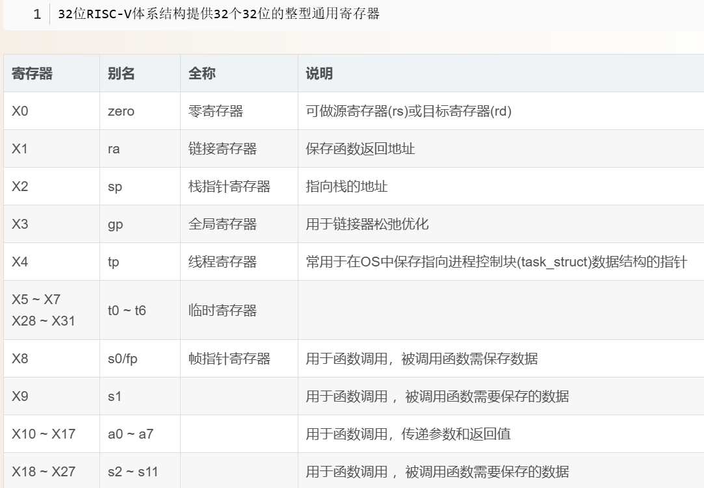</center>

最后是补充两行：

```assembly
    /* Lab3 Task1 */
    call setup_vm # 构造启动页表 early_pg_dir，建立恒等映射和内核高地址映射，并把待写入 satp 的值返回到 a0. 此时还没开启分页
    call relocate # 调用实现的重定位函数，做的事情包括：
    # 给 ra 和 sp 加上 PA2VA_OFFSET，转换为高位虚拟地址。
    # 将 a0 写入 satp，开启 Sv39 分页，并执行 sfence.vma。
    # 通过 ret 跳到转换后的 ra，让后续代码在高位虚拟地址执行

    la t0, _traps
    csrw stvec, t0
    # 需要重新设置 trap 入口，因为已经转换过地址了，需要让异常和中断也进入高位地址的 _traps前面设置的信息丢失了
```

通过结算：（如果在 `setup_vm` 处打断点就会浪费10min）

<center>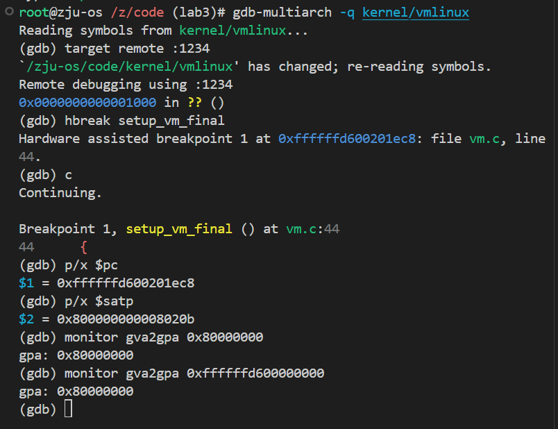</center>

<center>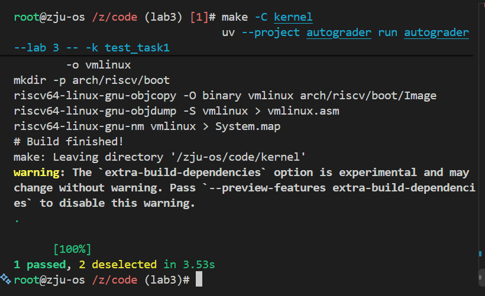</center>

### Task 2：多级页表

这个代码和实验文档写的什么玩意.

```c
// vm.c
/** vmlinux.lds 各段 */
extern uint8_t _stext[];
extern uint8_t _srodata[];
extern uint8_t _sdata[];
```

所以 `setup_vm_final` 的实现：

```c
uint64_t setup_vm_final(void)
{
	memset(swapper_pg_dir, 0, PGSIZE);

	/* Lab3 Task2 */
	// .text 部分
	create_mapping(swapper_pg_dir, _stext, (void *)VA2PA(_stext), (uint64_t)_srodata - (uint64_t)_stext, PTE_R | PTE_X);
	// read-only data (.rodata)
	create_mapping(swapper_pg_dir, _srodata, (void *)VA2PA(_srodata), (uint64_t)_sdata - (uint64_t)_srodata, PTE_R);
	// .data 部分
	create_mapping(swapper_pg_dir, _sdata, (void *)VA2PA(_sdata), VM_DIRECT_END - (uint64_t)_sdata, PTE_R | PTE_W);
	
	return SATP_MODE_SV39 | SATP_PA2PPN(VA2PA(swapper_pg_dir)); 
}
```

只需要调用 `create_mapping` 来递归实现就行.

`create_mapping` 就很恶心了，这段我写不出来，最后是AI写的. 已经无助了.

定义辅助函数 `map_page`：

```c
/* level 从根页表的 2 递减到 0；每次递归处理下一级页表。 */
static void map_page(uint64_t *pgtbl, uint64_t va, uint64_t pa, uint64_t perm, unsigned int level){
	uint64_t index = (va >> (12 + 9 * level)) & 0x1ff;
	uint64_t *entry = &pgtbl[index];

	if (level == 0) {
		*entry = PTE_PA2PPN(pa) | perm | PTE_V | PTE_A | PTE_D;
		return;
	}

	uint64_t *next_table;
	if (!(*entry & PTE_V)) {
		next_table = alloc_page();
		memset(next_table, 0, PGSIZE);
		// 非叶子项只设置 V，不设置 R/W/X
		*entry = PTE_PA2PPN(VA2PA(next_table)) | PTE_V;
	} else {
		// 页表项保存物理地址，访问下级页表时要转换为虚拟地址
		next_table = (uint64_t *)PA2VA((*entry & PTE_PPN) << 2);
	}

	map_page(next_table, va, pa, perm, level - 1);
}
```

这样就实现了递归处理一个页表.

最后传参拼接起来得到 `create_mapping`：

```c
void create_mapping(uint64_t pgtbl[static PGSIZE / 8], void *va, void *pa,
		    uint64_t size, uint64_t perm)
{
	/* Lab3 Task2 */
	/* 调用者提供页对齐的起始地址；末尾不足一页也映射完整一页。 */
	for (uint64_t offset = 0; offset < size; offset += PGSIZE) {
		map_page(pgtbl, (uint64_t)va + offset, (uint64_t)pa + offset, perm, 2);
	}
}
```

通过：

<center>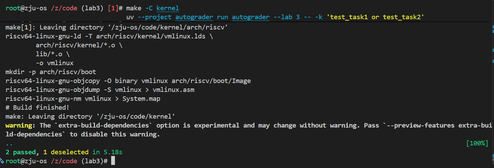</center>

甚至也没讲还有第 3 个测试点的事情：

```bash
make -C kernel
uv --project autograder run autograder --lab 3
```

会发现单纯的实现还是失败，无法通过 Lab 3 全部测试. 原因是超时，所以只需要调整  `autograder/pyproject.toml:50 (autograder/pyproject.toml:50)` 的 `timeout = "5"` 为 120s就行.

<center>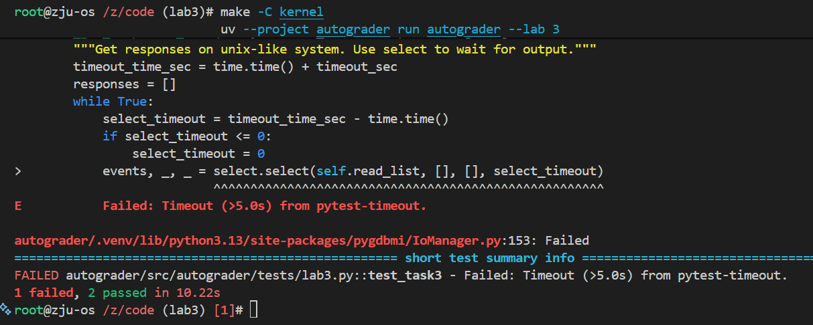</center>

<center>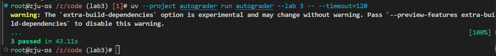</center>

## 验收tips

1. 使用 GDB 追踪 `create_mapping()` 的一次映射过程，说明映射范围、对应物理地址及权限。结合不同内核段的映射，解释权限位的设置依据。

    ```bash
    hbreak create_mapping # 或者写成 hb create_mapping
    continue
    info args
    ```

    看到的情况：

    <center>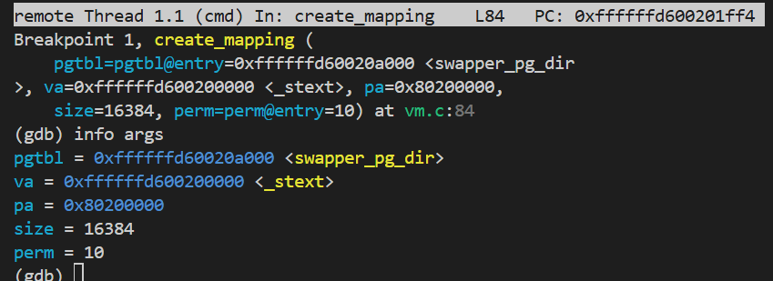</center>

    从 `va` 可以看出是 `.text` 字段：

    * 权限是 10，即末四位 XWRV 中的 X 与 R 为 1，为 read-executable page.
    * size 是 16384 B

    | 映射区域                        | 虚拟范围                                   | 对应物理范围               | 传入 perm   | 叶子 PTE 低 8 位 |
    | ------------------------------- | ------------------------------------------ | -------------------------- | ----------- | ---------------- |
    | `.text` 及其末尾对齐空间        | `[0xffffffd600200000, 0xffffffd600204000)` | `[0x80200000, 0x80204000)` | `0xa = R|X` | `0xcb`           |
    | `.rodata` 及其末尾对齐空间      | `[0xffffffd600204000, 0xffffffd600206000)` | `[0x80204000, 0x80206000)` | `0x2 = R`   | `0xc3`           |
    | 从 `.data` 开始的剩余直接映射区 | `[0xffffffd600206000, 0xffffffd608000000)` | `[0x80206000, 0x88000000)` | `0x6 = R|W` | `0xc7`           |

    - `.text` 需要取指和读取，设 R/X；清 W，防止普通写操作修改代码。
    - `.rodata` 是只读常量，设 R，清 W/X，避免写入和执行数据。
    - `.data`、`.bss`、栈和后续可分配内存需要读写，设 R/W，清 X。第三轮实际覆盖整个剩余直接映射区，并非仅覆盖 ELF 的 `.data` 段

2. 在启用初始页表后、读取当前低地址 PC 和 对应虚拟地址处的指令字节，验证内容是否相同

    在第一轮 `create_mapping()` 入口执行：

    ```bash
    hbreak map_page
    continue
    info args
    p/x (va >> (12 + 9 * level)) & 0x1ff 	# VPN[2], 输出158
    ```

    第一次 `level=2`，处理根页表。用 `list` 查看源码，执行 `next` 观察 `index`、`entry` 和 `next_table`：

    ```bash
    list
    next
    # 继续 next，直到赋值结束
    p/x index		# 0x158
    p/x entry		# 0xffffffd60020acc0
    p/x *entry		# 0x0，表示 Level = 0
    ```

    遇到递归调用可用 `step` 进入；也可让 `map_page` 的断点依次捕获 `level=1` 和 `level=0`，每次用 `info args` 看情况

3. 在最终页表启用后，从 `satp` 提取根页表开始，逐级追踪一个虚拟地址直到叶子项得到其物理地址

    ```bash
    p/x $satp	# 从 satp 得到根页表地址，输出0x800000000008020b
    ```

    低 44 位是根页表的物理页号，左移 12 位得到 56 bit 物理地址：

    ```bash
    set $root = ($satp & 0xfffffffffff) << 12
    p/x $root 			# 0x8020b000
    ```

    但 GDB 普通内存读取使用虚拟地址，要访问这张页表，需要加上项目中的直接映射偏移：

    ```bash
    set $off = 0xffffffd580000000
    p/x $root + $off
    ```

    得到根页表的虚拟地址 `0xffffffd60020a000`.

    ---

    **选一个地址，拆出3个索引**：

    我们查代码段中的 0xffffffd600200123：

    ```bash
    set $va = 0xffffffd600200123
    p/x ($va >> 30) & 0x1ff		# VPN2 = 0x158
    p/x ($va >> 21) & 0x1ff		# VPN1 = 0x1
    p/x ($va >> 12) & 0x1ff		# VPN0 = 0x0
    ```

    也就是：查根表第 344 项，再查下一张表第 1 项，最后查第 0 

4. 根据初始页表和最终页表的一个PTE项，解释其映射粒度的区别，以及为何能设置出不同粒度的映射

    ```bash
    p/x early_pg_dir[2] # 0x200000cf，最后四位 enables 对应 X / W / R / V
    ```

    这说明根页表这一项本身就是叶子，不需要查后面两级. 根表就结束查找时，VA 的低 30 位全部作为页内偏移，所以一项覆盖 $2^{30}$ 字节 = 1 GiB


## 总结

这次的量对比 lab2 降低了一点，但是完全不会做.

完全建构不起来思路，不知道实验文档几个字带过的地方是什么意思，不知道函数目的，不知道变量在什么地方定义过了，极度痛苦. 

如果基于这个lab设置上机考题目是极度恶心的. 完成这份报告的时候对整个实验生理性反胃.