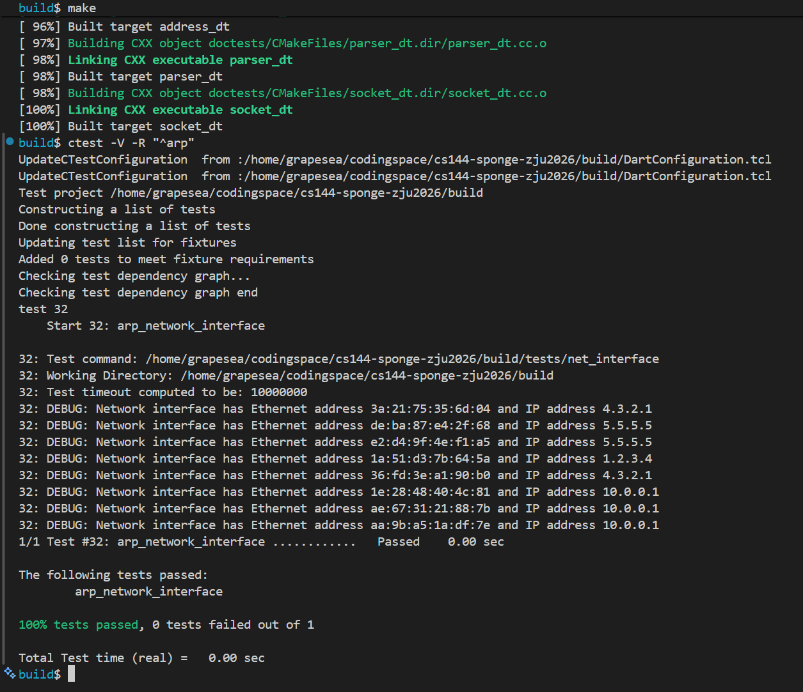
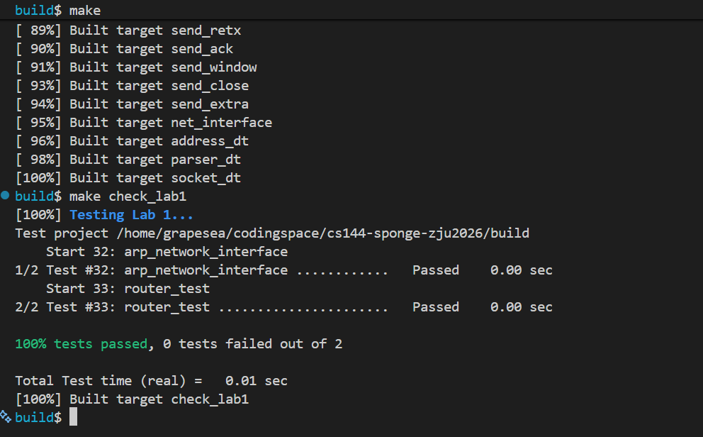

# Lab3 网络接口与 IP 路由器

> CS144 Sponge参考文档：[CS144-Sponge/labs_pdf_21/lab7.pdf at master · LRL52/CS144-Sponge](https://github.com/LRL52/CS144-Sponge/)
>
> Lab 3 实验文档：[Lab3 - 2026 计算机网络实验文档](https://zju-zhiyi.github.io/2026netlab/lab3/#3)

## 实验目的

- 学习掌握网络接口的工作原理
- 学习掌握ARP地址解析协议相关知识
- 学习掌握IP路由的工作原理

## 实验内容

- 实现network interface，为每个下一跳地址查找（和缓存）以太网地址，即实现地址解析协议ARP。
- 实现简易路由器，对于给定的数据包，确认发送接口以及下一跳的IP地址。

## 主要仪器设备

- 联网的PC机
- Linux虚拟机

## 操作方法与实验步骤

### 网络接口

组装以太网帧：阅读`libsponge/tcp_helpers/ethernet_frame.hh` 和 `libsponge/tcp_helpers/ethernet_header.hh`，容易发现：

```c++
EthernetFrame frame;
frame.header().src = ?;  // EthernetAddress = std::array<uint8_t, 6>
frame.header().dst = ?;  // EthernetAddress = std::array<uint8_t, 6>
frame.header().type = ?; // uint16_t
frame.payload() = ?;     // BufferList = std::deque<Buffer>
```

数据包的序列化与反序列化（`libsponge/tcp_helpers/ipv4_datagram.hh` 和 `libsponge/tcp_helpers/ipv4_header.hh`）、Message对象的组装、序列化和解析（ `libsponge/tcp_helpers/arp_message.hh`）：

```c++
ARPMessage arp_request;
arp_request.opcode = ?; // uint16_t opcode{};  //!< Request or reply
arp_request.sender_ethernet_address = ?; // 发送 EthernetAddress
arp_request.sender_ip_address = ?; // 
arp_request.target_ethernet_address = ?;
arp_request.target_ip_address = ?;
```

接下来观察`.hh`中提到的各个函数的功能：

```c++
//! \brief Sends an IPv4 datagram, encapsulated in an Ethernet frame (if it knows the Ethernet destination address).

    //! Will need to use [ARP](\ref rfc::rfc826) to look up the Ethernet destination address for the next hop
    //! ("Sending" is accomplished by pushing the frame onto the frames_out queue.)
    void send_datagram(const InternetDatagram &dgram, const Address &next_hop);

    //! \brief Receives an Ethernet frame and responds appropriately.

    //! If type is IPv4, returns the datagram.
    //! If type is ARP request, learn a mapping from the "sender" fields, and send an ARP reply.
    //! If type is ARP reply, learn a mapping from the "sender" fields.
    std::optional<InternetDatagram> recv_frame(const EthernetFrame &frame);

    //! \brief Called periodically when time elapses
    void tick(const size_t ms_since_last_tick);
```

这里面的三个函数分别的作用是：

* 将数据包输出；
* 接受网帧；
* 计算放在缓存表内的时间并在合适情况下清除缓存.

编译：

```bash
make
ctest -V -R "^arp"
```

结果：

<center></center>

### 简易路由器

```c++
	//! Send a single datagram from the appropriate outbound interface to the next hop,
    //! as specified by the route with the longest prefix_length that matches the
    //! datagram's destination address.
    void route_one_datagram(InternetDatagram &dgram);

```

当一个 IP 数据报到达路由器时：

1. 路由器检查数据报的**目的 IP 地址**。
2. 与路由表中的所有条目进行**匹配**。
3. 按照**最长前缀匹配（Longest Prefix Match）**原则选择最具体的路由。
4. 根据匹配到的条目，将数据报从对应的接口转发到合适的下一跳。

对应下来就是：

```c++
//! \param[in] dgram The datagram to be routed
void Router::route_one_datagram(InternetDatagram &dgram) {
    if (dgram.header().ttl <= 1) { //如果数据报的 ttl 小于或等于 1，则直接丢弃
        return;
    }

    const uint32_t destination = dgram.header().dst;
    const RouteEntry *best_route = nullptr;

    for (const auto &route : _routes) {
        // /0 matches every address; handle it separately to avoid shifting by 32 bits.
        const u_int move_bits = 32 - route.prefix_length;
        const bool matches = route.prefix_length == 0 || (destination >> move_bits) == (route.route_prefix >> move_bits); // 对于一条路由，如果目的 IP 地址与 route_prefix 的高 prefix_length 位相同，则该路由匹配
        if (matches && (best_route == nullptr || route.prefix_length > best_route->prefix_length)) {
            best_route = &route; // 在所有匹配项中选择 prefix_length 最大的路由；
        }
    }

    if (best_route == nullptr) { // 如果没有匹配项，则丢弃数据报。
        return;
    }

    --dgram.header().ttl; // 否则将 ttl 减 1
    const Address next_hop = best_route->next_hop.value_or(Address::from_ipv4_numeric(destination)); // 大概这就是用std::optional的原因吧.
    // 如果所选路由的 next_hop 有值，则将其作为下一跳；如果 next_hop 为空，则将数据报的目的 IP 地址作为下一跳
    interface(best_route->interface_num).send_datagram(dgram, next_hop); // 最后，通过 interface_num 指定的接口发送数据报。
}
```

编译完成结算：

<center></center>

## <span id='result'> 实验结果与分析 </span>

### 结果分析

实验步骤已经给出了，符合预期.

### 思考题

- **通过代码，请描述network interface是如何发送一个以太网帧的？**

    入口是 `send_datagram()` (`libsponge/network_interface.cc:23`)，输入为 IP 数据报和下一跳 IP 地址，发送过程如下：

    1. 查询 ARP 缓存：使用下一跳 IP 查询 `_arp_cache`，获取对应的 MAC 地址。这里查询的是下一跳，可能是网关，也可能是同一局域网内的目标主机。
    2. 缓存命中时封装发送：创建 `EthernetFrame`，源 MAC 填本接口地址，目的 MAC 填查询结果，类型设为 `TYPE_IPv4`，载荷填入 `dgram.serialize()`，然后压入 `_frames_out`.
    3. 缓存未命中时发起 ARP 查询：先将数据报放入 `_pending[next_hop_ip]` 等待队列，再构造 ARP 请求，以广播 MAC 地址为目的地址，封装成 ARP 以太网帧并压入 `_frames_out`. 通过 `_arp_elapsed_time` 限制同一 IP 的 ARP 请求频率，5 秒内不重复发送。
    4. 学到 MAC 后发送等待的数据报：`recv_frame()` (`libsponge/network_interface.cc:82`) 从收到的合法 ARP 报文中学习发送方的 IP—MAC 映射，然后遍历该 IP 对应的等待队列，再次调用 `send_datagram()` 完成封装。

    本实验中，“发送”具体表现为将帧放入 `_frames_out`. 外部适配器负责取出帧、序列化并写入 TAP 设备，见 `send_pending()` (`libsponge/tcp_helpers/tuntap_adapter.cc:51`)

- **虽然在此次实验不需要考虑这种情况，但是当network interface发送一个ARP请求后如果没收到一个应答该怎么解决？请思考。**

    可以采用超时重试、有限次数、失败清理的机制：

    - 为每个待解析 IP 记录等待时间和重试次数。超时仍未收到应答，就重新广播 ARP 请求，并限制重试频率。
    - 达到最大重试次数或总等待期限后，判定本次地址解析失败，丢弃对应的等待数据报，并清理相关状态，避免无限等待。
    - 限制等待队列长度，防止目标长期不可达时持续占用内存。
    - 根据协议栈职责向上层报告发送失败；如果是路由器转发场景，可以在符合条件时生成 ICMP 目的不可达报文

- **请描述一下你为了记录路由表所建立的数据结构？为什么？**

    代码使用 `std::vector<RouteEntry>` 保存路由表，每个表项是一个结构体，定义在 `router.hh`(`libsponge/router.hh:50`)：

    ```c++
    struct RouteEntry {
        uint32_t route_prefix{0};           // 目标网络前缀
        uint8_t prefix_length{0};           // 前缀长度
        std::optional<Address> next_hop{};  // 下一跳；为空表示直连网络
        size_t interface_num{0};            // 出接口编号
    };
    
    std::vector<RouteEntry> _routes{};
    ```

    这样设计有以下原因：

    - 结构体集中描述一条路由：网络前缀和前缀长度决定匹配范围，下一跳和接口编号决定如何转发。
    - optional 清楚表达直连路由：有值时将报文交给指定下一跳；为空时，直接以数据报的目的 IP 作为下一跳，无须约定特殊地址。
    - vector 简单且适合实验规模：添加路由时直接 push_back()；查询时遍历所有表项，选择匹配且前缀最长的一项，不要求提前排序。


## 讨论、心得

中文和英文之间的理解切换似乎很不方便，有些字段用中文讲就看不懂什么意思了……于是回去看了CS144 Sponge 2021 Fall 的 [lab5](https://github.com/LRL52/CS144-Sponge/blob/master/labs_pdf_21/lab5.pdf)-[lab6](https://github.com/LRL52/CS144-Sponge/blob/master/labs_pdf_21/lab6.pdf) 文档.